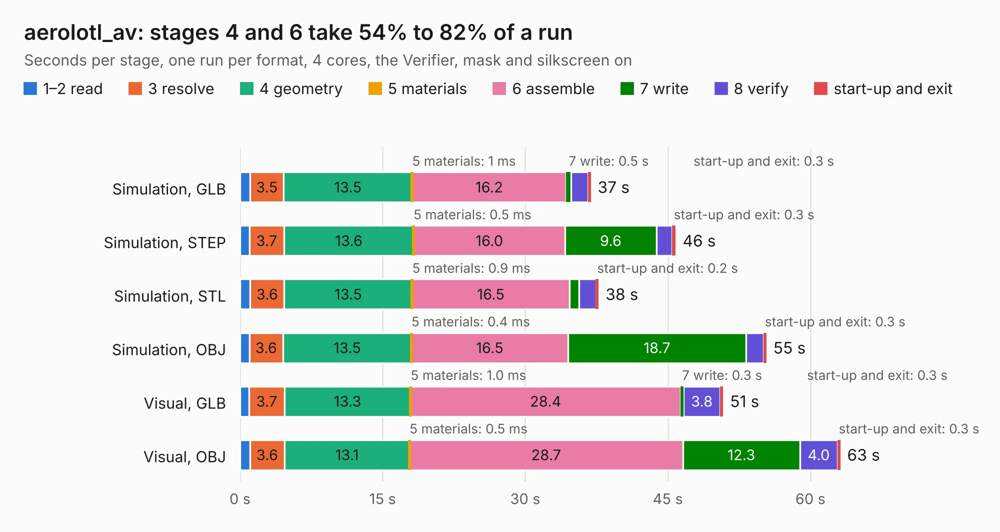

# 2627. aerolotl_av

Board 2,627 of the 3,100 of [Corpus Testing](../Corpus-Testing.md), on [Corpus Page 25](../CorpusTestingPages/Corpus-Testing-25.md#2627-aerolotl_av).

| Mode and format | 1–2 read | 3 resolve | 4 geometry | 5 materials | 6 assemble | 7 write | 8 verify | start-up and exit | Total |
|---|---:|---:|---:|---:|---:|---:|---:|---:|---:|
| Simulation, GLB | 1.1 | 3.5 | 13.5 | 1&nbsp;ms | 16.2 | 0.5 | 1.8 | 0.3 | 36.9 |
| Simulation, STEP | 1.0 | 3.7 | 13.6 | 0.5&nbsp;ms | 16.0 | 9.6 | 1.7 | 0.3 | 45.8 |
| Simulation, STL | 1.1 | 3.6 | 13.5 | 0.9&nbsp;ms | 16.5 | 1.0 | 1.8 | 0.2 | 37.7 |
| Simulation, OBJ | 1.0 | 3.6 | 13.5 | 0.4&nbsp;ms | 16.5 | 18.7 | 1.9 | 0.3 | 55.3 |
| Visual, GLB | 1.0 | 3.7 | 13.3 | 1.0&nbsp;ms | 28.4 | 0.3 | 3.8 | 0.3 | 50.8 |
| Visual, OBJ | 1.0 | 3.6 | 13.1 | 0.5&nbsp;ms | 28.7 | 12.3 | 4.0 | 0.3 | 63.1 |

<table align="center"><tr><td valign="top">

| Board | Repo: [stanford-ssi/aerolotl_av](https://github.com/stanford-ssi/aerolotl_av) Board: `aerolotl_av.kicad_pcb` |
|---|---|
| Complexity | 359&nbsp;/&nbsp;1000 (size&nbsp;264, features&nbsp;95) |
| KESE&nbsp;features | through vias, slotted holes, rounded, trapezoid or chamfered pads, filled zones, curved board outline, stack-up, dielectric εr and tanδ |
| Tested | 9th November 2026 |
| Copper&nbsp;layers | 4 |
| File&nbsp;format | KiCad 10 (20260206) |
| Parts,&nbsp;tracks,&nbsp;vias | 163, 1,889, 639 |
| Triangles,&nbsp;simulation | 3,503,362 in 181 parts |
| Verifier | PASS in all six runs |

</td><td valign="top">

<table>
<tr><th>File type</th><th>File size</th><th>Peak memory used</th></tr>
<tr><th colspan="3" align="left">Simulation</th></tr>
<tr><td>GLB</td><td align="right">119&nbsp;MB</td><td align="right">1.1&nbsp;GB</td></tr>
<tr><td>STEP</td><td align="right">465&nbsp;MB</td><td align="right">1.5&nbsp;GB</td></tr>
<tr><td>STL</td><td align="right">175&nbsp;MB</td><td align="right">1.1&nbsp;GB</td></tr>
<tr><td>OBJ</td><td align="right">375&nbsp;MB</td><td align="right">2.3&nbsp;GB</td></tr>
<tr><th colspan="3" align="left">Visual</th></tr>
<tr><td>GLB</td><td align="right">79&nbsp;MB</td><td align="right">1.4&nbsp;GB</td></tr>
<tr><td>OBJ</td><td align="right">253&nbsp;MB</td><td align="right">1.7&nbsp;GB</td></tr>
</table>

</td></tr></table>

| Previous | Next |
|:---|---:|
| [2626. m5-pantilt](b2626b_stack-chan_m5-pantilt.md) | [2628. aerolotl](b2628b_aerolotl-kicad_aerolotl.md) |
