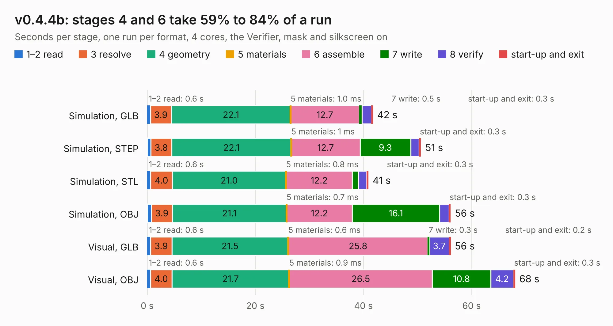

# 2627. v0.4.4b

Board 2,627 of the 3,120 of [Corpus Testing](../Corpus-Testing.md), on [Corpus Page 25](../CorpusTestingPages/Corpus-Testing-25.md#2627-v044b).

| Mode and format | 1–2 read | 3 resolve | 4 geometry | 5 materials | 6 assemble | 7 write | 8 verify | start-up and exit | Total |
|---|---:|---:|---:|---:|---:|---:|---:|---:|---:|
| Simulation, GLB | 0.6 | 3.9 | 22.1 | 1.0&nbsp;ms | 12.7 | 0.5 | 1.8 | 0.3 | 41.7 |
| Simulation, STEP | 0.7 | 3.8 | 22.1 | 1&nbsp;ms | 12.7 | 9.3 | 1.6 | 0.3 | 50.6 |
| Simulation, STL | 0.6 | 4.0 | 21.0 | 0.8&nbsp;ms | 12.2 | 1.1 | 1.5 | 0.3 | 40.9 |
| Simulation, OBJ | 0.8 | 3.9 | 21.1 | 0.7&nbsp;ms | 12.2 | 16.1 | 1.7 | 0.3 | 56.1 |
| Visual, GLB | 0.6 | 3.9 | 21.5 | 0.6&nbsp;ms | 25.8 | 0.3 | 3.7 | 0.2 | 56.1 |
| Visual, OBJ | 0.6 | 4.0 | 21.7 | 0.9&nbsp;ms | 26.5 | 10.8 | 4.2 | 0.3 | 68.0 |

<table align="center"><tr><td valign="top">

| Board | Repo: [speeduino/hardware](https://github.com/speeduino/hardware) Board: `v0.4.4b.kicad_pcb` |
|---|---|
| Folder | v0.4 / SMD / Prior Versions / 0.4.4b |
| Complexity | 233&nbsp;/&nbsp;1000 (size&nbsp;188, features&nbsp;45) |
| KESE&nbsp;features | through vias, rounded, trapezoid or chamfered pads, filled zones |
| Tested | 9th November 2026 |
| Copper&nbsp;layers | 2 |
| File&nbsp;format | KiCad 5 (20171130) |
| Parts,&nbsp;tracks,&nbsp;vias | 143, 990, 89 |
| Triangles,&nbsp;simulation | 3,391,558 in 194 parts |
| Verifier | PASS in all six runs |

</td><td valign="top">

<table>
<tr><th>File type</th><th>File size</th><th>Peak memory used</th></tr>
<tr><th colspan="3" align="left">Simulation</th></tr>
<tr><td>GLB</td><td align="right">117&nbsp;MB</td><td align="right">1.2&nbsp;GB</td></tr>
<tr><td>STEP</td><td align="right">631&nbsp;MB</td><td align="right">1.4&nbsp;GB</td></tr>
<tr><td>STL</td><td align="right">170&nbsp;MB</td><td align="right">1.1&nbsp;GB</td></tr>
<tr><td>OBJ</td><td align="right">361&nbsp;MB</td><td align="right">2.2&nbsp;GB</td></tr>
<tr><th colspan="3" align="left">Visual</th></tr>
<tr><td>GLB</td><td align="right">76&nbsp;MB</td><td align="right">1.3&nbsp;GB</td></tr>
<tr><td>OBJ</td><td align="right">234&nbsp;MB</td><td align="right">1.6&nbsp;GB</td></tr>
</table>

</td></tr></table>

| Previous | Next |
|:---|---:|
| [2626. v0.4.4d](b2626b_hardware_v0-4-4d.md) | [2628. v0.4.4c](b2628b_hardware_v0-4-4c.md) |
