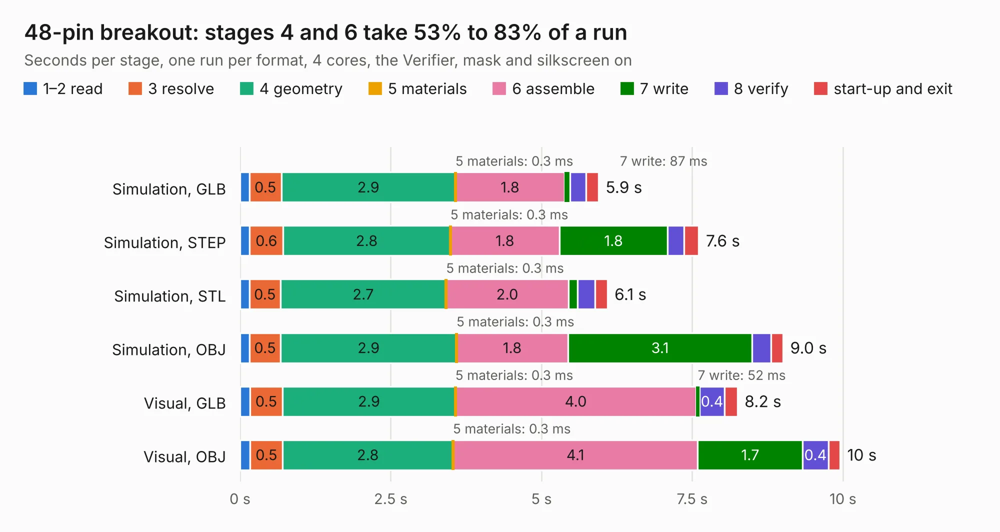

# 2628. 48-pin breakout

Board 2,628 of the 3,126 of [Corpus Testing](../Corpus-Testing.md), on [Corpus Page 25](../CorpusTestingPages/Corpus-Testing-25.md#2628-48-pin-breakout).

| Mode and format | 1–2 read | 3 resolve | 4 geometry | 5 materials | 6 assemble | 7 write | 8 verify | start-up and exit | Total |
|---|---:|---:|---:|---:|---:|---:|---:|---:|---:|
| Simulation, GLB | 0.2 | 0.5 | 2.9 | 0.3&nbsp;ms | 1.8 | 87&nbsp;ms | 0.3 | 0.2 | 5.9 |
| Simulation, STEP | 0.2 | 0.6 | 2.8 | 0.3&nbsp;ms | 1.8 | 1.8 | 0.3 | 0.2 | 7.6 |
| Simulation, STL | 0.2 | 0.5 | 2.7 | 0.3&nbsp;ms | 2.0 | 0.1 | 0.3 | 0.2 | 6.1 |
| Simulation, OBJ | 0.2 | 0.5 | 2.9 | 0.3&nbsp;ms | 1.8 | 3.1 | 0.3 | 0.2 | 9.0 |
| Visual, GLB | 0.2 | 0.5 | 2.9 | 0.3&nbsp;ms | 4.0 | 52&nbsp;ms | 0.4 | 0.2 | 8.2 |
| Visual, OBJ | 0.2 | 0.5 | 2.8 | 0.3&nbsp;ms | 4.1 | 1.7 | 0.4 | 0.2 | 10.0 |

<table align="center"><tr><td valign="top">

| Board | Repo: [speeduino/hardware](https://github.com/speeduino/hardware) Board: `48-pin breakout.kicad_pcb` |
|---|---|
| Folder | PNPs / Miata NA6 / Latest / 48-pin breakout |
| Complexity | 148&nbsp;/&nbsp;1000 (size&nbsp;113, features&nbsp;35) |
| KESE&nbsp;features | through vias, filled zones |
| Tested | 9th November 2026 |
| Copper&nbsp;layers | 2 |
| File&nbsp;format | KiCad 5 (20171130) |
| Parts,&nbsp;tracks,&nbsp;vias | 4, 111, 4 |
| Triangles,&nbsp;simulation | 609,954 in 56 parts |
| Verifier | PASS in all six runs |

</td><td valign="top">

<table>
<tr><th>File type</th><th>File size</th><th>Peak memory used</th></tr>
<tr><th colspan="3" align="left">Simulation</th></tr>
<tr><td>GLB</td><td align="right">21&nbsp;MB</td><td align="right">315&nbsp;MB</td></tr>
<tr><td>STEP</td><td align="right">99&nbsp;MB</td><td align="right">359&nbsp;MB</td></tr>
<tr><td>STL</td><td align="right">31&nbsp;MB</td><td align="right">311&nbsp;MB</td></tr>
<tr><td>OBJ</td><td align="right">62&nbsp;MB</td><td align="right">446&nbsp;MB</td></tr>
<tr><th colspan="3" align="left">Visual</th></tr>
<tr><td>GLB</td><td align="right">12&nbsp;MB</td><td align="right">356&nbsp;MB</td></tr>
<tr><td>OBJ</td><td align="right">37&nbsp;MB</td><td align="right">355&nbsp;MB</td></tr>
</table>

</td></tr></table>

| Previous | Next |
|:---|---:|
| [2627. DropBear](b2627b_hardware_DropBear-V2_DropBear.md) | [2629. NA6 v1.3](b2629b_hardware_NA6-v1-3.md) |
