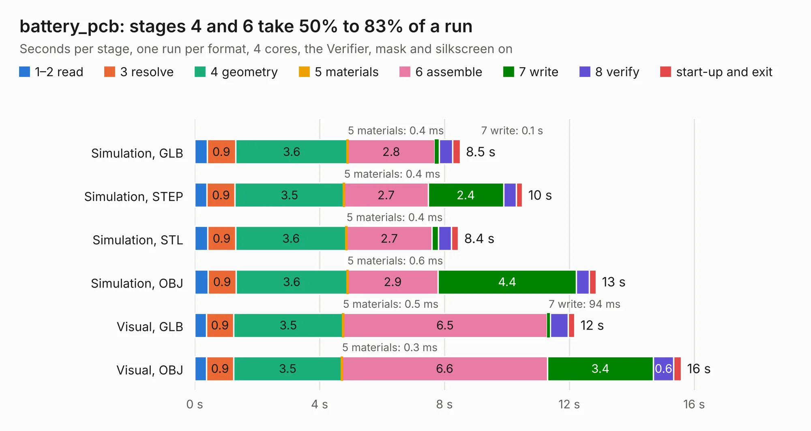

# 2629. battery_pcb

Board 2,629 of the 3,100 of [Corpus Testing](../Corpus-Testing.md), on [Corpus Page 25](../CorpusTestingPages/Corpus-Testing-25.md#2629-battery_pcb).

| Mode and format | 1–2 read | 3 resolve | 4 geometry | 5 materials | 6 assemble | 7 write | 8 verify | start-up and exit | Total |
|---|---:|---:|---:|---:|---:|---:|---:|---:|---:|
| Simulation, GLB | 0.4 | 0.9 | 3.6 | 0.4&nbsp;ms | 2.8 | 0.1 | 0.4 | 0.2 | 8.5 |
| Simulation, STEP | 0.4 | 0.9 | 3.5 | 0.4&nbsp;ms | 2.7 | 2.4 | 0.4 | 0.2 | 10.5 |
| Simulation, STL | 0.4 | 0.9 | 3.6 | 0.4&nbsp;ms | 2.7 | 0.2 | 0.4 | 0.2 | 8.4 |
| Simulation, OBJ | 0.4 | 0.9 | 3.6 | 0.6&nbsp;ms | 2.9 | 4.4 | 0.4 | 0.2 | 12.9 |
| Visual, GLB | 0.4 | 0.9 | 3.5 | 0.5&nbsp;ms | 6.5 | 94&nbsp;ms | 0.6 | 0.2 | 12.2 |
| Visual, OBJ | 0.4 | 0.9 | 3.5 | 0.3&nbsp;ms | 6.6 | 3.4 | 0.6 | 0.2 | 15.6 |

<table align="center"><tr><td valign="top">

| Board | Repo: [stanford-ssi/aerolotl_kicad](https://github.com/stanford-ssi/aerolotl_kicad) Board: `battery_pcb.kicad_pcb` |
|---|---|
| Folder | BatteryPCB |
| Complexity | 239&nbsp;/&nbsp;1000 (size&nbsp;159, features&nbsp;80) |
| KESE&nbsp;features | through vias, custom pads, rounded, trapezoid or chamfered pads, filled zones, copper drawings, curved board outline |
| Tested | 9th November 2026 |
| Copper&nbsp;layers | 2 |
| File&nbsp;format | KiCad 10 (20260206) |
| Parts,&nbsp;tracks,&nbsp;vias | 42, 126, 123 |
| Triangles,&nbsp;simulation | 797,334 in 67 parts |
| Verifier | PASS in all six runs |

</td><td valign="top">

<table>
<tr><th>File type</th><th>File size</th><th>Peak memory used</th></tr>
<tr><th colspan="3" align="left">Simulation</th></tr>
<tr><td>GLB</td><td align="right">27&nbsp;MB</td><td align="right">384&nbsp;MB</td></tr>
<tr><td>STEP</td><td align="right">126&nbsp;MB</td><td align="right">470&nbsp;MB</td></tr>
<tr><td>STL</td><td align="right">40&nbsp;MB</td><td align="right">381&nbsp;MB</td></tr>
<tr><td>OBJ</td><td align="right">81&nbsp;MB</td><td align="right">571&nbsp;MB</td></tr>
<tr><th colspan="3" align="left">Visual</th></tr>
<tr><td>GLB</td><td align="right">21&nbsp;MB</td><td align="right">533&nbsp;MB</td></tr>
<tr><td>OBJ</td><td align="right">63&nbsp;MB</td><td align="right">536&nbsp;MB</td></tr>
</table>

</td></tr></table>

| Previous | Next |
|:---|---:|
| [2628. aerolotl](b2628b_aerolotl-kicad_aerolotl.md) | [2630. battery_pcb_30pin](b2630b_aerolotl-kicad_battery-pcb-30pin.md) |
