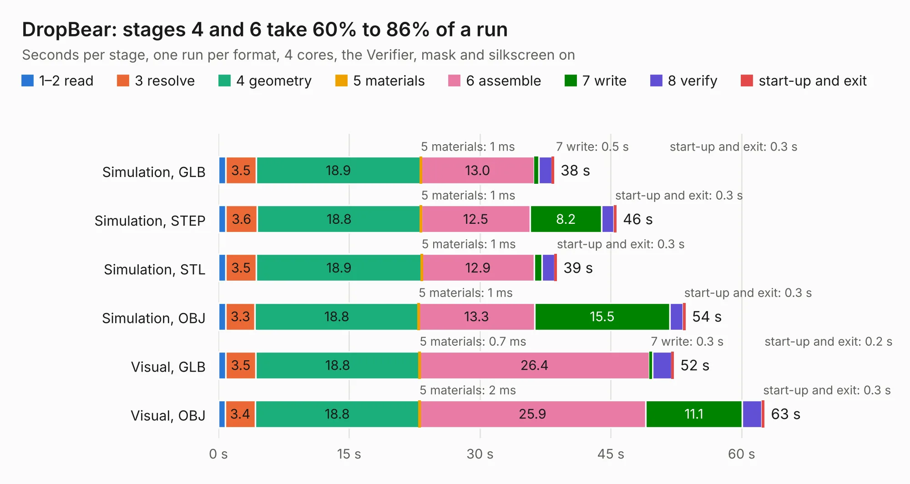

# 2629. DropBear

Board 2,629 of the 3,131 of [Corpus Testing](../Corpus-Testing.md), on [Corpus Page 25](../CorpusTestingPages/Corpus-Testing-25.md#2629-dropbear).

| Mode and format | 1–2 read | 3 resolve | 4 geometry | 5 materials | 6 assemble | 7 write | 8 verify | start-up and exit | Total |
|---|---:|---:|---:|---:|---:|---:|---:|---:|---:|
| Simulation, GLB | 0.8 | 3.5 | 18.9 | 1&nbsp;ms | 13.0 | 0.5 | 1.5 | 0.3 | 38.5 |
| Simulation, STEP | 0.9 | 3.6 | 18.8 | 1&nbsp;ms | 12.5 | 8.2 | 1.4 | 0.3 | 45.6 |
| Simulation, STL | 0.8 | 3.5 | 18.9 | 1&nbsp;ms | 12.9 | 0.9 | 1.5 | 0.3 | 38.8 |
| Simulation, OBJ | 0.8 | 3.3 | 18.8 | 1&nbsp;ms | 13.3 | 15.5 | 1.5 | 0.3 | 53.6 |
| Visual, GLB | 0.8 | 3.5 | 18.8 | 0.7&nbsp;ms | 26.4 | 0.3 | 2.2 | 0.2 | 52.2 |
| Visual, OBJ | 0.8 | 3.4 | 18.8 | 2&nbsp;ms | 25.9 | 11.1 | 2.2 | 0.3 | 62.6 |

<table align="center"><tr><td valign="top">

| Board | Repo: [speeduino/hardware](https://github.com/speeduino/hardware) Board: `DropBear.kicad_pcb` |
|---|---|
| Folder | DropBear / V1.1 |
| Complexity | 367&nbsp;/&nbsp;1000 (size&nbsp;257, features&nbsp;110) |
| KESE&nbsp;features | through vias, custom pads, rounded, trapezoid or chamfered pads, filled zones, copper drawings, curved board outline, stack-up, dielectric εr and tanδ |
| Tested | 9th November 2026 |
| Copper&nbsp;layers | 2 |
| File&nbsp;format | KiCad 7 (20221018) |
| Parts,&nbsp;tracks,&nbsp;vias | 187, 2,130, 417 |
| Triangles,&nbsp;simulation | 2,877,926 in 282 parts |
| Verifier | PASS in all six runs |

</td><td valign="top">

<table>
<tr><th>File type</th><th>File size</th><th>Peak memory used</th></tr>
<tr><th colspan="3" align="left">Simulation</th></tr>
<tr><td>GLB</td><td align="right">101&nbsp;MB</td><td align="right">1.0&nbsp;GB</td></tr>
<tr><td>STEP</td><td align="right">544&nbsp;MB</td><td align="right">1.3&nbsp;GB</td></tr>
<tr><td>STL</td><td align="right">144&nbsp;MB</td><td align="right">993&nbsp;MB</td></tr>
<tr><td>OBJ</td><td align="right">309&nbsp;MB</td><td align="right">2.0&nbsp;GB</td></tr>
<tr><th colspan="3" align="left">Visual</th></tr>
<tr><td>GLB</td><td align="right">72&nbsp;MB</td><td align="right">1.3&nbsp;GB</td></tr>
<tr><td>OBJ</td><td align="right">222&nbsp;MB</td><td align="right">1.6&nbsp;GB</td></tr>
</table>

</td></tr></table>

| Previous | Next |
|:---|---:|
| [2628. MAP Card](b2628b_hardware_DropBear-MAP-Card-v0-3_MAP-Card.md) | [2630. DropBear](b2630b_hardware_DropBear-V2_DropBear.md) |
