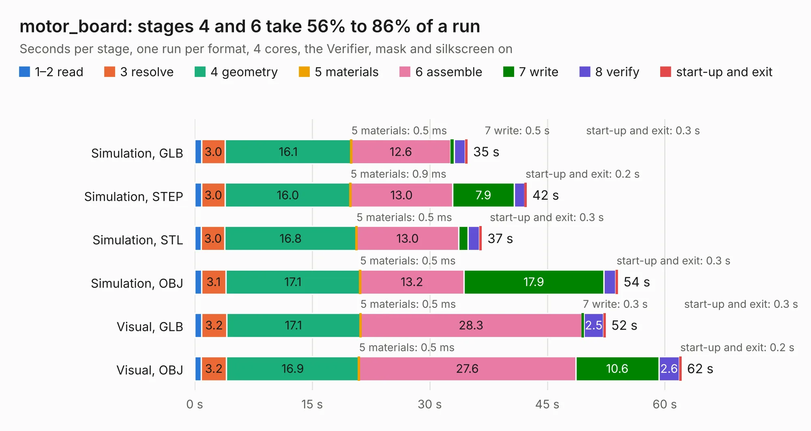

# 2632. motor_board

Board 2,632 of the 3,100 of [Corpus Testing](../Corpus-Testing.md), on [Corpus Page 25](../CorpusTestingPages/Corpus-Testing-25.md#2632-motor_board).

| Mode and format | 1–2 read | 3 resolve | 4 geometry | 5 materials | 6 assemble | 7 write | 8 verify | start-up and exit | Total |
|---|---:|---:|---:|---:|---:|---:|---:|---:|---:|
| Simulation, GLB | 0.9 | 3.0 | 16.1 | 0.5&nbsp;ms | 12.6 | 0.5 | 1.4 | 0.3 | 34.8 |
| Simulation, STEP | 0.9 | 3.0 | 16.0 | 0.9&nbsp;ms | 13.0 | 7.9 | 1.3 | 0.2 | 42.4 |
| Simulation, STL | 0.8 | 3.0 | 16.8 | 0.5&nbsp;ms | 13.0 | 1.2 | 1.4 | 0.3 | 36.6 |
| Simulation, OBJ | 0.9 | 3.1 | 17.1 | 0.5&nbsp;ms | 13.2 | 17.9 | 1.5 | 0.3 | 54.0 |
| Visual, GLB | 0.9 | 3.2 | 17.1 | 0.5&nbsp;ms | 28.3 | 0.3 | 2.5 | 0.3 | 52.4 |
| Visual, OBJ | 0.8 | 3.2 | 16.9 | 0.5&nbsp;ms | 27.6 | 10.6 | 2.6 | 0.2 | 62.1 |

<table align="center"><tr><td valign="top">

| Board | Repo: [stanford-ssi/samwise-avionics](https://github.com/stanford-ssi/samwise-avionics) Board: `motor_board.kicad_pcb` |
|---|---|
| Folder | ADCS / ADCS-motors-v1-samwise |
| Complexity | 359&nbsp;/&nbsp;1000 (size&nbsp;259, features&nbsp;100) |
| KESE&nbsp;features | through vias, slotted holes, rounded, trapezoid or chamfered pads, filled zones, curved board outline, stack-up, dielectric εr and tanδ, mask and silkscreen colours |
| Tested | 9th November 2026 |
| Copper&nbsp;layers | 4 |
| File&nbsp;format | KiCad 9 (20241229) |
| Parts,&nbsp;tracks,&nbsp;vias | 161, 1,571, 412 |
| Triangles,&nbsp;simulation | 3,264,640 in 197 parts |
| Verifier | PASS in all six runs |

</td><td valign="top">

<table>
<tr><th>File type</th><th>File size</th><th>Peak memory used</th></tr>
<tr><th colspan="3" align="left">Simulation</th></tr>
<tr><td>GLB</td><td align="right">114&nbsp;MB</td><td align="right">1.1&nbsp;GB</td></tr>
<tr><td>STEP</td><td align="right">523&nbsp;MB</td><td align="right">1.3&nbsp;GB</td></tr>
<tr><td>STL</td><td align="right">163&nbsp;MB</td><td align="right">1.1&nbsp;GB</td></tr>
<tr><td>OBJ</td><td align="right">356&nbsp;MB</td><td align="right">2.2&nbsp;GB</td></tr>
<tr><th colspan="3" align="left">Visual</th></tr>
<tr><td>GLB</td><td align="right">70&nbsp;MB</td><td align="right">1.3&nbsp;GB</td></tr>
<tr><td>OBJ</td><td align="right">221&nbsp;MB</td><td align="right">1.6&nbsp;GB</td></tr>
</table>

</td></tr></table>

| Previous | Next |
|:---|---:|
| [2631. seed_user_1224](b2631b_aerolotl-kicad_seed-user-1224.md) | [2633. ADCS_board](b2633b_samwise-avionics_ADCS-board.md) |
