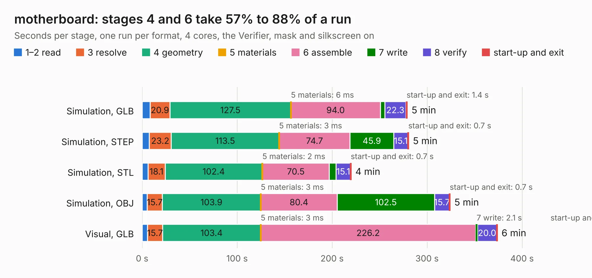

# 2633. motherboard

Board 2,633 of the 3,120 of [Corpus Testing](../Corpus-Testing.md), on [Corpus Page 25](../CorpusTestingPages/Corpus-Testing-25.md#2633-motherboard).

| Mode and format | 1–2 read | 3 resolve | 4 geometry | 5 materials | 6 assemble | 7 write | 8 verify | start-up and exit | Total |
|---|---:|---:|---:|---:|---:|---:|---:|---:|---:|
| Simulation, GLB | 8.3 | 20.9 | 127.5 | 6&nbsp;ms | 94.0 | 4.7 | 22.3 | 1.4 | 279.2 |
| Simulation, STEP | 7.5 | 23.2 | 113.5 | 3&nbsp;ms | 74.7 | 45.9 | 15.1 | 0.7 | 280.6 |
| Simulation, STL | 6.1 | 18.1 | 102.4 | 2&nbsp;ms | 70.5 | 7.1 | 15.1 | 0.7 | 220.0 |
| Simulation, OBJ | 5.4 | 15.7 | 103.9 | 3&nbsp;ms | 80.4 | 102.5 | 15.7 | 0.7 | 324.2 |
| Visual, GLB | 5.7 | 15.7 | 103.4 | 3&nbsp;ms | 226.2 | 2.1 | 20.0 | 0.8 | 373.9 |
| Visual, OBJ | 5.6 | 15.5 | 101.3 | 2&nbsp;ms | 208.6 | 66.1 | 16.7 | 0.4 | 414.2 |

<table align="center"><tr><td valign="top">

| Board | Repo: [sporniket/kicad-conversions--atari-260-520-st-motherboard--c070231](https://github.com/sporniket/kicad-conversions--atari-260-520-st-motherboard--c070231) Board: `motherboard.kicad_pcb` |
|---|---|
| Complexity | 371&nbsp;/&nbsp;1000 (size&nbsp;286, features&nbsp;85) |
| KESE&nbsp;features | through vias, slotted holes, filled zones, curved board outline, stack-up, dielectric εr and tanδ |
| Tested | 9th November 2026 |
| Copper&nbsp;layers | 2 |
| File&nbsp;format | KiCad 7 (20221018) |
| Parts,&nbsp;tracks,&nbsp;vias | 331, 13,570, 1,159 |
| Triangles,&nbsp;simulation | 14,594,790 in 433 parts |
| Verifier | PASS in all six runs |

</td><td valign="top">

<table>
<tr><th>File type</th><th>File size</th><th>Peak memory used</th></tr>
<tr><th colspan="3" align="left">Simulation</th></tr>
<tr><td>GLB</td><td align="right">491&nbsp;MB</td><td align="right">3.9&nbsp;GB</td></tr>
<tr><td>STEP</td><td align="right">2.5&nbsp;GB</td><td align="right">5.4&nbsp;GB</td></tr>
<tr><td>STL</td><td align="right">730&nbsp;MB</td><td align="right">4.1&nbsp;GB</td></tr>
<tr><td>OBJ</td><td align="right">1.6&nbsp;GB</td><td align="right">9.2&nbsp;GB</td></tr>
<tr><th colspan="3" align="left">Visual</th></tr>
<tr><td>GLB</td><td align="right">332&nbsp;MB</td><td align="right">5.2&nbsp;GB</td></tr>
<tr><td>OBJ</td><td align="right">1.1&nbsp;GB</td><td align="right">6.8&nbsp;GB</td></tr>
</table>

</td></tr></table>

| Previous | Next |
|:---|---:|
| [2632. cm5-carrier](b2632b_spirit_cm5-carrier.md) | [2634. leaf](b2634b_leaf-rv1126_leaf.md) |
