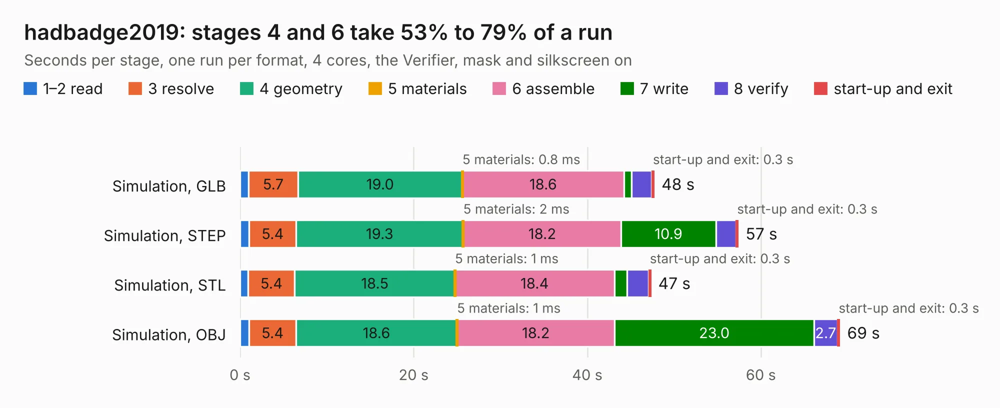

# 2636. hadbadge2019

Board 2,636 of the 3,120 of [Corpus Testing](../Corpus-Testing.md), on [Corpus Page 25](../CorpusTestingPages/Corpus-Testing-25.md#2636-hadbadge2019).

| Mode and format | 1–2 read | 3 resolve | 4 geometry | 5 materials | 6 assemble | 7 write | 8 verify | start-up and exit | Total |
|---|---:|---:|---:|---:|---:|---:|---:|---:|---:|
| Simulation, GLB | 1.0 | 5.7 | 19.0 | 0.8&nbsp;ms | 18.6 | 0.9 | 2.3 | 0.3 | 47.7 |
| Simulation, STEP | 1.1 | 5.4 | 19.3 | 2&nbsp;ms | 18.2 | 10.9 | 2.3 | 0.3 | 57.4 |
| Simulation, STL | 0.9 | 5.4 | 18.5 | 1&nbsp;ms | 18.4 | 1.5 | 2.5 | 0.3 | 47.3 |
| Simulation, OBJ | 1.1 | 5.4 | 18.6 | 1&nbsp;ms | 18.2 | 23.0 | 2.7 | 0.3 | 69.1 |
| Visual, GLB | 1.0 | 5.7 | 19.6 | 1&nbsp;ms | 37.9 | 0.4 | 4.4 | 0.3 | 69.3 |
| Visual, OBJ | 1.0 | 5.5 | 18.9 | 1&nbsp;ms | 35.1 | 15.1 | 4.0 | 0.3 | 79.8 |

<table align="center"><tr><td valign="top">

| Board | Repo: [Spritetm/hadbadge2019_pcb](https://github.com/Spritetm/hadbadge2019_pcb) Board: `hadbadge2019.kicad_pcb` |
|---|---|
| Complexity | 366&nbsp;/&nbsp;1000 (size&nbsp;281, features&nbsp;85) |
| KESE&nbsp;features | through vias, slotted holes, rounded, trapezoid or chamfered pads, drill offsets, filled zones, copper text, curved board outline |
| Tested | 9th November 2026 |
| Copper&nbsp;layers | 4 |
| File&nbsp;format | KiCad 5 (20171130) |
| Parts,&nbsp;tracks,&nbsp;vias | 184, 3,746, 393 |
| Triangles,&nbsp;simulation | 3,996,450 in 324 parts |
| Verifier | PASS in all six runs |

</td><td valign="top">

<table>
<tr><th>File type</th><th>File size</th><th>Peak memory used</th></tr>
<tr><th colspan="3" align="left">Simulation</th></tr>
<tr><td>GLB</td><td align="right">141&nbsp;MB</td><td align="right">1.1&nbsp;GB</td></tr>
<tr><td>STEP</td><td align="right">659&nbsp;MB</td><td align="right">1.5&nbsp;GB</td></tr>
<tr><td>STL</td><td align="right">200&nbsp;MB</td><td align="right">1.1&nbsp;GB</td></tr>
<tr><td>OBJ</td><td align="right">437&nbsp;MB</td><td align="right">2.6&nbsp;GB</td></tr>
<tr><th colspan="3" align="left">Visual</th></tr>
<tr><td>GLB</td><td align="right">90&nbsp;MB</td><td align="right">1.5&nbsp;GB</td></tr>
<tr><td>OBJ</td><td align="right">285&nbsp;MB</td><td align="right">1.9&nbsp;GB</td></tr>
</table>

</td></tr></table>

| Previous | Next |
|:---|---:|
| [2635. leaf-minipcie](b2635b_leaf-rv1126_leaf-minipcie.md) | [2637. beepy](b2637b_beepy-hardware_beepy.md) |
