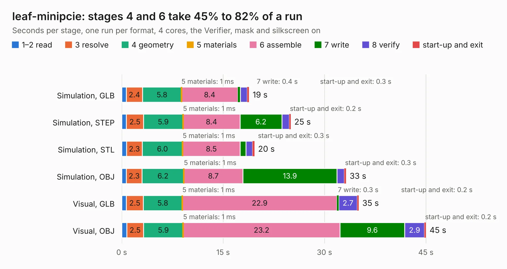

# 2636. leaf-minipcie

Board 2,636 of the 3,121 of [Corpus Testing](../Corpus-Testing.md), on [Corpus Page 25](../CorpusTestingPages/Corpus-Testing-25.md#2636-leaf-minipcie).

| Mode and format | 1–2 read | 3 resolve | 4 geometry | 5 materials | 6 assemble | 7 write | 8 verify | start-up and exit | Total |
|---|---:|---:|---:|---:|---:|---:|---:|---:|---:|
| Simulation, GLB | 0.7 | 2.4 | 5.8 | 1&nbsp;ms | 8.4 | 0.4 | 1.0 | 0.3 | 18.8 |
| Simulation, STEP | 0.7 | 2.5 | 5.9 | 1&nbsp;ms | 8.4 | 6.2 | 1.1 | 0.2 | 25.0 |
| Simulation, STL | 0.7 | 2.3 | 6.0 | 1&nbsp;ms | 8.5 | 0.9 | 1.0 | 0.3 | 19.6 |
| Simulation, OBJ | 0.7 | 2.3 | 6.2 | 1&nbsp;ms | 8.7 | 13.9 | 1.1 | 0.3 | 33.2 |
| Visual, GLB | 0.7 | 2.5 | 5.8 | 1&nbsp;ms | 22.9 | 0.3 | 2.7 | 0.2 | 35.1 |
| Visual, OBJ | 0.7 | 2.5 | 5.9 | 1&nbsp;ms | 23.2 | 9.6 | 2.9 | 0.2 | 45.0 |

<table align="center"><tr><td valign="top">

| Board | Repo: [sprhawk/leaf-rv1126](https://github.com/sprhawk/leaf-rv1126) Board: `leaf-minipcie.kicad_pcb` |
|---|---|
| Folder | minipcie |
| Complexity | 371&nbsp;/&nbsp;1000 (size&nbsp;281, features&nbsp;90) |
| KESE&nbsp;features | through vias, slotted holes, custom pads, rounded, trapezoid or chamfered pads, copper drawings, stack-up, dielectric εr and tanδ |
| Tested | 9th November 2026 |
| Copper&nbsp;layers | 6 |
| File&nbsp;format | KiCad 7 (20221018) |
| Parts,&nbsp;tracks,&nbsp;vias | 270, 369, 173 |
| Triangles,&nbsp;simulation | 2,581,276 in 515 parts |
| Verifier | PASS in all six runs |

</td><td valign="top">

<table>
<tr><th>File type</th><th>File size</th><th>Peak memory used</th></tr>
<tr><th colspan="3" align="left">Simulation</th></tr>
<tr><td>GLB</td><td align="right">85&nbsp;MB</td><td align="right">922&nbsp;MB</td></tr>
<tr><td>STEP</td><td align="right">374&nbsp;MB</td><td align="right">1.0&nbsp;GB</td></tr>
<tr><td>STL</td><td align="right">129&nbsp;MB</td><td align="right">1.0&nbsp;GB</td></tr>
<tr><td>OBJ</td><td align="right">270&nbsp;MB</td><td align="right">1.7&nbsp;GB</td></tr>
<tr><th colspan="3" align="left">Visual</th></tr>
<tr><td>GLB</td><td align="right">58&nbsp;MB</td><td align="right">1.1&nbsp;GB</td></tr>
<tr><td>OBJ</td><td align="right">183&nbsp;MB</td><td align="right">1.2&nbsp;GB</td></tr>
</table>

</td></tr></table>

| Previous | Next |
|:---|---:|
| [2635. leaf](b2635b_leaf-rv1126_leaf.md) | [2637. hadbadge2019](b2637b_hadbadge2019-pcb_hadbadge2019.md) |
