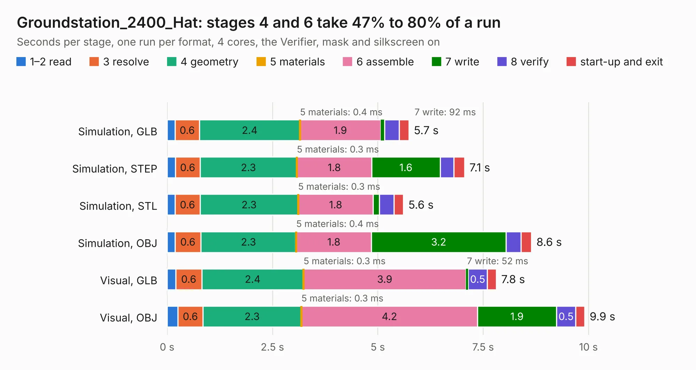

# 2641. Groundstation_2400_Hat

Board 2,641 of the 3,105 of [Corpus Testing](../Corpus-Testing.md), on [Corpus Page 25](../CorpusTestingPages/Corpus-Testing-25.md#2641-groundstation_2400_hat).

| Mode and format | 1–2 read | 3 resolve | 4 geometry | 5 materials | 6 assemble | 7 write | 8 verify | start-up and exit | Total |
|---|---:|---:|---:|---:|---:|---:|---:|---:|---:|
| Simulation, GLB | 0.2 | 0.6 | 2.4 | 0.4&nbsp;ms | 1.9 | 92&nbsp;ms | 0.3 | 0.2 | 5.7 |
| Simulation, STEP | 0.2 | 0.6 | 2.3 | 0.3&nbsp;ms | 1.8 | 1.6 | 0.3 | 0.3 | 7.1 |
| Simulation, STL | 0.2 | 0.6 | 2.3 | 0.3&nbsp;ms | 1.8 | 0.1 | 0.3 | 0.2 | 5.6 |
| Simulation, OBJ | 0.2 | 0.6 | 2.3 | 0.4&nbsp;ms | 1.8 | 3.2 | 0.4 | 0.2 | 8.6 |
| Visual, GLB | 0.2 | 0.6 | 2.4 | 0.3&nbsp;ms | 3.9 | 52&nbsp;ms | 0.5 | 0.2 | 7.8 |
| Visual, OBJ | 0.3 | 0.6 | 2.3 | 0.3&nbsp;ms | 4.2 | 1.9 | 0.5 | 0.2 | 9.9 |

<table align="center"><tr><td valign="top">

| Board | Repo: [stanford-ssi/samwise-avionics](https://github.com/stanford-ssi/samwise-avionics) Board: `Groundstation_2400_Hat.kicad_pcb` |
|---|---|
| Folder | Groundstation_2400_Hat |
| Complexity | 237&nbsp;/&nbsp;1000 (size&nbsp;147, features&nbsp;90) |
| KESE&nbsp;features | through vias, rounded, trapezoid or chamfered pads, filled zones, curved board outline, stack-up, dielectric εr and tanδ, mask and silkscreen colours |
| Tested | 9th November 2026 |
| Copper&nbsp;layers | 4 |
| File&nbsp;format | KiCad 9 (20241229) |
| Parts,&nbsp;tracks,&nbsp;vias | 10, 91, 38 |
| Triangles,&nbsp;simulation | 563,868 in 50 parts |
| Verifier | PASS in all six runs |

</td><td valign="top">

<table>
<tr><th>File type</th><th>File size</th><th>Peak memory used</th></tr>
<tr><th colspan="3" align="left">Simulation</th></tr>
<tr><td>GLB</td><td align="right">19&nbsp;MB</td><td align="right">297&nbsp;MB</td></tr>
<tr><td>STEP</td><td align="right">64&nbsp;MB</td><td align="right">342&nbsp;MB</td></tr>
<tr><td>STL</td><td align="right">28&nbsp;MB</td><td align="right">304&nbsp;MB</td></tr>
<tr><td>OBJ</td><td align="right">57&nbsp;MB</td><td align="right">414&nbsp;MB</td></tr>
<tr><th colspan="3" align="left">Visual</th></tr>
<tr><td>GLB</td><td align="right">11&nbsp;MB</td><td align="right">330&nbsp;MB</td></tr>
<tr><td>OBJ</td><td align="right">34&nbsp;MB</td><td align="right">337&nbsp;MB</td></tr>
</table>

</td></tr></table>

| Previous | Next |
|:---|---:|
| [2640. FlexDeploySidePanels](b2640b_samwise-avionics_FlexDeploySidePanels.md) | [2642. Groundstation_433_Hat](b2642b_samwise-avionics_Groundstation-433-Hat.md) |
