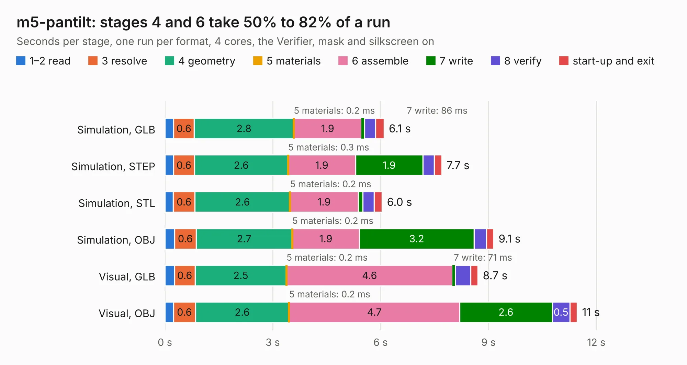

# 2642. m5-pantilt

Board 2,642 of the 3,116 of [Corpus Testing](../Corpus-Testing.md), on [Corpus Page 25](../CorpusTestingPages/Corpus-Testing-25.md#2642-m5-pantilt).

| Mode and format | 1–2 read | 3 resolve | 4 geometry | 5 materials | 6 assemble | 7 write | 8 verify | start-up and exit | Total |
|---|---:|---:|---:|---:|---:|---:|---:|---:|---:|
| Simulation, GLB | 0.2 | 0.6 | 2.8 | 0.2&nbsp;ms | 1.9 | 86&nbsp;ms | 0.3 | 0.2 | 6.1 |
| Simulation, STEP | 0.2 | 0.6 | 2.6 | 0.3&nbsp;ms | 1.9 | 1.9 | 0.3 | 0.2 | 7.7 |
| Simulation, STL | 0.2 | 0.6 | 2.6 | 0.2&nbsp;ms | 1.9 | 0.1 | 0.3 | 0.2 | 6.0 |
| Simulation, OBJ | 0.3 | 0.6 | 2.7 | 0.2&nbsp;ms | 1.9 | 3.2 | 0.3 | 0.2 | 9.1 |
| Visual, GLB | 0.3 | 0.6 | 2.5 | 0.2&nbsp;ms | 4.6 | 71&nbsp;ms | 0.4 | 0.2 | 8.7 |
| Visual, OBJ | 0.2 | 0.6 | 2.6 | 0.2&nbsp;ms | 4.7 | 2.6 | 0.5 | 0.2 | 11.5 |

<table align="center"><tr><td valign="top">

| Board | Repo: [stack-chan/stack-chan](https://github.com/stack-chan/stack-chan) Board: `m5-pantilt.kicad_pcb` |
|---|---|
| Folder | schematics / m5-pantilt |
| Complexity | 217&nbsp;/&nbsp;1000 (size&nbsp;162, features&nbsp;55) |
| KESE&nbsp;features | through vias, rounded, trapezoid or chamfered pads, filled zones, curved board outline |
| Tested | 9th November 2026 |
| Copper&nbsp;layers | 2 |
| File&nbsp;format | KiCad 7 (20221018) |
| Parts,&nbsp;tracks,&nbsp;vias | 37, 285, 114 |
| Triangles,&nbsp;simulation | 565,966 in 53 parts |
| Verifier | PASS in all six runs |

</td><td valign="top">

<table>
<tr><th>File type</th><th>File size</th><th>Peak memory used</th></tr>
<tr><th colspan="3" align="left">Simulation</th></tr>
<tr><td>GLB</td><td align="right">20&nbsp;MB</td><td align="right">343&nbsp;MB</td></tr>
<tr><td>STEP</td><td align="right">101&nbsp;MB</td><td align="right">371&nbsp;MB</td></tr>
<tr><td>STL</td><td align="right">28&nbsp;MB</td><td align="right">359&nbsp;MB</td></tr>
<tr><td>OBJ</td><td align="right">58&nbsp;MB</td><td align="right">379&nbsp;MB</td></tr>
<tr><th colspan="3" align="left">Visual</th></tr>
<tr><td>GLB</td><td align="right">16&nbsp;MB</td><td align="right">399&nbsp;MB</td></tr>
<tr><td>OBJ</td><td align="right">47&nbsp;MB</td><td align="right">412&nbsp;MB</td></tr>
</table>

</td></tr></table>

| Previous | Next |
|:---|---:|
| [2641. V1](b2641b_intel-i210-network-card_PCBV3-0-reference-OCP2PCIe-master-OCP2PCIe-H-F-4-OCP2PCIe-H-F-4-V2-0Beta_V1.md) | [2643. aerolotl_av](b2643b_aerolotl-av_aerolotl-av.md) |
