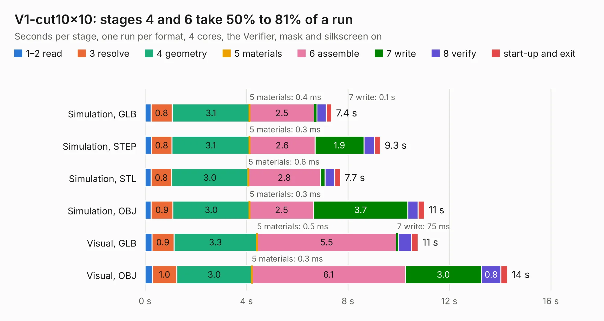

# 2643. V1-cut10x10

Board 2,643 of the 3,119 of [Corpus Testing](../Corpus-Testing.md), on [Corpus Page 25](../CorpusTestingPages/Corpus-Testing-25.md#2643-v1-cut10x10).

| Mode and format | 1–2 read | 3 resolve | 4 geometry | 5 materials | 6 assemble | 7 write | 8 verify | start-up and exit | Total |
|---|---:|---:|---:|---:|---:|---:|---:|---:|---:|
| Simulation, GLB | 0.2 | 0.8 | 3.1 | 0.4&nbsp;ms | 2.5 | 0.1 | 0.4 | 0.2 | 7.4 |
| Simulation, STEP | 0.3 | 0.8 | 3.1 | 0.3&nbsp;ms | 2.6 | 1.9 | 0.4 | 0.2 | 9.3 |
| Simulation, STL | 0.2 | 0.8 | 3.0 | 0.6&nbsp;ms | 2.8 | 0.2 | 0.4 | 0.2 | 7.7 |
| Simulation, OBJ | 0.2 | 0.9 | 3.0 | 0.3&nbsp;ms | 2.5 | 3.7 | 0.4 | 0.3 | 11.0 |
| Visual, GLB | 0.3 | 0.9 | 3.3 | 0.5&nbsp;ms | 5.5 | 75&nbsp;ms | 0.5 | 0.3 | 10.8 |
| Visual, OBJ | 0.3 | 1.0 | 3.0 | 0.3&nbsp;ms | 6.1 | 3.0 | 0.8 | 0.3 | 14.3 |

<table align="center"><tr><td valign="top">

| Board | Repo: [ssmiao/intel-i210-network-card](https://github.com/ssmiao/intel-i210-network-card) Board: `V1-cut10x10.kicad_pcb` |
|---|---|
| Folder | PCBV3.0 / reference / OCP2PCIe-master / OCP2PCIe-H-F-4 / OCP2PCIe-H-F-4-V2.0Beta |
| Complexity | 230&nbsp;/&nbsp;1000 (size&nbsp;155, features&nbsp;75) |
| KESE&nbsp;features | through vias, slotted holes, rounded, trapezoid or chamfered pads, drill offsets, filled zones, curved board outline |
| Tested | 9th November 2026 |
| Copper&nbsp;layers | 2 |
| File&nbsp;format | KiCad 5 (20171130) |
| Parts,&nbsp;tracks,&nbsp;vias | 10, 361, 195 |
| Triangles,&nbsp;simulation | 599,728 in 82 parts |
| Verifier | PASS in all six runs |

</td><td valign="top">

<table>
<tr><th>File type</th><th>File size</th><th>Peak memory used</th></tr>
<tr><th colspan="3" align="left">Simulation</th></tr>
<tr><td>GLB</td><td align="right">21&nbsp;MB</td><td align="right">330&nbsp;MB</td></tr>
<tr><td>STEP</td><td align="right">82&nbsp;MB</td><td align="right">397&nbsp;MB</td></tr>
<tr><td>STL</td><td align="right">30&nbsp;MB</td><td align="right">327&nbsp;MB</td></tr>
<tr><td>OBJ</td><td align="right">61&nbsp;MB</td><td align="right">456&nbsp;MB</td></tr>
<tr><th colspan="3" align="left">Visual</th></tr>
<tr><td>GLB</td><td align="right">16&nbsp;MB</td><td align="right">388&nbsp;MB</td></tr>
<tr><td>OBJ</td><td align="right">46&nbsp;MB</td><td align="right">399&nbsp;MB</td></tr>
</table>

</td></tr></table>

| Previous | Next |
|:---|---:|
| [2642. V1](b2642b_intel-i210-network-card_PCBV3-0-reference-OCP2PCIe-master-OCP2PCIe-H-F-4-OCP2PCIe-H-F-4-V1-1Beta_V1.md) | [2644. V1](b2644b_intel-i210-network-card_PCBV3-0-reference-OCP2PCIe-master-OCP2PCIe-H-F-4-OCP2PCIe-H-F-4-V2-0Beta_V1.md) |
