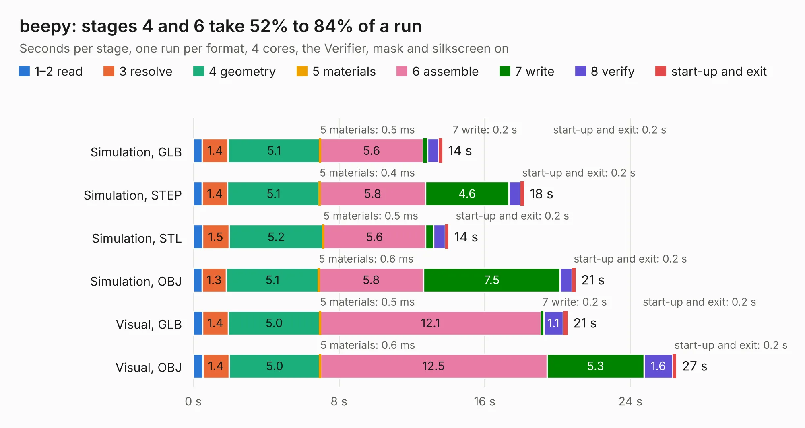

# 2646. beepy

Board 2,646 of the 3,130 of [Corpus Testing](../Corpus-Testing.md), on [Corpus Page 25](../CorpusTestingPages/Corpus-Testing-25.md#2646-beepy).

| Mode and format | 1–2 read | 3 resolve | 4 geometry | 5 materials | 6 assemble | 7 write | 8 verify | start-up and exit | Total |
|---|---:|---:|---:|---:|---:|---:|---:|---:|---:|
| Simulation, GLB | 0.5 | 1.4 | 5.1 | 0.5&nbsp;ms | 5.6 | 0.2 | 0.6 | 0.2 | 13.7 |
| Simulation, STEP | 0.5 | 1.4 | 5.1 | 0.4&nbsp;ms | 5.8 | 4.6 | 0.6 | 0.2 | 18.2 |
| Simulation, STL | 0.5 | 1.5 | 5.2 | 0.5&nbsp;ms | 5.6 | 0.4 | 0.6 | 0.2 | 14.0 |
| Simulation, OBJ | 0.5 | 1.3 | 5.1 | 0.6&nbsp;ms | 5.8 | 7.5 | 0.7 | 0.2 | 21.0 |
| Visual, GLB | 0.5 | 1.4 | 5.0 | 0.5&nbsp;ms | 12.1 | 0.2 | 1.1 | 0.2 | 20.5 |
| Visual, OBJ | 0.5 | 1.4 | 5.0 | 0.6&nbsp;ms | 12.5 | 5.3 | 1.6 | 0.2 | 26.5 |

<table align="center"><tr><td valign="top">

| Board | Repo: [sqfmi/beepy-hardware](https://github.com/sqfmi/beepy-hardware) Board: `beepy.kicad_pcb` |
|---|---|
| Folder | KiCad |
| Complexity | 377&nbsp;/&nbsp;1000 (size&nbsp;247, features&nbsp;130) |
| KESE&nbsp;features | through vias, slotted holes, custom pads, rounded, trapezoid or chamfered pads, filled zones, copper drawings, copper text, curved board outline, stack-up, dielectric εr and tanδ |
| Tested | 9th November 2026 |
| Copper&nbsp;layers | 4 |
| File&nbsp;format | KiCad 7 (20221018) |
| Parts,&nbsp;tracks,&nbsp;vias | 95, 1,444, 157 |
| Triangles,&nbsp;simulation | 1,517,110 in 125 parts |
| Verifier | PASS in all six runs |

</td><td valign="top">

<table>
<tr><th>File type</th><th>File size</th><th>Peak memory used</th></tr>
<tr><th colspan="3" align="left">Simulation</th></tr>
<tr><td>GLB</td><td align="right">52&nbsp;MB</td><td align="right">612&nbsp;MB</td></tr>
<tr><td>STEP</td><td align="right">239&nbsp;MB</td><td align="right">685&nbsp;MB</td></tr>
<tr><td>STL</td><td align="right">76&nbsp;MB</td><td align="right">601&nbsp;MB</td></tr>
<tr><td>OBJ</td><td align="right">157&nbsp;MB</td><td align="right">1.0&nbsp;GB</td></tr>
<tr><th colspan="3" align="left">Visual</th></tr>
<tr><td>GLB</td><td align="right">35&nbsp;MB</td><td align="right">749&nbsp;MB</td></tr>
<tr><td>OBJ</td><td align="right">108&nbsp;MB</td><td align="right">828&nbsp;MB</td></tr>
</table>

</td></tr></table>

| Previous | Next |
|:---|---:|
| [2645. hadbadge2019](b2645b_hadbadge2019-pcb_hadbadge2019.md) | [2647. Watchy](b2647b_watchy-hardware_Watchy.md) |
