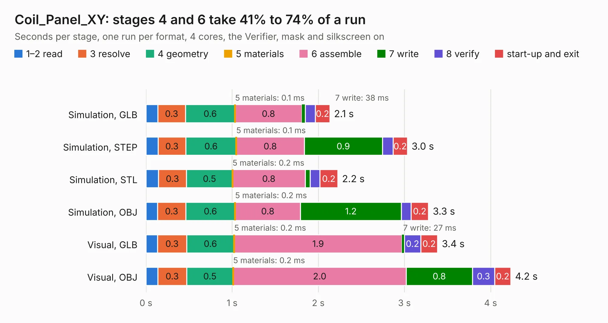

# 2646. Coil_Panel_XY

Board 2,646 of the 3,101 of [Corpus Testing](../Corpus-Testing.md), on [Corpus Page 25](../CorpusTestingPages/Corpus-Testing-25.md#2646-coil_panel_xy).

| Mode and format | 1–2 read | 3 resolve | 4 geometry | 5 materials | 6 assemble | 7 write | 8 verify | start-up and exit | Total |
|---|---:|---:|---:|---:|---:|---:|---:|---:|---:|
| Simulation, GLB | 0.1 | 0.3 | 0.6 | 0.1&nbsp;ms | 0.8 | 38&nbsp;ms | 0.1 | 0.2 | 2.1 |
| Simulation, STEP | 0.1 | 0.3 | 0.6 | 0.1&nbsp;ms | 0.8 | 0.9 | 0.1 | 0.2 | 3.0 |
| Simulation, STL | 0.1 | 0.3 | 0.5 | 0.2&nbsp;ms | 0.8 | 58&nbsp;ms | 0.1 | 0.2 | 2.2 |
| Simulation, OBJ | 0.1 | 0.3 | 0.6 | 0.2&nbsp;ms | 0.8 | 1.2 | 0.1 | 0.2 | 3.3 |
| Visual, GLB | 0.1 | 0.3 | 0.6 | 0.2&nbsp;ms | 1.9 | 27&nbsp;ms | 0.2 | 0.2 | 3.4 |
| Visual, OBJ | 0.1 | 0.3 | 0.5 | 0.2&nbsp;ms | 2.0 | 0.8 | 0.3 | 0.2 | 4.2 |

<table align="center"><tr><td valign="top">

| Board | Repo: [stanford-ssi/samwise-avionics](https://github.com/stanford-ssi/samwise-avionics) Board: `Coil_Panel_XY.kicad_pcb` |
|---|---|
| Folder | Universal_XY_MagTorq |
| Complexity | 245&nbsp;/&nbsp;1000 (size&nbsp;185, features&nbsp;60) |
| KESE&nbsp;features | through vias, curved board outline, stack-up, dielectric εr and tanδ, mask and silkscreen colours |
| Tested | 9th November 2026 |
| Copper&nbsp;layers | 6 |
| File&nbsp;format | KiCad 9 (20241229) |
| Parts,&nbsp;tracks,&nbsp;vias | 9, 1,242, 9 |
| Triangles,&nbsp;simulation | 287,304 in 38 parts |
| Note | panel |
| Verifier | PASS in all six runs |

</td><td valign="top">

<table>
<tr><th>File type</th><th>File size</th><th>Peak memory used</th></tr>
<tr><th colspan="3" align="left">Simulation</th></tr>
<tr><td>GLB</td><td align="right">9.7&nbsp;MB</td><td align="right">227&nbsp;MB</td></tr>
<tr><td>STEP</td><td align="right">40&nbsp;MB</td><td align="right">249&nbsp;MB</td></tr>
<tr><td>STL</td><td align="right">14&nbsp;MB</td><td align="right">230&nbsp;MB</td></tr>
<tr><td>OBJ</td><td align="right">30&nbsp;MB</td><td align="right">237&nbsp;MB</td></tr>
<tr><th colspan="3" align="left">Visual</th></tr>
<tr><td>GLB</td><td align="right">6.5&nbsp;MB</td><td align="right">198&nbsp;MB</td></tr>
<tr><td>OBJ</td><td align="right">19&nbsp;MB</td><td align="right">224&nbsp;MB</td></tr>
</table>

</td></tr></table>

| Previous | Next |
|:---|---:|
| [2645. Piramide_Del_Sol](b2645b_samwise-avionics_Piramide-Del-Sol.md) | [2647. Coil_Panel_Z](b2647b_samwise-avionics_Coil-Panel-Z.md) |
