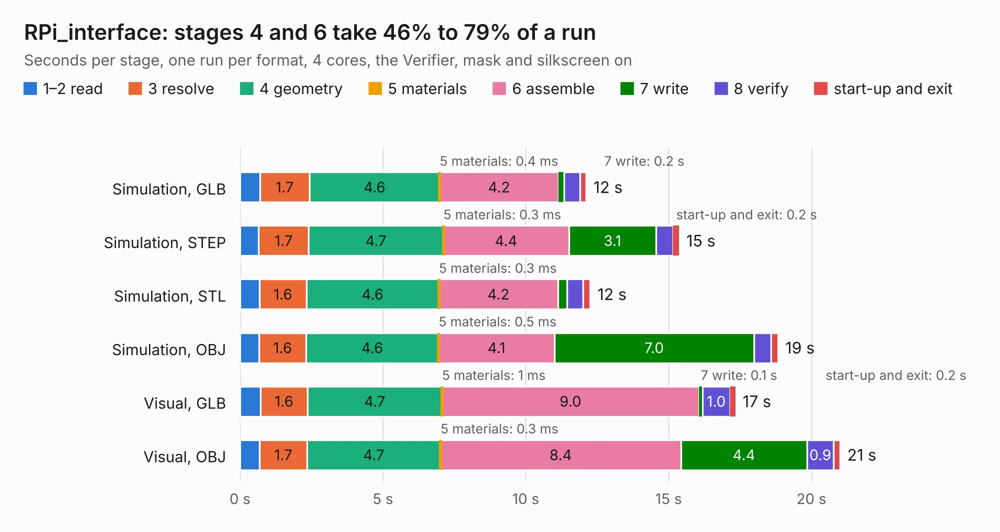

# 2647. RPi_interface

Board 2,647 of the 3,105 of [Corpus Testing](../Corpus-Testing.md), on [Corpus Page 25](../CorpusTestingPages/Corpus-Testing-25.md#2647-rpi_interface).

| Mode and format | 1–2 read | 3 resolve | 4 geometry | 5 materials | 6 assemble | 7 write | 8 verify | start-up and exit | Total |
|---|---:|---:|---:|---:|---:|---:|---:|---:|---:|
| Simulation, GLB | 0.7 | 1.7 | 4.6 | 0.4&nbsp;ms | 4.2 | 0.2 | 0.6 | 0.2 | 12.1 |
| Simulation, STEP | 0.7 | 1.7 | 4.7 | 0.3&nbsp;ms | 4.4 | 3.1 | 0.6 | 0.2 | 15.4 |
| Simulation, STL | 0.7 | 1.6 | 4.6 | 0.3&nbsp;ms | 4.2 | 0.3 | 0.6 | 0.2 | 12.3 |
| Simulation, OBJ | 0.7 | 1.6 | 4.6 | 0.5&nbsp;ms | 4.1 | 7.0 | 0.6 | 0.2 | 18.8 |
| Visual, GLB | 0.7 | 1.6 | 4.7 | 1&nbsp;ms | 9.0 | 0.1 | 1.0 | 0.2 | 17.3 |
| Visual, OBJ | 0.7 | 1.7 | 4.7 | 0.3&nbsp;ms | 8.4 | 4.4 | 0.9 | 0.2 | 21.0 |

<table align="center"><tr><td valign="top">

| Board | Repo: [stanford-ssi/samwise-avionics](https://github.com/stanford-ssi/samwise-avionics) Board: `RPi_interface.kicad_pcb` |
|---|---|
| Folder | RPi_Interface |
| Complexity | 272&nbsp;/&nbsp;1000 (size&nbsp;182, features&nbsp;90) |
| KESE&nbsp;features | through vias, rounded, trapezoid or chamfered pads, filled zones, curved board outline, stack-up, dielectric εr and tanδ, mask and silkscreen colours |
| Tested | 9th November 2026 |
| Copper&nbsp;layers | 4 |
| File&nbsp;format | KiCad 9 (20241229) |
| Parts,&nbsp;tracks,&nbsp;vias | 38, 340, 145 |
| Triangles,&nbsp;simulation | 1,287,604 in 63 parts |
| Verifier | PASS in all six runs |

</td><td valign="top">

<table>
<tr><th>File type</th><th>File size</th><th>Peak memory used</th></tr>
<tr><th colspan="3" align="left">Simulation</th></tr>
<tr><td>GLB</td><td align="right">45&nbsp;MB</td><td align="right">548&nbsp;MB</td></tr>
<tr><td>STEP</td><td align="right">175&nbsp;MB</td><td align="right">633&nbsp;MB</td></tr>
<tr><td>STL</td><td align="right">64&nbsp;MB</td><td align="right">578&nbsp;MB</td></tr>
<tr><td>OBJ</td><td align="right">135&nbsp;MB</td><td align="right">908&nbsp;MB</td></tr>
<tr><th colspan="3" align="left">Visual</th></tr>
<tr><td>GLB</td><td align="right">30&nbsp;MB</td><td align="right">631&nbsp;MB</td></tr>
<tr><td>OBJ</td><td align="right">91&nbsp;MB</td><td align="right">698&nbsp;MB</td></tr>
</table>

</td></tr></table>

| Previous | Next |
|:---|---:|
| [2646. picubed_samwise](b2646b_samwise-avionics_picubed-samwise.md) | [2648. Stationary_X_Panel](b2648b_samwise-avionics_Stationary-X-Panel.md) |
