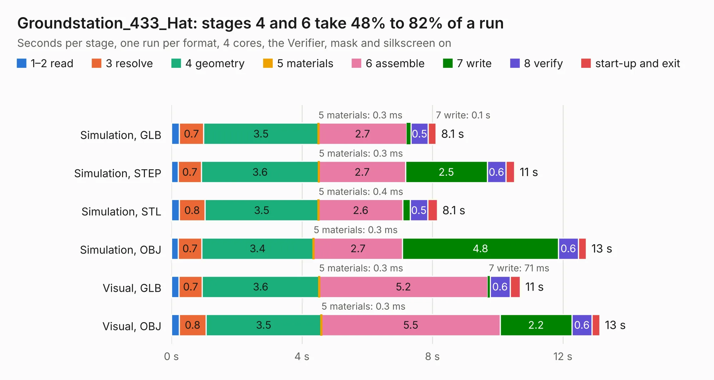

# 2648. Groundstation_433_Hat

Board 2,648 of the 3,111 of [Corpus Testing](../Corpus-Testing.md), on [Corpus Page 25](../CorpusTestingPages/Corpus-Testing-25.md#2648-groundstation_433_hat).

| Mode and format | 1–2 read | 3 resolve | 4 geometry | 5 materials | 6 assemble | 7 write | 8 verify | start-up and exit | Total |
|---|---:|---:|---:|---:|---:|---:|---:|---:|---:|
| Simulation, GLB | 0.2 | 0.7 | 3.5 | 0.3&nbsp;ms | 2.7 | 0.1 | 0.5 | 0.2 | 8.1 |
| Simulation, STEP | 0.2 | 0.7 | 3.6 | 0.3&nbsp;ms | 2.7 | 2.5 | 0.6 | 0.3 | 10.5 |
| Simulation, STL | 0.2 | 0.8 | 3.5 | 0.4&nbsp;ms | 2.6 | 0.2 | 0.5 | 0.3 | 8.1 |
| Simulation, OBJ | 0.2 | 0.7 | 3.4 | 0.3&nbsp;ms | 2.7 | 4.8 | 0.6 | 0.2 | 12.7 |
| Visual, GLB | 0.2 | 0.7 | 3.6 | 0.3&nbsp;ms | 5.2 | 71&nbsp;ms | 0.6 | 0.3 | 10.7 |
| Visual, OBJ | 0.2 | 0.8 | 3.5 | 0.3&nbsp;ms | 5.5 | 2.2 | 0.6 | 0.2 | 13.1 |

<table align="center"><tr><td valign="top">

| Board | Repo: [stanford-ssi/samwise-avionics](https://github.com/stanford-ssi/samwise-avionics) Board: `Groundstation_433_Hat.kicad_pcb` |
|---|---|
| Folder | Groundstation_433_Hat |
| Complexity | 237&nbsp;/&nbsp;1000 (size&nbsp;147, features&nbsp;90) |
| KESE&nbsp;features | through vias, rounded, trapezoid or chamfered pads, filled zones, curved board outline, stack-up, dielectric εr and tanδ, mask and silkscreen colours |
| Tested | 9th November 2026 |
| Copper&nbsp;layers | 4 |
| File&nbsp;format | KiCad 9 (20241229) |
| Parts,&nbsp;tracks,&nbsp;vias | 14, 149, 8 |
| Triangles,&nbsp;simulation | 759,192 in 48 parts |
| Verifier | PASS in all six runs |

</td><td valign="top">

<table>
<tr><th>File type</th><th>File size</th><th>Peak memory used</th></tr>
<tr><th colspan="3" align="left">Simulation</th></tr>
<tr><td>GLB</td><td align="right">26&nbsp;MB</td><td align="right">341&nbsp;MB</td></tr>
<tr><td>STEP</td><td align="right">112&nbsp;MB</td><td align="right">387&nbsp;MB</td></tr>
<tr><td>STL</td><td align="right">38&nbsp;MB</td><td align="right">347&nbsp;MB</td></tr>
<tr><td>OBJ</td><td align="right">78&nbsp;MB</td><td align="right">540&nbsp;MB</td></tr>
<tr><th colspan="3" align="left">Visual</th></tr>
<tr><td>GLB</td><td align="right">13&nbsp;MB</td><td align="right">378&nbsp;MB</td></tr>
<tr><td>OBJ</td><td align="right">39&nbsp;MB</td><td align="right">381&nbsp;MB</td></tr>
</table>

</td></tr></table>

| Previous | Next |
|:---|---:|
| [2647. Groundstation_2400_Hat](b2647b_samwise-avionics_Groundstation-2400-Hat.md) | [2649. LT8491-mezzanine](b2649b_samwise-avionics_LT8491-mezzanine.md) |
