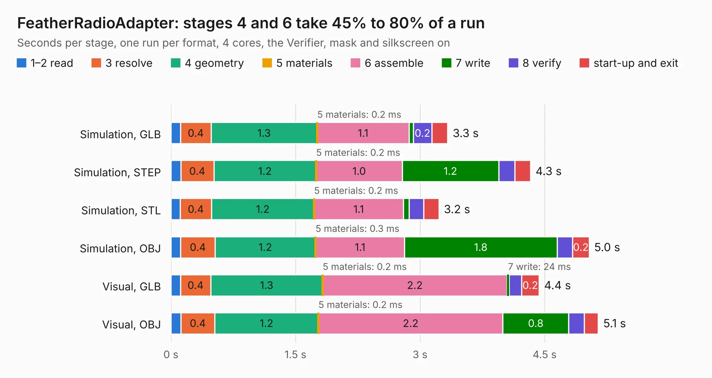

# 2649. FeatherRadioAdapter

Board 2,649 of the 3,102 of [Corpus Testing](../Corpus-Testing.md), on [Corpus Page 25](../CorpusTestingPages/Corpus-Testing-25.md#2649-featherradioadapter).

| Mode and format | 1–2 read | 3 resolve | 4 geometry | 5 materials | 6 assemble | 7 write | 8 verify | start-up and exit | Total |
|---|---:|---:|---:|---:|---:|---:|---:|---:|---:|
| Simulation, GLB | 0.1 | 0.4 | 1.3 | 0.2&nbsp;ms | 1.1 | 52&nbsp;ms | 0.2 | 0.2 | 3.3 |
| Simulation, STEP | 0.1 | 0.4 | 1.2 | 0.2&nbsp;ms | 1.0 | 1.2 | 0.2 | 0.2 | 4.3 |
| Simulation, STL | 0.1 | 0.4 | 1.2 | 0.2&nbsp;ms | 1.1 | 69&nbsp;ms | 0.2 | 0.2 | 3.2 |
| Simulation, OBJ | 0.1 | 0.4 | 1.2 | 0.3&nbsp;ms | 1.1 | 1.8 | 0.2 | 0.2 | 5.0 |
| Visual, GLB | 0.1 | 0.4 | 1.3 | 0.2&nbsp;ms | 2.2 | 24&nbsp;ms | 0.1 | 0.2 | 4.4 |
| Visual, OBJ | 0.1 | 0.4 | 1.2 | 0.2&nbsp;ms | 2.2 | 0.8 | 0.2 | 0.2 | 5.1 |

<table align="center"><tr><td valign="top">

| Board | Repo: [stanford-ssi/samwise-avionics](https://github.com/stanford-ssi/samwise-avionics) Board: `FeatherRadioAdapter.kicad_pcb` |
|---|---|
| Folder | unused_boards / FeatherRadioAdapter |
| Complexity | 224&nbsp;/&nbsp;1000 (size&nbsp;139, features&nbsp;85) |
| KESE&nbsp;features | through vias, rounded, trapezoid or chamfered pads, filled zones, curved board outline, stack-up, dielectric εr and tanδ |
| Tested | 9th November 2026 |
| Copper&nbsp;layers | 4 |
| File&nbsp;format | KiCad 8 (20240108) |
| Parts,&nbsp;tracks,&nbsp;vias | 8, 90, 18 |
| Triangles,&nbsp;simulation | 349,674 in 46 parts |
| Verifier | PASS in all six runs |

</td><td valign="top">

<table>
<tr><th>File type</th><th>File size</th><th>Peak memory used</th></tr>
<tr><th colspan="3" align="left">Simulation</th></tr>
<tr><td>GLB</td><td align="right">12&nbsp;MB</td><td align="right">225&nbsp;MB</td></tr>
<tr><td>STEP</td><td align="right">44&nbsp;MB</td><td align="right">248&nbsp;MB</td></tr>
<tr><td>STL</td><td align="right">17&nbsp;MB</td><td align="right">226&nbsp;MB</td></tr>
<tr><td>OBJ</td><td align="right">36&nbsp;MB</td><td align="right">254&nbsp;MB</td></tr>
<tr><th colspan="3" align="left">Visual</th></tr>
<tr><td>GLB</td><td align="right">5.6&nbsp;MB</td><td align="right">211&nbsp;MB</td></tr>
<tr><td>OBJ</td><td align="right">17&nbsp;MB</td><td align="right">208&nbsp;MB</td></tr>
</table>

</td></tr></table>

| Previous | Next |
|:---|---:|
| [2648. Coil_Panel_Z](b2648b_samwise-avionics_Coil-Panel-Z.md) | [2650. Pete_2400_Mini](b2650b_samwise-avionics_Pete-2400-Mini.md) |
