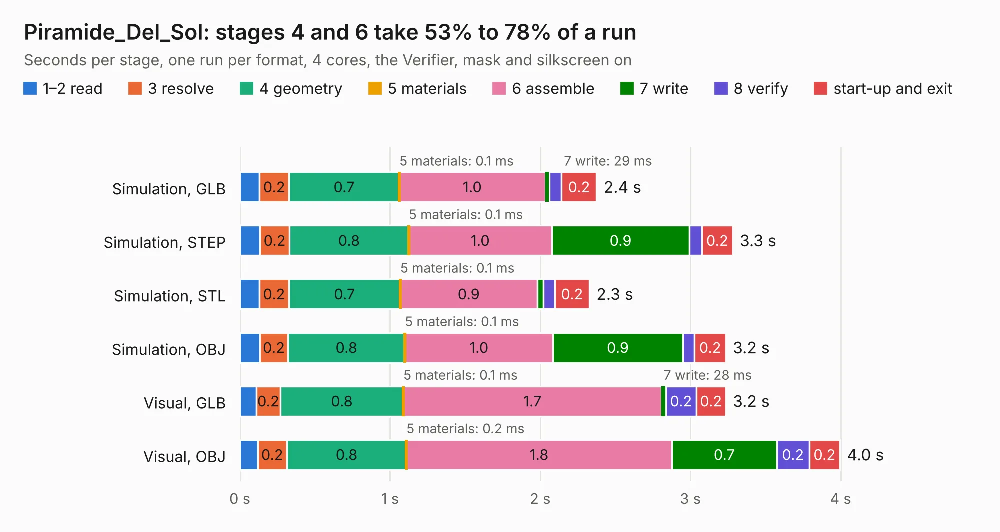

# 2649. Piramide_Del_Sol

Board 2,649 of the 3,105 of [Corpus Testing](../Corpus-Testing.md), on [Corpus Page 25](../CorpusTestingPages/Corpus-Testing-25.md#2649-piramide_del_sol).

| Mode and format | 1–2 read | 3 resolve | 4 geometry | 5 materials | 6 assemble | 7 write | 8 verify | start-up and exit | Total |
|---|---:|---:|---:|---:|---:|---:|---:|---:|---:|
| Simulation, GLB | 0.1 | 0.2 | 0.7 | 0.1&nbsp;ms | 1.0 | 29&nbsp;ms | 81&nbsp;ms | 0.2 | 2.4 |
| Simulation, STEP | 0.1 | 0.2 | 0.8 | 0.1&nbsp;ms | 1.0 | 0.9 | 82&nbsp;ms | 0.2 | 3.3 |
| Simulation, STL | 0.1 | 0.2 | 0.7 | 0.1&nbsp;ms | 0.9 | 41&nbsp;ms | 76&nbsp;ms | 0.2 | 2.3 |
| Simulation, OBJ | 0.1 | 0.2 | 0.8 | 0.1&nbsp;ms | 1.0 | 0.9 | 79&nbsp;ms | 0.2 | 3.2 |
| Visual, GLB | 0.1 | 0.2 | 0.8 | 0.1&nbsp;ms | 1.7 | 28&nbsp;ms | 0.2 | 0.2 | 3.2 |
| Visual, OBJ | 0.1 | 0.2 | 0.8 | 0.2&nbsp;ms | 1.8 | 0.7 | 0.2 | 0.2 | 4.0 |

<table align="center"><tr><td valign="top">

| Board | Repo: [stanford-ssi/samwise-avionics](https://github.com/stanford-ssi/samwise-avionics) Board: `Piramide_Del_Sol.kicad_pcb` |
|---|---|
| Folder | sun_sensor_pyramid |
| Complexity | 230&nbsp;/&nbsp;1000 (size&nbsp;140, features&nbsp;90) |
| KESE&nbsp;features | through vias, rounded, trapezoid or chamfered pads, filled zones, curved board outline, stack-up, dielectric εr and tanδ, mask and silkscreen colours |
| Tested | 9th November 2026 |
| Copper&nbsp;layers | 2 |
| File&nbsp;format | KiCad 9 (20241229) |
| Parts,&nbsp;tracks,&nbsp;vias | 19, 125, 45 |
| Triangles,&nbsp;simulation | 181,334 in 19 parts |
| Verifier | PASS in all six runs |

</td><td valign="top">

<table>
<tr><th>File type</th><th>File size</th><th>Peak memory used</th></tr>
<tr><th colspan="3" align="left">Simulation</th></tr>
<tr><td>GLB</td><td align="right">6.4&nbsp;MB</td><td align="right">214&nbsp;MB</td></tr>
<tr><td>STEP</td><td align="right">32&nbsp;MB</td><td align="right">239&nbsp;MB</td></tr>
<tr><td>STL</td><td align="right">9.1&nbsp;MB</td><td align="right">215&nbsp;MB</td></tr>
<tr><td>OBJ</td><td align="right">18&nbsp;MB</td><td align="right">214&nbsp;MB</td></tr>
<tr><th colspan="3" align="left">Visual</th></tr>
<tr><td>GLB</td><td align="right">5.7&nbsp;MB</td><td align="right">216&nbsp;MB</td></tr>
<tr><td>OBJ</td><td align="right">16&nbsp;MB</td><td align="right">225&nbsp;MB</td></tr>
</table>

</td></tr></table>

| Previous | Next |
|:---|---:|
| [2648. Stationary_X_Panel](b2648b_samwise-avionics_Stationary-X-Panel.md) | [2650. Coil_Panel_XY](b2650b_samwise-avionics_Coil-Panel-XY.md) |
