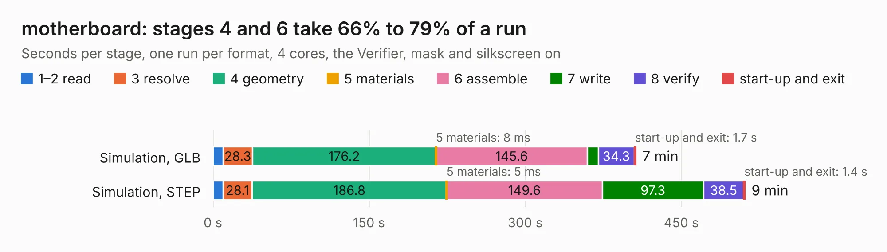

# 2650. motherboard

Board 2,650 of the 3,138 of [Corpus Testing](../Corpus-Testing.md), on [Corpus Page 25](../CorpusTestingPages/Corpus-Testing-25.md#2650-motherboard).

| Mode and format | 1–2 read | 3 resolve | 4 geometry | 5 materials | 6 assemble | 7 write | 8 verify | start-up and exit | Total |
|---|---:|---:|---:|---:|---:|---:|---:|---:|---:|
| Simulation, GLB | 9.7 | 28.3 | 176.2 | 8&nbsp;ms | 145.6 | 10.6 | 34.3 | 1.7 | 406.4 |
| Simulation, STEP | 9.6 | 28.1 | 186.8 | 5&nbsp;ms | 149.6 | 97.3 | 38.5 | 1.4 | 511.3 |
| Simulation, STL | 7.2 | 24.3 | 154.5 | 5&nbsp;ms | 110.9 | 17.4 | 26.9 | 0.8 | 342.0 |
| Simulation, OBJ |  |  |  |  |  |  |  |  | exceeded 11 GB on a 15 GB machine (stopped there, not a KESE failure); it will be run again on a machine with more memory |
| Visual, GLB | 7.2 | 24.0 | 153.5 | 4&nbsp;ms | 324.4 | 2.2 | 33.6 | 0.6 | 545.6 |
| Visual, OBJ | 8.0 | 25.4 | 154.5 | 4&nbsp;ms | 332.0 | 76.7 | 29.7 | 0.7 | 626.9 |

<table align="center"><tr><td valign="top">

| Board | Repo: [sporniket/kicad-conversions--atari-ste-motherboard--c300780-001](https://github.com/sporniket/kicad-conversions--atari-ste-motherboard--c300780-001) Board: `motherboard.kicad_pcb` |
|---|---|
| Complexity | 383&nbsp;/&nbsp;1000 (size&nbsp;318, features&nbsp;65) |
| KESE&nbsp;features | through vias, slotted holes, rounded, trapezoid or chamfered pads, drill offsets, filled zones |
| Tested | 9th November 2026 |
| Copper&nbsp;layers | 4 |
| File&nbsp;format | KiCad 7 (20221018) |
| Parts,&nbsp;tracks,&nbsp;vias | 554, 12,443, 1,817 |
| Triangles,&nbsp;simulation | 27,423,068 in 747 parts |
| Verifier | Simulation, OBJ: exceeded 11 GB on a 15 GB machine (stopped there, not a KESE failure); it will be run again on a machine with more memory |

</td><td valign="top">

<table>
<tr><th>File type</th><th>File size</th><th>Peak memory used</th></tr>
<tr><th colspan="3" align="left">Simulation</th></tr>
<tr><td>GLB</td><td align="right">925&nbsp;MB</td><td align="right">5.9&nbsp;GB</td></tr>
<tr><td>STEP</td><td align="right">3.7&nbsp;GB</td><td align="right">8.3&nbsp;GB</td></tr>
<tr><td>STL</td><td align="right">1.4&nbsp;GB</td><td align="right">5.5&nbsp;GB</td></tr>
<tr><td>OBJ</td><td align="right">–</td><td align="right">11&nbsp;GB</td></tr>
<tr><th colspan="3" align="left">Visual</th></tr>
<tr><td>GLB</td><td align="right">453&nbsp;MB</td><td align="right">7.2&nbsp;GB</td></tr>
<tr><td>OBJ</td><td align="right">1.5&nbsp;GB</td><td align="right">9.5&nbsp;GB</td></tr>
</table>

</td></tr></table>

| Previous | Next |
|:---|---:|
| [2649. motherboard](b2649b_kicad-conversions-atari-260-520-st-motherboard-c070231_motherboard.md) | [2651. leaf](b2651b_leaf-rv1126_leaf.md) |
