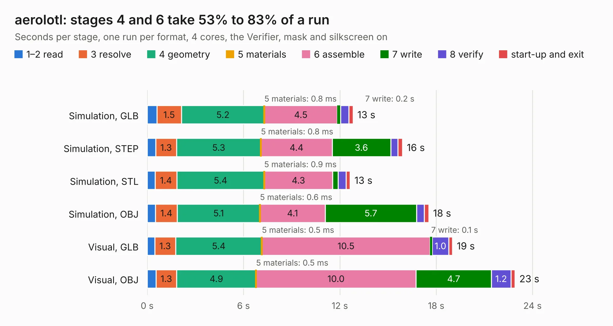

# 2651. aerolotl

Board 2,651 of the 3,123 of [Corpus Testing](../Corpus-Testing.md), on [Corpus Page 25](../CorpusTestingPages/Corpus-Testing-25.md#2651-aerolotl).

| Mode and format | 1–2 read | 3 resolve | 4 geometry | 5 materials | 6 assemble | 7 write | 8 verify | start-up and exit | Total |
|---|---:|---:|---:|---:|---:|---:|---:|---:|---:|
| Simulation, GLB | 0.6 | 1.5 | 5.2 | 0.8&nbsp;ms | 4.5 | 0.2 | 0.5 | 0.3 | 12.8 |
| Simulation, STEP | 0.5 | 1.3 | 5.3 | 0.8&nbsp;ms | 4.4 | 3.6 | 0.5 | 0.3 | 15.9 |
| Simulation, STL | 0.5 | 1.4 | 5.4 | 0.9&nbsp;ms | 4.3 | 0.3 | 0.5 | 0.3 | 12.6 |
| Simulation, OBJ | 0.5 | 1.4 | 5.1 | 0.6&nbsp;ms | 4.1 | 5.7 | 0.5 | 0.3 | 17.5 |
| Visual, GLB | 0.5 | 1.3 | 5.4 | 0.5&nbsp;ms | 10.5 | 0.1 | 1.0 | 0.2 | 19.0 |
| Visual, OBJ | 0.5 | 1.3 | 4.9 | 0.5&nbsp;ms | 10.0 | 4.7 | 1.2 | 0.2 | 22.9 |

<table align="center"><tr><td valign="top">

| Board | Repo: [stanford-ssi/aerolotl_kicad](https://github.com/stanford-ssi/aerolotl_kicad) Board: `aerolotl.kicad_pcb` |
|---|---|
| Complexity | 189&nbsp;/&nbsp;1000 (size&nbsp;129, features&nbsp;60) |
| KESE&nbsp;features | slotted holes, rounded, trapezoid or chamfered pads, curved board outline, stack-up, dielectric εr and tanδ |
| Tested | 9th November 2026 |
| Copper&nbsp;layers | 4 |
| File&nbsp;format | KiCad 10 (20260206) |
| Parts,&nbsp;tracks,&nbsp;vias | 173, 0, 0 |
| Triangles,&nbsp;simulation | 982,128 in 184 parts |
| Note | mostly unrouted |
| Verifier | PASS in all six runs |

</td><td valign="top">

<table>
<tr><th>File type</th><th>File size</th><th>Peak memory used</th></tr>
<tr><th colspan="3" align="left">Simulation</th></tr>
<tr><td>GLB</td><td align="right">34&nbsp;MB</td><td align="right">476&nbsp;MB</td></tr>
<tr><td>STEP</td><td align="right">140&nbsp;MB</td><td align="right">603&nbsp;MB</td></tr>
<tr><td>STL</td><td align="right">49&nbsp;MB</td><td align="right">474&nbsp;MB</td></tr>
<tr><td>OBJ</td><td align="right">103&nbsp;MB</td><td align="right">747&nbsp;MB</td></tr>
<tr><th colspan="3" align="left">Visual</th></tr>
<tr><td>GLB</td><td align="right">28&nbsp;MB</td><td align="right">600&nbsp;MB</td></tr>
<tr><td>OBJ</td><td align="right">84&nbsp;MB</td><td align="right">684&nbsp;MB</td></tr>
</table>

</td></tr></table>

| Previous | Next |
|:---|---:|
| [2650. aerolotl_av](b2650b_aerolotl-av_aerolotl-av.md) | [2652. battery_pcb](b2652b_aerolotl-kicad_battery-pcb.md) |
