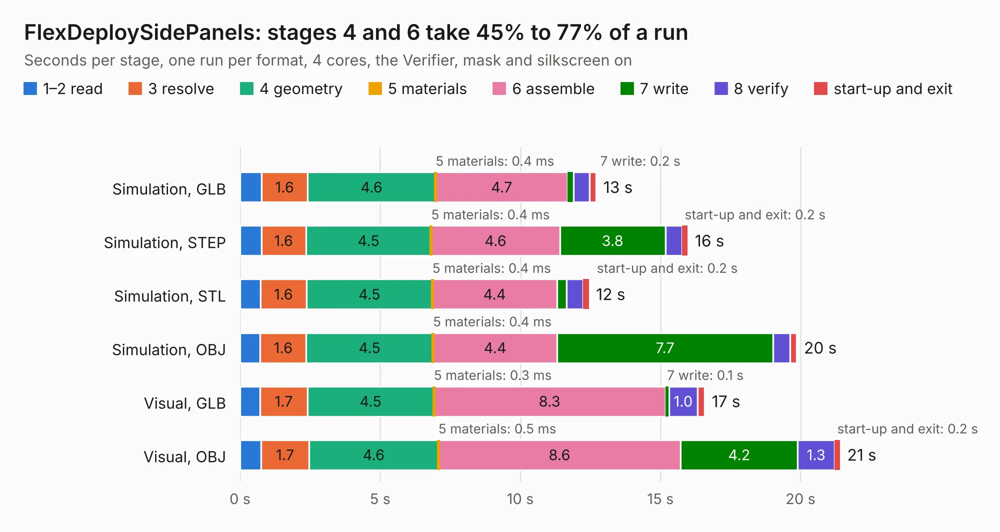

# 2651. FlexDeploySidePanels

Board 2,651 of the 3,116 of [Corpus Testing](../Corpus-Testing.md), on [Corpus Page 25](../CorpusTestingPages/Corpus-Testing-25.md#2651-flexdeploysidepanels).

| Mode and format | 1–2 read | 3 resolve | 4 geometry | 5 materials | 6 assemble | 7 write | 8 verify | start-up and exit | Total |
|---|---:|---:|---:|---:|---:|---:|---:|---:|---:|
| Simulation, GLB | 0.8 | 1.6 | 4.6 | 0.4&nbsp;ms | 4.7 | 0.2 | 0.6 | 0.2 | 12.7 |
| Simulation, STEP | 0.8 | 1.6 | 4.5 | 0.4&nbsp;ms | 4.6 | 3.8 | 0.6 | 0.2 | 16.0 |
| Simulation, STL | 0.7 | 1.6 | 4.5 | 0.4&nbsp;ms | 4.4 | 0.3 | 0.6 | 0.2 | 12.4 |
| Simulation, OBJ | 0.7 | 1.6 | 4.5 | 0.4&nbsp;ms | 4.4 | 7.7 | 0.6 | 0.2 | 19.9 |
| Visual, GLB | 0.7 | 1.7 | 4.5 | 0.3&nbsp;ms | 8.3 | 0.1 | 1.0 | 0.3 | 16.6 |
| Visual, OBJ | 0.8 | 1.7 | 4.6 | 0.5&nbsp;ms | 8.6 | 4.2 | 1.3 | 0.2 | 21.4 |

<table align="center"><tr><td valign="top">

| Board | Repo: [stanford-ssi/samwise-avionics](https://github.com/stanford-ssi/samwise-avionics) Board: `FlexDeploySidePanels.kicad_pcb` |
|---|---|
| Folder | FlexDeploySidePanels |
| Complexity | 291&nbsp;/&nbsp;1000 (size&nbsp;186, features&nbsp;105) |
| KESE&nbsp;features | through vias, rounded, trapezoid or chamfered pads, filled zones, curved board outline, stack-up, dielectric εr and tanδ, copper finish, mask and silkscreen colours |
| Tested | 9th November 2026 |
| Copper&nbsp;layers | 4 |
| File&nbsp;format | KiCad 9 (20241229) |
| Parts,&nbsp;tracks,&nbsp;vias | 127, 367, 23 |
| Triangles,&nbsp;simulation | 1,448,826 in 60 parts |
| Note | panel |
| Verifier | PASS in all six runs |

</td><td valign="top">

<table>
<tr><th>File type</th><th>File size</th><th>Peak memory used</th></tr>
<tr><th colspan="3" align="left">Simulation</th></tr>
<tr><td>GLB</td><td align="right">50&nbsp;MB</td><td align="right">578&nbsp;MB</td></tr>
<tr><td>STEP</td><td align="right">162&nbsp;MB</td><td align="right">648&nbsp;MB</td></tr>
<tr><td>STL</td><td align="right">72&nbsp;MB</td><td align="right">587&nbsp;MB</td></tr>
<tr><td>OBJ</td><td align="right">153&nbsp;MB</td><td align="right">993&nbsp;MB</td></tr>
<tr><th colspan="3" align="left">Visual</th></tr>
<tr><td>GLB</td><td align="right">29&nbsp;MB</td><td align="right">701&nbsp;MB</td></tr>
<tr><td>OBJ</td><td align="right">88&nbsp;MB</td><td align="right">668&nbsp;MB</td></tr>
</table>

</td></tr></table>

| Previous | Next |
|:---|---:|
| [2650. batteryboard](b2650b_samwise-avionics_batteryboard.md) | [2652. Groundstation_2400_Hat](b2652b_samwise-avionics_Groundstation-2400-Hat.md) |
