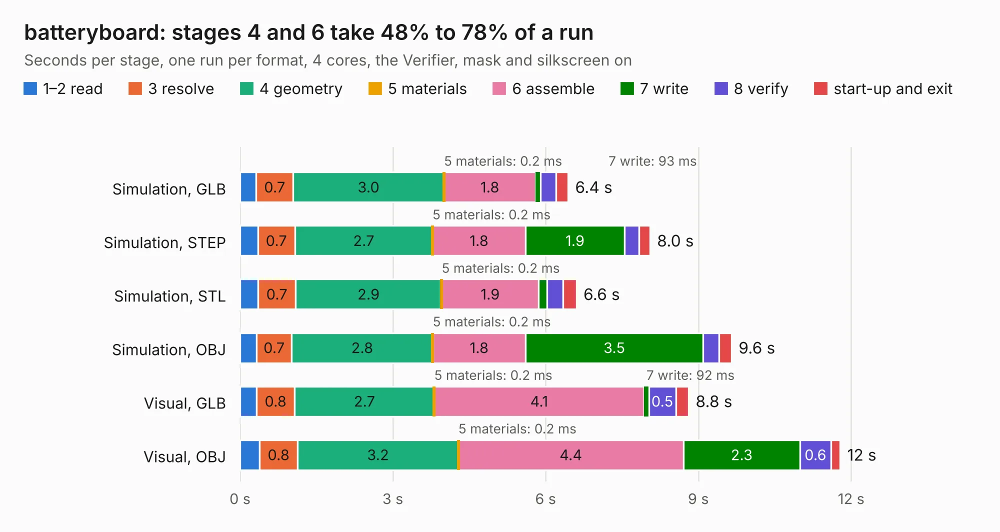

# 2655. batteryboard

Board 2,655 of the 3,121 of [Corpus Testing](../Corpus-Testing.md), on [Corpus Page 25](../CorpusTestingPages/Corpus-Testing-25.md#2655-batteryboard).

| Mode and format | 1–2 read | 3 resolve | 4 geometry | 5 materials | 6 assemble | 7 write | 8 verify | start-up and exit | Total |
|---|---:|---:|---:|---:|---:|---:|---:|---:|---:|
| Simulation, GLB | 0.3 | 0.7 | 3.0 | 0.2&nbsp;ms | 1.8 | 93&nbsp;ms | 0.3 | 0.2 | 6.4 |
| Simulation, STEP | 0.3 | 0.7 | 2.7 | 0.2&nbsp;ms | 1.8 | 1.9 | 0.3 | 0.2 | 8.0 |
| Simulation, STL | 0.4 | 0.7 | 2.9 | 0.2&nbsp;ms | 1.9 | 0.2 | 0.3 | 0.3 | 6.6 |
| Simulation, OBJ | 0.3 | 0.7 | 2.8 | 0.2&nbsp;ms | 1.8 | 3.5 | 0.3 | 0.2 | 9.6 |
| Visual, GLB | 0.3 | 0.8 | 2.7 | 0.2&nbsp;ms | 4.1 | 92&nbsp;ms | 0.5 | 0.2 | 8.8 |
| Visual, OBJ | 0.4 | 0.8 | 3.2 | 0.2&nbsp;ms | 4.4 | 2.3 | 0.6 | 0.2 | 11.8 |

<table align="center"><tr><td valign="top">

| Board | Repo: [stanford-ssi/samwise-avionics](https://github.com/stanford-ssi/samwise-avionics) Board: `batteryboard.kicad_pcb` |
|---|---|
| Folder | BatteryBoard / batteryboard-v02.3 |
| Complexity | 270&nbsp;/&nbsp;1000 (size&nbsp;180, features&nbsp;90) |
| KESE&nbsp;features | through vias, rounded, trapezoid or chamfered pads, filled zones, curved board outline, stack-up, dielectric εr and tanδ, mask and silkscreen colours |
| Tested | 9th November 2026 |
| Copper&nbsp;layers | 4 |
| File&nbsp;format | KiCad 9 (20241229) |
| Parts,&nbsp;tracks,&nbsp;vias | 30, 596, 61 |
| Triangles,&nbsp;simulation | 635,618 in 36 parts |
| Verifier | PASS in all six runs |

</td><td valign="top">

<table>
<tr><th>File type</th><th>File size</th><th>Peak memory used</th></tr>
<tr><th colspan="3" align="left">Simulation</th></tr>
<tr><td>GLB</td><td align="right">23&nbsp;MB</td><td align="right">369&nbsp;MB</td></tr>
<tr><td>STEP</td><td align="right">109&nbsp;MB</td><td align="right">391&nbsp;MB</td></tr>
<tr><td>STL</td><td align="right">32&nbsp;MB</td><td align="right">368&nbsp;MB</td></tr>
<tr><td>OBJ</td><td align="right">66&nbsp;MB</td><td align="right">497&nbsp;MB</td></tr>
<tr><th colspan="3" align="left">Visual</th></tr>
<tr><td>GLB</td><td align="right">15&nbsp;MB</td><td align="right">392&nbsp;MB</td></tr>
<tr><td>OBJ</td><td align="right">45&nbsp;MB</td><td align="right">407&nbsp;MB</td></tr>
</table>

</td></tr></table>

| Previous | Next |
|:---|---:|
| [2654. ADCS_board](b2654b_samwise-avionics_ADCS-board.md) | [2656. FlexDeploySidePanels](b2656b_samwise-avionics_FlexDeploySidePanels.md) |
