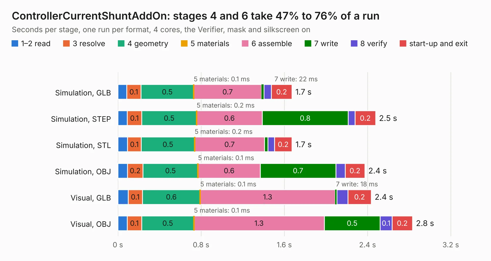

# 2657. ControllerCurrentShuntAddOn

Board 2,657 of the 3,101 of [Corpus Testing](../Corpus-Testing.md), on [Corpus Page 25](../CorpusTestingPages/Corpus-Testing-25.md#2657-controllercurrentshuntaddon).

| Mode and format | 1–2 read | 3 resolve | 4 geometry | 5 materials | 6 assemble | 7 write | 8 verify | start-up and exit | Total |
|---|---:|---:|---:|---:|---:|---:|---:|---:|---:|
| Simulation, GLB | 85&nbsp;ms | 0.1 | 0.5 | 0.1&nbsp;ms | 0.7 | 22&nbsp;ms | 72&nbsp;ms | 0.2 | 1.7 |
| Simulation, STEP | 89&nbsp;ms | 0.1 | 0.5 | 0.2&nbsp;ms | 0.6 | 0.8 | 66&nbsp;ms | 0.2 | 2.5 |
| Simulation, STL | 92&nbsp;ms | 0.1 | 0.5 | 0.2&nbsp;ms | 0.7 | 33&nbsp;ms | 62&nbsp;ms | 0.2 | 1.7 |
| Simulation, OBJ | 91&nbsp;ms | 0.2 | 0.5 | 0.1&nbsp;ms | 0.6 | 0.7 | 89&nbsp;ms | 0.2 | 2.4 |
| Visual, GLB | 98&nbsp;ms | 0.1 | 0.6 | 0.1&nbsp;ms | 1.3 | 18&nbsp;ms | 0.1 | 0.2 | 2.4 |
| Visual, OBJ | 90&nbsp;ms | 0.1 | 0.5 | 0.1&nbsp;ms | 1.3 | 0.5 | 0.1 | 0.2 | 2.8 |

<table align="center"><tr><td valign="top">

| Board | Repo: [stuartpittaway/diybmsv4](https://github.com/stuartpittaway/diybmsv4) Board: `ControllerCurrentShuntAddOn.kicad_pcb` |
|---|---|
| Folder | ControllerCurrentShuntAddOn |
| Complexity | 186&nbsp;/&nbsp;1000 (size&nbsp;121, features&nbsp;65) |
| KESE&nbsp;features | through vias, rounded, trapezoid or chamfered pads, drill offsets, filled zones, curved board outline |
| Tested | 9th November 2026 |
| Copper&nbsp;layers | 2 |
| File&nbsp;format | KiCad 5 (20171130) |
| Parts,&nbsp;tracks,&nbsp;vias | 9, 72, 17 |
| Triangles,&nbsp;simulation | 134,582 in 23 parts |
| Verifier | PASS in all six runs |

</td><td valign="top">

<table>
<tr><th>File type</th><th>File size</th><th>Peak memory used</th></tr>
<tr><th colspan="3" align="left">Simulation</th></tr>
<tr><td>GLB</td><td align="right">4.8&nbsp;MB</td><td align="right">192&nbsp;MB</td></tr>
<tr><td>STEP</td><td align="right">22&nbsp;MB</td><td align="right">209&nbsp;MB</td></tr>
<tr><td>STL</td><td align="right">6.7&nbsp;MB</td><td align="right">190&nbsp;MB</td></tr>
<tr><td>OBJ</td><td align="right">13&nbsp;MB</td><td align="right">195&nbsp;MB</td></tr>
<tr><th colspan="3" align="left">Visual</th></tr>
<tr><td>GLB</td><td align="right">3.9&nbsp;MB</td><td align="right">170&nbsp;MB</td></tr>
<tr><td>OBJ</td><td align="right">11&nbsp;MB</td><td align="right">169&nbsp;MB</td></tr>
</table>

</td></tr></table>

| Previous | Next |
|:---|---:|
| [2656. ControllerCircuit](b2656b_diybmsv4_ControllerCircuit.md) | [2658. ESP8266ControllerCircuit](b2658b_diybmsv4_ESP8266ControllerCircuit.md) |
