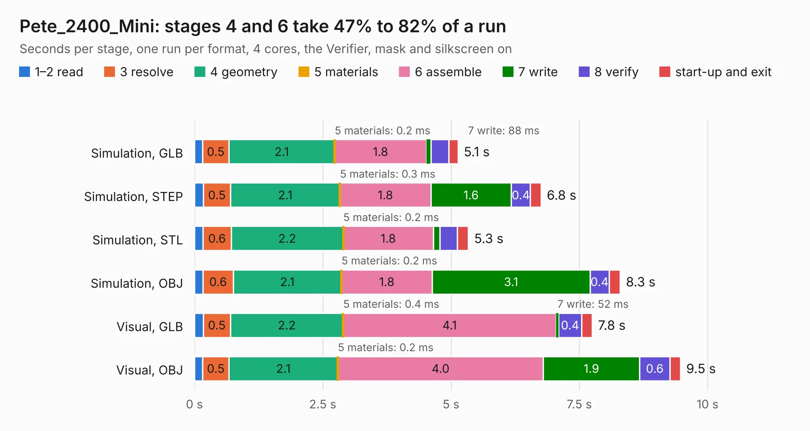

# 2660. Pete_2400_Mini

Board 2,660 of the 3,112 of [Corpus Testing](../Corpus-Testing.md), on [Corpus Page 25](../CorpusTestingPages/Corpus-Testing-25.md#2660-pete_2400_mini).

| Mode and format | 1–2 read | 3 resolve | 4 geometry | 5 materials | 6 assemble | 7 write | 8 verify | start-up and exit | Total |
|---|---:|---:|---:|---:|---:|---:|---:|---:|---:|
| Simulation, GLB | 0.2 | 0.5 | 2.1 | 0.2&nbsp;ms | 1.8 | 88&nbsp;ms | 0.3 | 0.2 | 5.1 |
| Simulation, STEP | 0.2 | 0.5 | 2.1 | 0.3&nbsp;ms | 1.8 | 1.6 | 0.4 | 0.2 | 6.8 |
| Simulation, STL | 0.2 | 0.6 | 2.2 | 0.2&nbsp;ms | 1.8 | 0.1 | 0.3 | 0.2 | 5.3 |
| Simulation, OBJ | 0.2 | 0.6 | 2.1 | 0.2&nbsp;ms | 1.8 | 3.1 | 0.4 | 0.2 | 8.3 |
| Visual, GLB | 0.2 | 0.5 | 2.2 | 0.4&nbsp;ms | 4.1 | 52&nbsp;ms | 0.4 | 0.2 | 7.8 |
| Visual, OBJ | 0.2 | 0.5 | 2.1 | 0.2&nbsp;ms | 4.0 | 1.9 | 0.6 | 0.2 | 9.5 |

<table align="center"><tr><td valign="top">

| Board | Repo: [stanford-ssi/samwise-avionics](https://github.com/stanford-ssi/samwise-avionics) Board: `Pete_2400_Mini.kicad_pcb` |
|---|---|
| Folder | unused_boards / Pete_2400_Mini |
| Complexity | 261&nbsp;/&nbsp;1000 (size&nbsp;151, features&nbsp;110) |
| KESE&nbsp;features | through vias, custom pads, rounded, trapezoid or chamfered pads, filled zones, copper drawings, curved board outline, stack-up, dielectric εr and tanδ |
| Tested | 9th November 2026 |
| Copper&nbsp;layers | 4 |
| File&nbsp;format | KiCad 8 (20240108) |
| Parts,&nbsp;tracks,&nbsp;vias | 12, 130, 35 |
| Triangles,&nbsp;simulation | 612,166 in 52 parts |
| Verifier | PASS in all six runs |

</td><td valign="top">

<table>
<tr><th>File type</th><th>File size</th><th>Peak memory used</th></tr>
<tr><th colspan="3" align="left">Simulation</th></tr>
<tr><td>GLB</td><td align="right">21&nbsp;MB</td><td align="right">324&nbsp;MB</td></tr>
<tr><td>STEP</td><td align="right">79&nbsp;MB</td><td align="right">341&nbsp;MB</td></tr>
<tr><td>STL</td><td align="right">31&nbsp;MB</td><td align="right">313&nbsp;MB</td></tr>
<tr><td>OBJ</td><td align="right">63&nbsp;MB</td><td align="right">447&nbsp;MB</td></tr>
<tr><th colspan="3" align="left">Visual</th></tr>
<tr><td>GLB</td><td align="right">13&nbsp;MB</td><td align="right">355&nbsp;MB</td></tr>
<tr><td>OBJ</td><td align="right">37&nbsp;MB</td><td align="right">358&nbsp;MB</td></tr>
</table>

</td></tr></table>

| Previous | Next |
|:---|---:|
| [2659. FeatherRadioAdapter](b2659b_samwise-avionics_FeatherRadioAdapter.md) | [2661. reaction_wheel](b2661b_samwise-avionics_reaction-wheel.md) |
