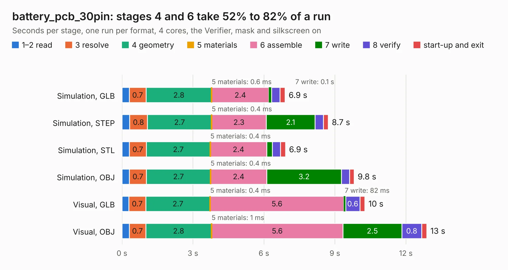

# 2661. battery_pcb_30pin

Board 2,661 of the 3,132 of [Corpus Testing](../Corpus-Testing.md), on [Corpus Page 25](../CorpusTestingPages/Corpus-Testing-25.md#2661-battery_pcb_30pin).

| Mode and format | 1–2 read | 3 resolve | 4 geometry | 5 materials | 6 assemble | 7 write | 8 verify | start-up and exit | Total |
|---|---:|---:|---:|---:|---:|---:|---:|---:|---:|
| Simulation, GLB | 0.3 | 0.7 | 2.8 | 0.6&nbsp;ms | 2.4 | 0.1 | 0.4 | 0.2 | 6.9 |
| Simulation, STEP | 0.3 | 0.8 | 2.7 | 0.4&nbsp;ms | 2.3 | 2.1 | 0.3 | 0.2 | 8.7 |
| Simulation, STL | 0.3 | 0.7 | 2.7 | 0.4&nbsp;ms | 2.4 | 0.2 | 0.3 | 0.2 | 6.9 |
| Simulation, OBJ | 0.3 | 0.7 | 2.7 | 0.4&nbsp;ms | 2.4 | 3.2 | 0.3 | 0.2 | 9.8 |
| Visual, GLB | 0.3 | 0.7 | 2.7 | 0.4&nbsp;ms | 5.6 | 82&nbsp;ms | 0.6 | 0.2 | 10.3 |
| Visual, OBJ | 0.3 | 0.7 | 2.8 | 1&nbsp;ms | 5.6 | 2.5 | 0.8 | 0.2 | 12.9 |

<table align="center"><tr><td valign="top">

| Board | Repo: [stanford-ssi/aerolotl_kicad](https://github.com/stanford-ssi/aerolotl_kicad) Board: `battery_pcb_30pin.kicad_pcb` |
|---|---|
| Folder | BatteryPCB_30pin |
| Complexity | 240&nbsp;/&nbsp;1000 (size&nbsp;160, features&nbsp;80) |
| KESE&nbsp;features | through vias, custom pads, rounded, trapezoid or chamfered pads, filled zones, copper drawings, curved board outline |
| Tested | 9th November 2026 |
| Copper&nbsp;layers | 2 |
| File&nbsp;format | KiCad 10 (20260206) |
| Parts,&nbsp;tracks,&nbsp;vias | 42, 153, 122 |
| Triangles,&nbsp;simulation | 788,398 in 60 parts |
| Verifier | PASS in all six runs |

</td><td valign="top">

<table>
<tr><th>File type</th><th>File size</th><th>Peak memory used</th></tr>
<tr><th colspan="3" align="left">Simulation</th></tr>
<tr><td>GLB</td><td align="right">27&nbsp;MB</td><td align="right">389&nbsp;MB</td></tr>
<tr><td>STEP</td><td align="right">127&nbsp;MB</td><td align="right">464&nbsp;MB</td></tr>
<tr><td>STL</td><td align="right">39&nbsp;MB</td><td align="right">397&nbsp;MB</td></tr>
<tr><td>OBJ</td><td align="right">80&nbsp;MB</td><td align="right">580&nbsp;MB</td></tr>
<tr><th colspan="3" align="left">Visual</th></tr>
<tr><td>GLB</td><td align="right">21&nbsp;MB</td><td align="right">485&nbsp;MB</td></tr>
<tr><td>OBJ</td><td align="right">63&nbsp;MB</td><td align="right">489&nbsp;MB</td></tr>
</table>

</td></tr></table>

| Previous | Next |
|:---|---:|
| [2660. battery_pcb](b2660b_aerolotl-kicad_battery-pcb.md) | [2662. seed_user_1224](b2662b_aerolotl-kicad_seed-user-1224.md) |
