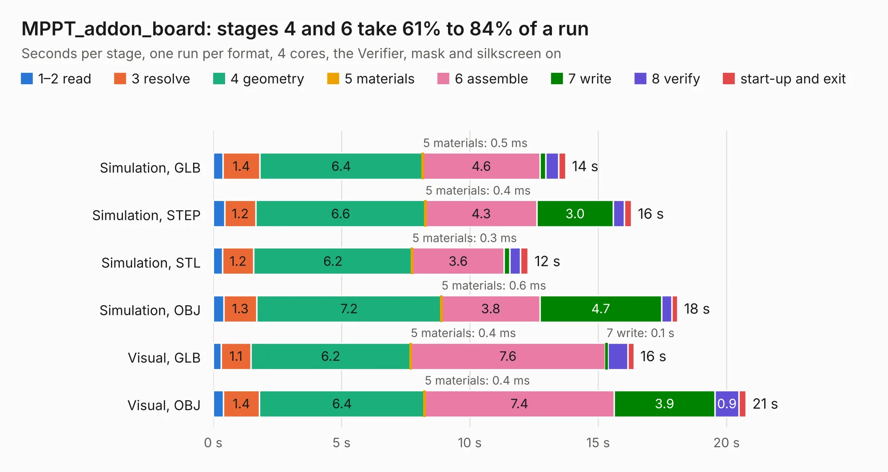

# 2662. MPPT_addon_board

Board 2,662 of the 3,122 of [Corpus Testing](../Corpus-Testing.md), on [Corpus Page 25](../CorpusTestingPages/Corpus-Testing-25.md#2662-mppt_addon_board).

| Mode and format | 1–2 read | 3 resolve | 4 geometry | 5 materials | 6 assemble | 7 write | 8 verify | start-up and exit | Total |
|---|---:|---:|---:|---:|---:|---:|---:|---:|---:|
| Simulation, GLB | 0.4 | 1.4 | 6.4 | 0.5&nbsp;ms | 4.6 | 0.2 | 0.5 | 0.3 | 13.7 |
| Simulation, STEP | 0.4 | 1.2 | 6.6 | 0.4&nbsp;ms | 4.3 | 3.0 | 0.4 | 0.3 | 16.3 |
| Simulation, STL | 0.4 | 1.2 | 6.2 | 0.3&nbsp;ms | 3.6 | 0.2 | 0.4 | 0.3 | 12.3 |
| Simulation, OBJ | 0.4 | 1.3 | 7.2 | 0.6&nbsp;ms | 3.8 | 4.7 | 0.4 | 0.2 | 18.1 |
| Visual, GLB | 0.3 | 1.1 | 6.2 | 0.4&nbsp;ms | 7.6 | 0.1 | 0.8 | 0.2 | 16.4 |
| Visual, OBJ | 0.4 | 1.4 | 6.4 | 0.4&nbsp;ms | 7.4 | 3.9 | 0.9 | 0.3 | 20.8 |

<table align="center"><tr><td valign="top">

| Board | Repo: [stanford-ssi/samwise-avionics](https://github.com/stanford-ssi/samwise-avionics) Board: `MPPT_addon_board.kicad_pcb` |
|---|---|
| Folder | PiCubed / MPPT_addon_board |
| Complexity | 257&nbsp;/&nbsp;1000 (size&nbsp;167, features&nbsp;90) |
| KESE&nbsp;features | through vias, rounded, trapezoid or chamfered pads, filled zones, curved board outline, stack-up, dielectric εr and tanδ, mask and silkscreen colours |
| Tested | 9th November 2026 |
| Copper&nbsp;layers | 2 |
| File&nbsp;format | KiCad 9 (20241229) |
| Parts,&nbsp;tracks,&nbsp;vias | 48, 433, 105 |
| Triangles,&nbsp;simulation | 739,358 in 61 parts |
| Verifier | PASS in all six runs |

</td><td valign="top">

<table>
<tr><th>File type</th><th>File size</th><th>Peak memory used</th></tr>
<tr><th colspan="3" align="left">Simulation</th></tr>
<tr><td>GLB</td><td align="right">27&nbsp;MB</td><td align="right">417&nbsp;MB</td></tr>
<tr><td>STEP</td><td align="right">145&nbsp;MB</td><td align="right">494&nbsp;MB</td></tr>
<tr><td>STL</td><td align="right">37&nbsp;MB</td><td align="right">420&nbsp;MB</td></tr>
<tr><td>OBJ</td><td align="right">78&nbsp;MB</td><td align="right">560&nbsp;MB</td></tr>
<tr><th colspan="3" align="left">Visual</th></tr>
<tr><td>GLB</td><td align="right">22&nbsp;MB</td><td align="right">509&nbsp;MB</td></tr>
<tr><td>OBJ</td><td align="right">64&nbsp;MB</td><td align="right">510&nbsp;MB</td></tr>
</table>

</td></tr></table>

| Previous | Next |
|:---|---:|
| [2661. magnetometer_extern](b2661b_samwise-avionics_magnetometer-extern.md) | [2663. picubed_samwise](b2663b_samwise-avionics_picubed-samwise.md) |
