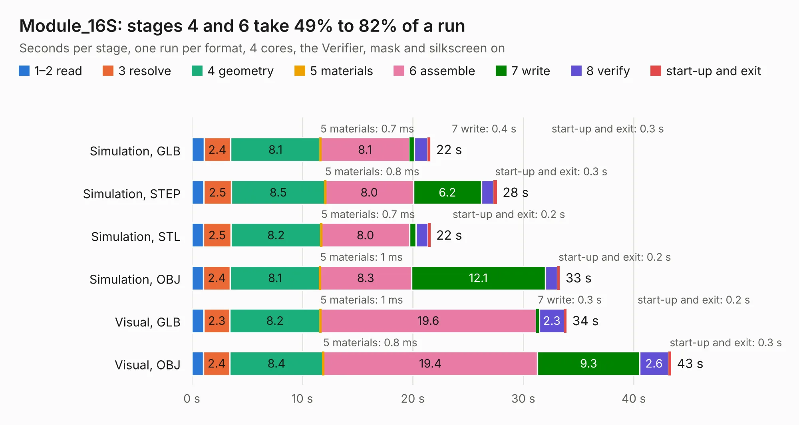

# 2663. Module_16S

Board 2,663 of the 3,101 of [Corpus Testing](../Corpus-Testing.md), on [Corpus Page 25](../CorpusTestingPages/Corpus-Testing-25.md#2663-module_16s).

| Mode and format | 1–2 read | 3 resolve | 4 geometry | 5 materials | 6 assemble | 7 write | 8 verify | start-up and exit | Total |
|---|---:|---:|---:|---:|---:|---:|---:|---:|---:|
| Simulation, GLB | 1.1 | 2.4 | 8.1 | 0.7&nbsp;ms | 8.1 | 0.4 | 1.2 | 0.3 | 21.6 |
| Simulation, STEP | 1.1 | 2.5 | 8.5 | 0.8&nbsp;ms | 8.0 | 6.2 | 1.1 | 0.3 | 27.6 |
| Simulation, STL | 1.0 | 2.5 | 8.2 | 0.7&nbsp;ms | 8.0 | 0.6 | 1.1 | 0.2 | 21.6 |
| Simulation, OBJ | 1.0 | 2.4 | 8.1 | 1&nbsp;ms | 8.3 | 12.1 | 1.1 | 0.2 | 33.3 |
| Visual, GLB | 1.1 | 2.3 | 8.2 | 1&nbsp;ms | 19.6 | 0.3 | 2.3 | 0.2 | 33.9 |
| Visual, OBJ | 1.1 | 2.4 | 8.4 | 0.8&nbsp;ms | 19.4 | 9.3 | 2.6 | 0.3 | 43.4 |

<table align="center"><tr><td valign="top">

| Board | Repo: [stuartpittaway/diybmsv4](https://github.com/stuartpittaway/diybmsv4) Board: `Module_16S.kicad_pcb` |
|---|---|
| Folder | ModuleV490-AllInOne |
| Complexity | 371&nbsp;/&nbsp;1000 (size&nbsp;256, features&nbsp;115) |
| KESE&nbsp;features | through vias, rounded, trapezoid or chamfered pads, filled zones, curved board outline, TrueType text, stack-up, dielectric εr and tanδ, copper finish |
| Tested | 9th November 2026 |
| Copper&nbsp;layers | 4 |
| File&nbsp;format | KiCad 7 (20221018) |
| Parts,&nbsp;tracks,&nbsp;vias | 113, 1,167, 289 |
| Triangles,&nbsp;simulation | 2,358,828 in 154 parts |
| Verifier | PASS in all six runs |

</td><td valign="top">

<table>
<tr><th>File type</th><th>File size</th><th>Peak memory used</th></tr>
<tr><th colspan="3" align="left">Simulation</th></tr>
<tr><td>GLB</td><td align="right">82&nbsp;MB</td><td align="right">753&nbsp;MB</td></tr>
<tr><td>STEP</td><td align="right">320&nbsp;MB</td><td align="right">984&nbsp;MB</td></tr>
<tr><td>STL</td><td align="right">118&nbsp;MB</td><td align="right">770&nbsp;MB</td></tr>
<tr><td>OBJ</td><td align="right">249&nbsp;MB</td><td align="right">1.6&nbsp;GB</td></tr>
<tr><th colspan="3" align="left">Visual</th></tr>
<tr><td>GLB</td><td align="right">59&nbsp;MB</td><td align="right">1.0&nbsp;GB</td></tr>
<tr><td>OBJ</td><td align="right">181&nbsp;MB</td><td align="right">1.3&nbsp;GB</td></tr>
</table>

</td></tr></table>

| Previous | Next |
|:---|---:|
| [2662. ModuleV450](b2662b_diybmsv4_ModuleV450.md) | [2664. Module_16S_PassiveBalanceAddOn](b2664b_diybmsv4_Module-16S-PassiveBalanceAddOn.md) |
