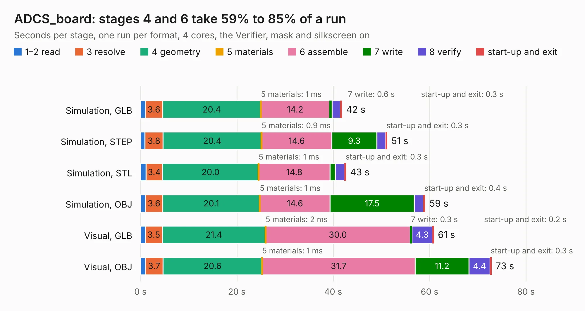

# 2664. ADCS_board

Board 2,664 of the 3,132 of [Corpus Testing](../Corpus-Testing.md), on [Corpus Page 25](../CorpusTestingPages/Corpus-Testing-25.md#2664-adcs_board).

| Mode and format | 1–2 read | 3 resolve | 4 geometry | 5 materials | 6 assemble | 7 write | 8 verify | start-up and exit | Total |
|---|---:|---:|---:|---:|---:|---:|---:|---:|---:|
| Simulation, GLB | 1.0 | 3.6 | 20.4 | 1&nbsp;ms | 14.2 | 0.6 | 1.7 | 0.3 | 41.8 |
| Simulation, STEP | 0.9 | 3.8 | 20.4 | 0.9&nbsp;ms | 14.6 | 9.3 | 1.9 | 0.3 | 51.2 |
| Simulation, STL | 1.1 | 3.4 | 20.0 | 1&nbsp;ms | 14.8 | 1.1 | 1.9 | 0.3 | 42.6 |
| Simulation, OBJ | 1.0 | 3.6 | 20.1 | 1&nbsp;ms | 14.6 | 17.5 | 1.9 | 0.4 | 59.1 |
| Visual, GLB | 1.0 | 3.5 | 21.4 | 2&nbsp;ms | 30.0 | 0.3 | 4.3 | 0.2 | 60.9 |
| Visual, OBJ | 1.0 | 3.7 | 20.6 | 1&nbsp;ms | 31.7 | 11.2 | 4.4 | 0.3 | 72.8 |

<table align="center"><tr><td valign="top">

| Board | Repo: [stanford-ssi/samwise-avionics](https://github.com/stanford-ssi/samwise-avionics) Board: `ADCS_board.kicad_pcb` |
|---|---|
| Folder | ADCS / ADCS-v1-samwise |
| Complexity | 393&nbsp;/&nbsp;1000 (size&nbsp;268, features&nbsp;125) |
| KESE&nbsp;features | through vias, slotted holes, custom pads, rounded, trapezoid or chamfered pads, filled zones, copper drawings, curved board outline, stack-up, dielectric εr and tanδ, mask and silkscreen colours |
| Tested | 9th November 2026 |
| Copper&nbsp;layers | 4 |
| File&nbsp;format | KiCad 9 (20241229) |
| Parts,&nbsp;tracks,&nbsp;vias | 188, 1,511, 471 |
| Triangles,&nbsp;simulation | 3,615,090 in 210 parts |
| Verifier | PASS in all six runs |

</td><td valign="top">

<table>
<tr><th>File type</th><th>File size</th><th>Peak memory used</th></tr>
<tr><th colspan="3" align="left">Simulation</th></tr>
<tr><td>GLB</td><td align="right">128&nbsp;MB</td><td align="right">1.2&nbsp;GB</td></tr>
<tr><td>STEP</td><td align="right">600&nbsp;MB</td><td align="right">1.5&nbsp;GB</td></tr>
<tr><td>STL</td><td align="right">181&nbsp;MB</td><td align="right">1.2&nbsp;GB</td></tr>
<tr><td>OBJ</td><td align="right">397&nbsp;MB</td><td align="right">2.5&nbsp;GB</td></tr>
<tr><th colspan="3" align="left">Visual</th></tr>
<tr><td>GLB</td><td align="right">83&nbsp;MB</td><td align="right">1.4&nbsp;GB</td></tr>
<tr><td>OBJ</td><td align="right">263&nbsp;MB</td><td align="right">1.8&nbsp;GB</td></tr>
</table>

</td></tr></table>

| Previous | Next |
|:---|---:|
| [2663. motor_board](b2663b_samwise-avionics_motor-board.md) | [2665. batteryboard](b2665b_samwise-avionics_batteryboard.md) |
