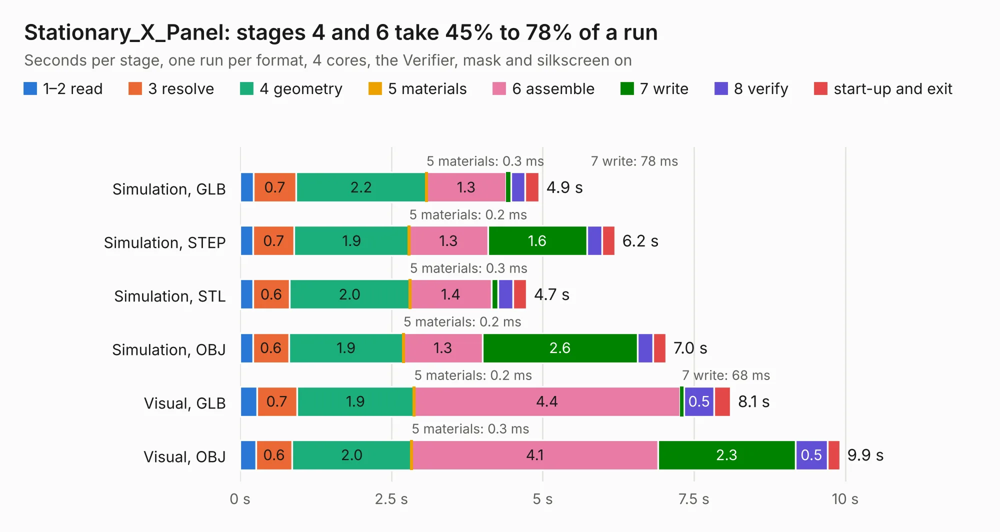

# 2664. Stationary_X_Panel

Board 2,664 of the 3,121 of [Corpus Testing](../Corpus-Testing.md), on [Corpus Page 25](../CorpusTestingPages/Corpus-Testing-25.md#2664-stationary_x_panel).

| Mode and format | 1–2 read | 3 resolve | 4 geometry | 5 materials | 6 assemble | 7 write | 8 verify | start-up and exit | Total |
|---|---:|---:|---:|---:|---:|---:|---:|---:|---:|
| Simulation, GLB | 0.2 | 0.7 | 2.2 | 0.3&nbsp;ms | 1.3 | 78&nbsp;ms | 0.2 | 0.2 | 4.9 |
| Simulation, STEP | 0.2 | 0.7 | 1.9 | 0.2&nbsp;ms | 1.3 | 1.6 | 0.3 | 0.2 | 6.2 |
| Simulation, STL | 0.2 | 0.6 | 2.0 | 0.3&nbsp;ms | 1.4 | 0.1 | 0.2 | 0.2 | 4.7 |
| Simulation, OBJ | 0.2 | 0.6 | 1.9 | 0.2&nbsp;ms | 1.3 | 2.6 | 0.3 | 0.2 | 7.0 |
| Visual, GLB | 0.3 | 0.7 | 1.9 | 0.2&nbsp;ms | 4.4 | 68&nbsp;ms | 0.5 | 0.3 | 8.1 |
| Visual, OBJ | 0.3 | 0.6 | 2.0 | 0.3&nbsp;ms | 4.1 | 2.3 | 0.5 | 0.2 | 9.9 |

<table align="center"><tr><td valign="top">

| Board | Repo: [stanford-ssi/samwise-avionics](https://github.com/stanford-ssi/samwise-avionics) Board: `Stationary_X_Panel.kicad_pcb` |
|---|---|
| Folder | Stationary_X_Panel |
| Complexity | 245&nbsp;/&nbsp;1000 (size&nbsp;150, features&nbsp;95) |
| KESE&nbsp;features | through vias, filled zones, curved board outline, knockout text, stack-up, dielectric εr and tanδ, mask and silkscreen colours |
| Tested | 9th November 2026 |
| Copper&nbsp;layers | 2 |
| File&nbsp;format | KiCad 9 (20241229) |
| Parts,&nbsp;tracks,&nbsp;vias | 41, 239, 16 |
| Triangles,&nbsp;simulation | 439,218 in 38 parts |
| Note | panel |
| Verifier | PASS in all six runs |

</td><td valign="top">

<table>
<tr><th>File type</th><th>File size</th><th>Peak memory used</th></tr>
<tr><th colspan="3" align="left">Simulation</th></tr>
<tr><td>GLB</td><td align="right">15&nbsp;MB</td><td align="right">287&nbsp;MB</td></tr>
<tr><td>STEP</td><td align="right">66&nbsp;MB</td><td align="right">328&nbsp;MB</td></tr>
<tr><td>STL</td><td align="right">22&nbsp;MB</td><td align="right">291&nbsp;MB</td></tr>
<tr><td>OBJ</td><td align="right">45&nbsp;MB</td><td align="right">333&nbsp;MB</td></tr>
<tr><th colspan="3" align="left">Visual</th></tr>
<tr><td>GLB</td><td align="right">13&nbsp;MB</td><td align="right">358&nbsp;MB</td></tr>
<tr><td>OBJ</td><td align="right">39&nbsp;MB</td><td align="right">360&nbsp;MB</td></tr>
</table>

</td></tr></table>

| Previous | Next |
|:---|---:|
| [2663. RPi_interface](b2663b_samwise-avionics_RPi-interface.md) | [2665. Piramide_Del_Sol](b2665b_samwise-avionics_Piramide-Del-Sol.md) |
