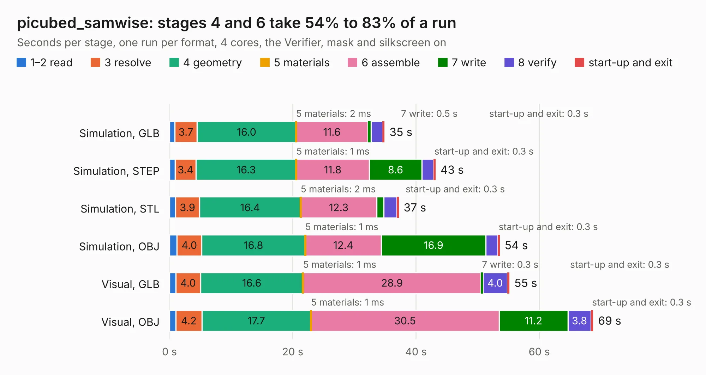

# 2664. picubed_samwise

Board 2,664 of the 3,123 of [Corpus Testing](../Corpus-Testing.md), on [Corpus Page 25](../CorpusTestingPages/Corpus-Testing-25.md#2664-picubed_samwise).

| Mode and format | 1–2 read | 3 resolve | 4 geometry | 5 materials | 6 assemble | 7 write | 8 verify | start-up and exit | Total |
|---|---:|---:|---:|---:|---:|---:|---:|---:|---:|
| Simulation, GLB | 0.8 | 3.7 | 16.0 | 2&nbsp;ms | 11.6 | 0.5 | 1.9 | 0.3 | 34.9 |
| Simulation, STEP | 0.9 | 3.4 | 16.3 | 1&nbsp;ms | 11.8 | 8.6 | 1.9 | 0.3 | 43.1 |
| Simulation, STL | 1.0 | 3.9 | 16.4 | 2&nbsp;ms | 12.3 | 1.1 | 2.1 | 0.3 | 37.2 |
| Simulation, OBJ | 1.2 | 4.0 | 16.8 | 1&nbsp;ms | 12.4 | 16.9 | 1.9 | 0.3 | 53.6 |
| Visual, GLB | 1.0 | 4.0 | 16.6 | 1&nbsp;ms | 28.9 | 0.3 | 4.0 | 0.3 | 55.1 |
| Visual, OBJ | 1.0 | 4.2 | 17.7 | 1&nbsp;ms | 30.5 | 11.2 | 3.8 | 0.3 | 68.7 |

<table align="center"><tr><td valign="top">

| Board | Repo: [stanford-ssi/samwise-avionics](https://github.com/stanford-ssi/samwise-avionics) Board: `picubed_samwise.kicad_pcb` |
|---|---|
| Folder | PiCubed / picubed_samwise |
| Complexity | 380&nbsp;/&nbsp;1000 (size&nbsp;255, features&nbsp;125) |
| KESE&nbsp;features | through vias, slotted holes, custom pads, rounded, trapezoid or chamfered pads, filled zones, copper drawings, curved board outline, stack-up, dielectric εr and tanδ, mask and silkscreen colours |
| Tested | 9th November 2026 |
| Copper&nbsp;layers | 4 |
| File&nbsp;format | KiCad 9 (20241229) |
| Parts,&nbsp;tracks,&nbsp;vias | 179, 1,266, 289 |
| Triangles,&nbsp;simulation | 3,389,692 in 178 parts |
| Verifier | PASS in all six runs |

</td><td valign="top">

<table>
<tr><th>File type</th><th>File size</th><th>Peak memory used</th></tr>
<tr><th colspan="3" align="left">Simulation</th></tr>
<tr><td>GLB</td><td align="right">119&nbsp;MB</td><td align="right">1.0&nbsp;GB</td></tr>
<tr><td>STEP</td><td align="right">579&nbsp;MB</td><td align="right">1.3&nbsp;GB</td></tr>
<tr><td>STL</td><td align="right">169&nbsp;MB</td><td align="right">1.0&nbsp;GB</td></tr>
<tr><td>OBJ</td><td align="right">371&nbsp;MB</td><td align="right">2.3&nbsp;GB</td></tr>
<tr><th colspan="3" align="left">Visual</th></tr>
<tr><td>GLB</td><td align="right">73&nbsp;MB</td><td align="right">1.3&nbsp;GB</td></tr>
<tr><td>OBJ</td><td align="right">231&nbsp;MB</td><td align="right">1.5&nbsp;GB</td></tr>
</table>

</td></tr></table>

| Previous | Next |
|:---|---:|
| [2663. MPPT_addon_board](b2663b_samwise-avionics_MPPT-addon-board.md) | [2665. RPi_interface](b2665b_samwise-avionics_RPi-interface.md) |
