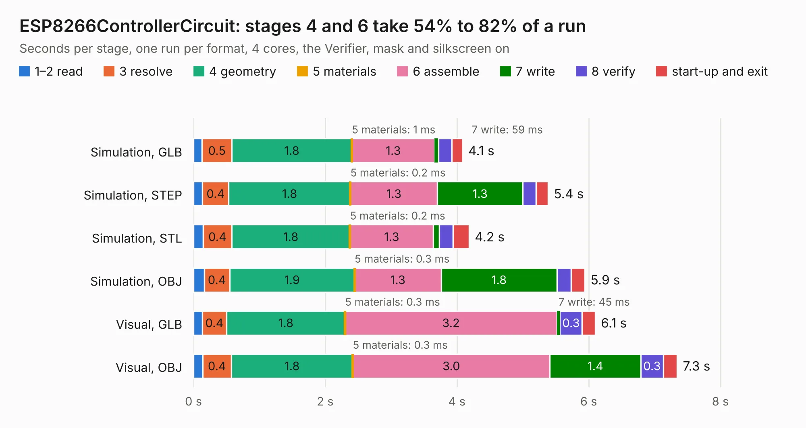

# 2666. ESP8266ControllerCircuit

Board 2,666 of the 3,109 of [Corpus Testing](../Corpus-Testing.md), on [Corpus Page 25](../CorpusTestingPages/Corpus-Testing-25.md#2666-esp8266controllercircuit).

| Mode and format | 1–2 read | 3 resolve | 4 geometry | 5 materials | 6 assemble | 7 write | 8 verify | start-up and exit | Total |
|---|---:|---:|---:|---:|---:|---:|---:|---:|---:|
| Simulation, GLB | 0.1 | 0.5 | 1.8 | 1&nbsp;ms | 1.3 | 59&nbsp;ms | 0.2 | 0.2 | 4.1 |
| Simulation, STEP | 0.1 | 0.4 | 1.8 | 0.2&nbsp;ms | 1.3 | 1.3 | 0.2 | 0.2 | 5.4 |
| Simulation, STL | 0.1 | 0.4 | 1.8 | 0.2&nbsp;ms | 1.3 | 90&nbsp;ms | 0.2 | 0.2 | 4.2 |
| Simulation, OBJ | 0.2 | 0.4 | 1.9 | 0.3&nbsp;ms | 1.3 | 1.8 | 0.2 | 0.2 | 5.9 |
| Visual, GLB | 0.1 | 0.4 | 1.8 | 0.3&nbsp;ms | 3.2 | 45&nbsp;ms | 0.3 | 0.2 | 6.1 |
| Visual, OBJ | 0.1 | 0.4 | 1.8 | 0.3&nbsp;ms | 3.0 | 1.4 | 0.3 | 0.2 | 7.3 |

<table align="center"><tr><td valign="top">

| Board | Repo: [stuartpittaway/diybmsv4](https://github.com/stuartpittaway/diybmsv4) Board: `ESP8266ControllerCircuit.kicad_pcb` |
|---|---|
| Folder | ESP8266ControllerCircuit |
| Complexity | 183&nbsp;/&nbsp;1000 (size&nbsp;138, features&nbsp;45) |
| KESE&nbsp;features | through vias, filled zones, curved board outline |
| Tested | 9th November 2026 |
| Copper&nbsp;layers | 2 |
| File&nbsp;format | KiCad 5 (20171130) |
| Parts,&nbsp;tracks,&nbsp;vias | 20, 176, 16 |
| Triangles,&nbsp;simulation | 453,950 in 37 parts |
| Verifier | PASS in all six runs |

</td><td valign="top">

<table>
<tr><th>File type</th><th>File size</th><th>Peak memory used</th></tr>
<tr><th colspan="3" align="left">Simulation</th></tr>
<tr><td>GLB</td><td align="right">16&nbsp;MB</td><td align="right">280&nbsp;MB</td></tr>
<tr><td>STEP</td><td align="right">78&nbsp;MB</td><td align="right">322&nbsp;MB</td></tr>
<tr><td>STL</td><td align="right">23&nbsp;MB</td><td align="right">288&nbsp;MB</td></tr>
<tr><td>OBJ</td><td align="right">46&nbsp;MB</td><td align="right">328&nbsp;MB</td></tr>
<tr><th colspan="3" align="left">Visual</th></tr>
<tr><td>GLB</td><td align="right">12&nbsp;MB</td><td align="right">321&nbsp;MB</td></tr>
<tr><td>OBJ</td><td align="right">35&nbsp;MB</td><td align="right">326&nbsp;MB</td></tr>
</table>

</td></tr></table>

| Previous | Next |
|:---|---:|
| [2665. ControllerCurrentShuntAddOn](b2665b_diybmsv4_ControllerCurrentShuntAddOn.md) | [2667. v4](b2667b_diybmsv4_v4.md) |
