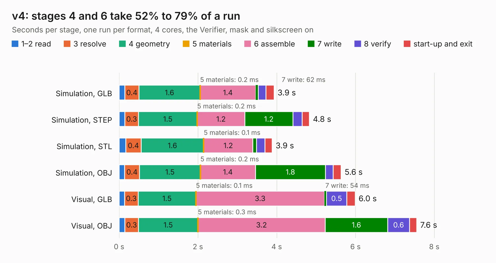

# 2666. v4

Board 2,666 of the 3,108 of [Corpus Testing](../Corpus-Testing.md), on [Corpus Page 25](../CorpusTestingPages/Corpus-Testing-25.md#2666-v4).

| Mode and format | 1–2 read | 3 resolve | 4 geometry | 5 materials | 6 assemble | 7 write | 8 verify | start-up and exit | Total |
|---|---:|---:|---:|---:|---:|---:|---:|---:|---:|
| Simulation, GLB | 0.1 | 0.4 | 1.6 | 0.2&nbsp;ms | 1.4 | 62&nbsp;ms | 0.2 | 0.2 | 3.9 |
| Simulation, STEP | 0.1 | 0.3 | 1.5 | 0.2&nbsp;ms | 1.2 | 1.2 | 0.2 | 0.2 | 4.8 |
| Simulation, STL | 0.2 | 0.4 | 1.6 | 0.1&nbsp;ms | 1.2 | 93&nbsp;ms | 0.2 | 0.2 | 3.9 |
| Simulation, OBJ | 0.1 | 0.4 | 1.5 | 0.2&nbsp;ms | 1.4 | 1.8 | 0.2 | 0.2 | 5.6 |
| Visual, GLB | 0.1 | 0.3 | 1.5 | 0.1&nbsp;ms | 3.3 | 54&nbsp;ms | 0.5 | 0.2 | 6.0 |
| Visual, OBJ | 0.1 | 0.3 | 1.5 | 0.3&nbsp;ms | 3.2 | 1.6 | 0.6 | 0.2 | 7.6 |

<table align="center"><tr><td valign="top">

| Board | Repo: [stuartpittaway/diybmsv4](https://github.com/stuartpittaway/diybmsv4) Board: `v4.kicad_pcb` |
|---|---|
| Folder | ModuleV400 |
| Complexity | 205&nbsp;/&nbsp;1000 (size&nbsp;160, features&nbsp;45) |
| KESE&nbsp;features | through vias, filled zones, curved board outline |
| Tested | 9th November 2026 |
| Copper&nbsp;layers | 2 |
| File&nbsp;format | KiCad 5 (20171130) |
| Parts,&nbsp;tracks,&nbsp;vias | 38, 401, 54 |
| Triangles,&nbsp;simulation | 446,686 in 40 parts |
| Verifier | PASS in all six runs |

</td><td valign="top">

<table>
<tr><th>File type</th><th>File size</th><th>Peak memory used</th></tr>
<tr><th colspan="3" align="left">Simulation</th></tr>
<tr><td>GLB</td><td align="right">16&nbsp;MB</td><td align="right">276&nbsp;MB</td></tr>
<tr><td>STEP</td><td align="right">80&nbsp;MB</td><td align="right">338&nbsp;MB</td></tr>
<tr><td>STL</td><td align="right">22&nbsp;MB</td><td align="right">288&nbsp;MB</td></tr>
<tr><td>OBJ</td><td align="right">46&nbsp;MB</td><td align="right">359&nbsp;MB</td></tr>
<tr><th colspan="3" align="left">Visual</th></tr>
<tr><td>GLB</td><td align="right">14&nbsp;MB</td><td align="right">355&nbsp;MB</td></tr>
<tr><td>OBJ</td><td align="right">40&nbsp;MB</td><td align="right">344&nbsp;MB</td></tr>
</table>

</td></tr></table>

| Previous | Next |
|:---|---:|
| [2665. ESP8266ControllerCircuit](b2665b_diybmsv4_ESP8266ControllerCircuit.md) | [2667. ModuleV421](b2667b_diybmsv4_ModuleV421.md) |
