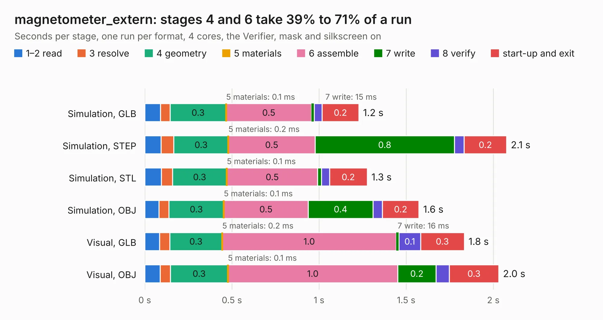

# 2666. magnetometer_extern

Board 2,666 of the 3,127 of [Corpus Testing](../Corpus-Testing.md), on [Corpus Page 25](../CorpusTestingPages/Corpus-Testing-25.md#2666-magnetometer_extern).

| Mode and format | 1–2 read | 3 resolve | 4 geometry | 5 materials | 6 assemble | 7 write | 8 verify | start-up and exit | Total |
|---|---:|---:|---:|---:|---:|---:|---:|---:|---:|
| Simulation, GLB | 89&nbsp;ms | 56&nbsp;ms | 0.3 | 0.1&nbsp;ms | 0.5 | 15&nbsp;ms | 46&nbsp;ms | 0.2 | 1.2 |
| Simulation, STEP | 93&nbsp;ms | 74&nbsp;ms | 0.3 | 0.2&nbsp;ms | 0.5 | 0.8 | 56&nbsp;ms | 0.2 | 2.1 |
| Simulation, STL | 94&nbsp;ms | 64&nbsp;ms | 0.3 | 0.1&nbsp;ms | 0.5 | 21&nbsp;ms | 47&nbsp;ms | 0.2 | 1.3 |
| Simulation, OBJ | 82&nbsp;ms | 57&nbsp;ms | 0.3 | 0.1&nbsp;ms | 0.5 | 0.4 | 54&nbsp;ms | 0.2 | 1.6 |
| Visual, GLB | 85&nbsp;ms | 58&nbsp;ms | 0.3 | 0.2&nbsp;ms | 1.0 | 16&nbsp;ms | 0.1 | 0.3 | 1.8 |
| Visual, OBJ | 88&nbsp;ms | 59&nbsp;ms | 0.3 | 0.1&nbsp;ms | 1.0 | 0.2 | 76&nbsp;ms | 0.3 | 2.0 |

<table align="center"><tr><td valign="top">

| Board | Repo: [stanford-ssi/samwise-avionics](https://github.com/stanford-ssi/samwise-avionics) Board: `magnetometer_extern.kicad_pcb` |
|---|---|
| Folder | magnetometer_extern / magnetometer_extern |
| Complexity | 106&nbsp;/&nbsp;1000 (size&nbsp;76, features&nbsp;30) |
| KESE&nbsp;features | rounded, trapezoid or chamfered pads, filled zones |
| Tested | 9th November 2026 |
| Copper&nbsp;layers | 2 |
| File&nbsp;format | KiCad 9 (20241229) |
| Parts,&nbsp;tracks,&nbsp;vias | 4, 12, 0 |
| Triangles,&nbsp;simulation | 78,032 in 18 parts |
| Verifier | PASS in all six runs |

</td><td valign="top">

<table>
<tr><th>File type</th><th>File size</th><th>Peak memory used</th></tr>
<tr><th colspan="3" align="left">Simulation</th></tr>
<tr><td>GLB</td><td align="right">2.6&nbsp;MB</td><td align="right">173&nbsp;MB</td></tr>
<tr><td>STEP</td><td align="right">11&nbsp;MB</td><td align="right">180&nbsp;MB</td></tr>
<tr><td>STL</td><td align="right">3.9&nbsp;MB</td><td align="right">173&nbsp;MB</td></tr>
<tr><td>OBJ</td><td align="right">7.3&nbsp;MB</td><td align="right">175&nbsp;MB</td></tr>
<tr><th colspan="3" align="left">Visual</th></tr>
<tr><td>GLB</td><td align="right">1.7&nbsp;MB</td><td align="right">150&nbsp;MB</td></tr>
<tr><td>OBJ</td><td align="right">4.6&nbsp;MB</td><td align="right">150&nbsp;MB</td></tr>
</table>

</td></tr></table>

| Previous | Next |
|:---|---:|
| [2665. LT8491-mezzanine](b2665b_samwise-avionics_LT8491-mezzanine.md) | [2667. MPPT_addon_board](b2667b_samwise-avionics_MPPT-addon-board.md) |
