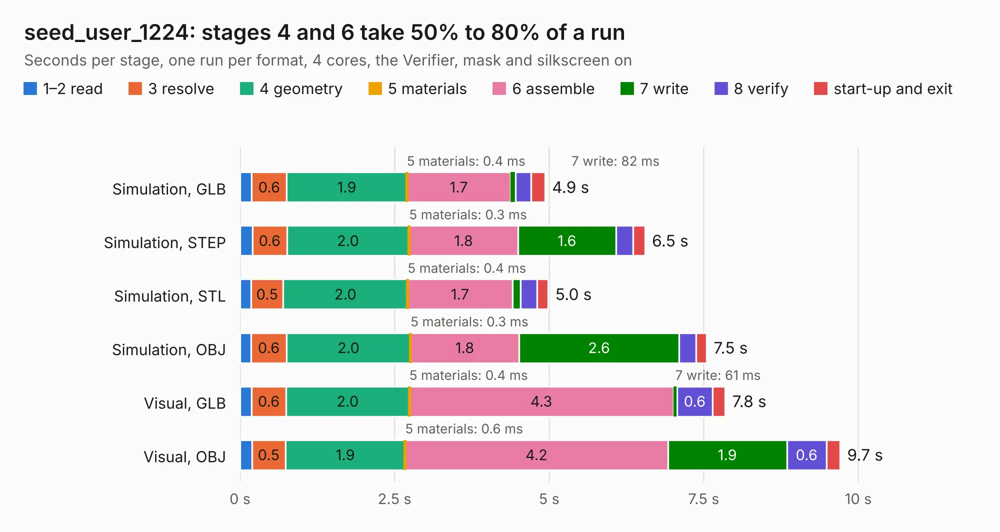

# 2669. seed_user_1224

Board 2,669 of the 3,139 of [Corpus Testing](../Corpus-Testing.md), on [Corpus Page 25](../CorpusTestingPages/Corpus-Testing-25.md#2669-seed_user_1224).

| Mode and format | 1–2 read | 3 resolve | 4 geometry | 5 materials | 6 assemble | 7 write | 8 verify | start-up and exit | Total |
|---|---:|---:|---:|---:|---:|---:|---:|---:|---:|
| Simulation, GLB | 0.2 | 0.6 | 1.9 | 0.4&nbsp;ms | 1.7 | 82&nbsp;ms | 0.3 | 0.2 | 4.9 |
| Simulation, STEP | 0.2 | 0.6 | 2.0 | 0.3&nbsp;ms | 1.8 | 1.6 | 0.3 | 0.2 | 6.5 |
| Simulation, STL | 0.2 | 0.5 | 2.0 | 0.4&nbsp;ms | 1.7 | 0.1 | 0.3 | 0.2 | 5.0 |
| Simulation, OBJ | 0.2 | 0.6 | 2.0 | 0.3&nbsp;ms | 1.8 | 2.6 | 0.3 | 0.2 | 7.5 |
| Visual, GLB | 0.2 | 0.6 | 2.0 | 0.4&nbsp;ms | 4.3 | 61&nbsp;ms | 0.6 | 0.2 | 7.8 |
| Visual, OBJ | 0.2 | 0.5 | 1.9 | 0.6&nbsp;ms | 4.2 | 1.9 | 0.6 | 0.2 | 9.7 |

<table align="center"><tr><td valign="top">

| Board | Repo: [stanford-ssi/aerolotl_kicad](https://github.com/stanford-ssi/aerolotl_kicad) Board: `seed_user_1224.kicad_pcb` |
|---|---|
| Folder | BatteryPCB_30pin / tools / layoutA |
| Complexity | 213&nbsp;/&nbsp;1000 (size&nbsp;158, features&nbsp;55) |
| KESE&nbsp;features | through vias, rounded, trapezoid or chamfered pads, filled zones, curved board outline |
| Tested | 9th November 2026 |
| Copper&nbsp;layers | 2 |
| File&nbsp;format | KiCad 10 (20260206) |
| Parts,&nbsp;tracks,&nbsp;vias | 35, 89, 147 |
| Triangles,&nbsp;simulation | 636,314 in 65 parts |
| Verifier | PASS in all six runs |

</td><td valign="top">

<table>
<tr><th>File type</th><th>File size</th><th>Peak memory used</th></tr>
<tr><th colspan="3" align="left">Simulation</th></tr>
<tr><td>GLB</td><td align="right">21&nbsp;MB</td><td align="right">371&nbsp;MB</td></tr>
<tr><td>STEP</td><td align="right">81&nbsp;MB</td><td align="right">410&nbsp;MB</td></tr>
<tr><td>STL</td><td align="right">32&nbsp;MB</td><td align="right">342&nbsp;MB</td></tr>
<tr><td>OBJ</td><td align="right">63&nbsp;MB</td><td align="right">462&nbsp;MB</td></tr>
<tr><th colspan="3" align="left">Visual</th></tr>
<tr><td>GLB</td><td align="right">16&nbsp;MB</td><td align="right">431&nbsp;MB</td></tr>
<tr><td>OBJ</td><td align="right">49&nbsp;MB</td><td align="right">428&nbsp;MB</td></tr>
</table>

</td></tr></table>

| Previous | Next |
|:---|---:|
| [2668. battery_pcb_30pin](b2668b_aerolotl-kicad_battery-pcb-30pin.md) | [2670. motor_board](b2670b_samwise-avionics_motor-board.md) |
