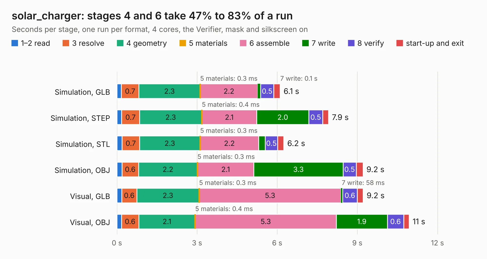

# 2669. solar_charger

Board 2,669 of the 3,119 of [Corpus Testing](../Corpus-Testing.md), on [Corpus Page 25](../CorpusTestingPages/Corpus-Testing-25.md#2669-solar_charger).

| Mode and format | 1–2 read | 3 resolve | 4 geometry | 5 materials | 6 assemble | 7 write | 8 verify | start-up and exit | Total |
|---|---:|---:|---:|---:|---:|---:|---:|---:|---:|
| Simulation, GLB | 0.2 | 0.7 | 2.3 | 0.3&nbsp;ms | 2.2 | 0.1 | 0.5 | 0.2 | 6.1 |
| Simulation, STEP | 0.2 | 0.7 | 2.3 | 0.4&nbsp;ms | 2.1 | 2.0 | 0.5 | 0.2 | 7.9 |
| Simulation, STL | 0.2 | 0.7 | 2.3 | 0.3&nbsp;ms | 2.2 | 0.2 | 0.5 | 0.2 | 6.2 |
| Simulation, OBJ | 0.2 | 0.6 | 2.2 | 0.3&nbsp;ms | 2.1 | 3.3 | 0.5 | 0.3 | 9.2 |
| Visual, GLB | 0.2 | 0.6 | 2.3 | 0.3&nbsp;ms | 5.3 | 58&nbsp;ms | 0.6 | 0.2 | 9.2 |
| Visual, OBJ | 0.2 | 0.6 | 2.1 | 0.4&nbsp;ms | 5.3 | 1.9 | 0.6 | 0.2 | 10.9 |

<table align="center"><tr><td valign="top">

| Board | Repo: [stanford-ssi/samwise-avionics](https://github.com/stanford-ssi/samwise-avionics) Board: `solar_charger.kicad_pcb` |
|---|---|
| Folder | unused_boards / solar_charger |
| Complexity | 232&nbsp;/&nbsp;1000 (size&nbsp;147, features&nbsp;85) |
| KESE&nbsp;features | through vias, rounded, trapezoid or chamfered pads, drill offsets, filled zones, stack-up, dielectric εr and tanδ |
| Tested | 9th November 2026 |
| Copper&nbsp;layers | 4 |
| File&nbsp;format | KiCad 8 (20240108) |
| Parts,&nbsp;tracks,&nbsp;vias | 15, 117, 15 |
| Triangles,&nbsp;simulation | 675,838 in 80 parts |
| Verifier | PASS in all six runs |

</td><td valign="top">

<table>
<tr><th>File type</th><th>File size</th><th>Peak memory used</th></tr>
<tr><th colspan="3" align="left">Simulation</th></tr>
<tr><td>GLB</td><td align="right">22&nbsp;MB</td><td align="right">336&nbsp;MB</td></tr>
<tr><td>STEP</td><td align="right">85&nbsp;MB</td><td align="right">372&nbsp;MB</td></tr>
<tr><td>STL</td><td align="right">34&nbsp;MB</td><td align="right">352&nbsp;MB</td></tr>
<tr><td>OBJ</td><td align="right">67&nbsp;MB</td><td align="right">485&nbsp;MB</td></tr>
<tr><th colspan="3" align="left">Visual</th></tr>
<tr><td>GLB</td><td align="right">12&nbsp;MB</td><td align="right">385&nbsp;MB</td></tr>
<tr><td>OBJ</td><td align="right">37&nbsp;MB</td><td align="right">387&nbsp;MB</td></tr>
</table>

</td></tr></table>

| Previous | Next |
|:---|---:|
| [2668. reaction_wheel](b2668b_samwise-avionics_reaction-wheel.md) | [2670. ZPlus_Panel](b2670b_samwise-avionics_ZPlus-Panel.md) |
