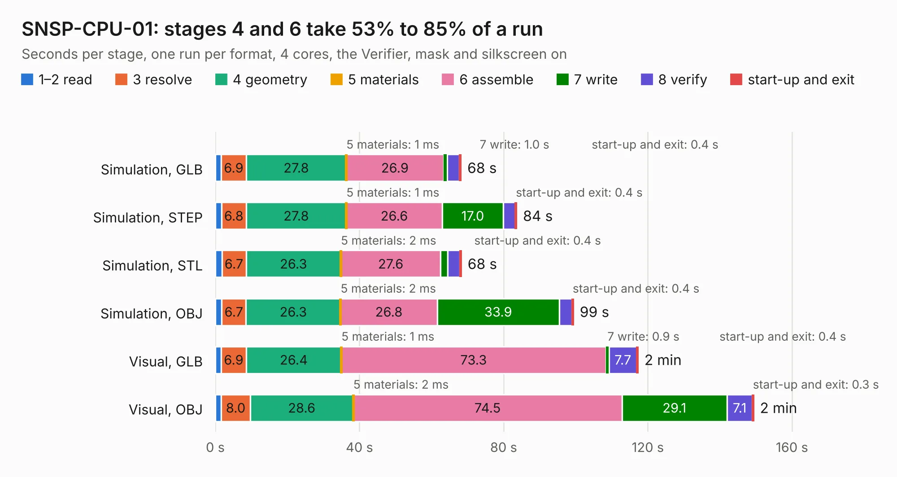

# 2672. SNSP-CPU-01

Board 2,672 of the 3,119 of [Corpus Testing](../Corpus-Testing.md), on [Corpus Page 25](../CorpusTestingPages/Corpus-Testing-25.md#2672-snsp-cpu-01).

| Mode and format | 1–2 read | 3 resolve | 4 geometry | 5 materials | 6 assemble | 7 write | 8 verify | start-up and exit | Total |
|---|---:|---:|---:|---:|---:|---:|---:|---:|---:|
| Simulation, GLB | 1.7 | 6.9 | 27.8 | 1&nbsp;ms | 26.9 | 1.0 | 3.4 | 0.4 | 68.1 |
| Simulation, STEP | 1.8 | 6.8 | 27.8 | 1&nbsp;ms | 26.6 | 17.0 | 3.3 | 0.4 | 83.6 |
| Simulation, STL | 1.8 | 6.7 | 26.3 | 2&nbsp;ms | 27.6 | 2.0 | 3.4 | 0.4 | 68.2 |
| Simulation, OBJ | 1.8 | 6.7 | 26.3 | 2&nbsp;ms | 26.8 | 33.9 | 3.5 | 0.4 | 99.3 |
| Visual, GLB | 1.7 | 6.9 | 26.4 | 1&nbsp;ms | 73.3 | 0.9 | 7.7 | 0.4 | 117.3 |
| Visual, OBJ | 1.7 | 8.0 | 28.6 | 2&nbsp;ms | 74.5 | 29.1 | 7.1 | 0.3 | 149.3 |

<table align="center"><tr><td valign="top">

| Board | Repo: [stonedDiscord/nonSNES](https://github.com/stonedDiscord/nonSNES) Board: `SNSP-CPU-01.kicad_pcb` |
|---|---|
| Folder | SNSP-CPU-01 |
| Complexity | 423&nbsp;/&nbsp;1000 (size&nbsp;288, features&nbsp;135) |
| KESE&nbsp;features | through vias, slotted holes, custom pads, rounded, trapezoid or chamfered pads, filled zones, copper drawings, copper text, curved board outline, stack-up, dielectric εr and tanδ, mask and silkscreen colours |
| Tested | 9th November 2026 |
| Copper&nbsp;layers | 2 |
| File&nbsp;format | KiCad 10 (20260206) |
| Parts,&nbsp;tracks,&nbsp;vias | 291, 8,639, 1,197 |
| Triangles,&nbsp;simulation | 5,578,300 in 446 parts |
| Verifier | PASS in all six runs |

</td><td valign="top">

<table>
<tr><th>File type</th><th>File size</th><th>Peak memory used</th></tr>
<tr><th colspan="3" align="left">Simulation</th></tr>
<tr><td>GLB</td><td align="right">192&nbsp;MB</td><td align="right">2.2&nbsp;GB</td></tr>
<tr><td>STEP</td><td align="right">1.0&nbsp;GB</td><td align="right">2.2&nbsp;GB</td></tr>
<tr><td>STL</td><td align="right">279&nbsp;MB</td><td align="right">2.0&nbsp;GB</td></tr>
<tr><td>OBJ</td><td align="right">597&nbsp;MB</td><td align="right">3.6&nbsp;GB</td></tr>
<tr><th colspan="3" align="left">Visual</th></tr>
<tr><td>GLB</td><td align="right">162&nbsp;MB</td><td align="right">2.6&nbsp;GB</td></tr>
<tr><td>OBJ</td><td align="right">522&nbsp;MB</td><td align="right">3.3&nbsp;GB</td></tr>
</table>

</td></tr></table>

| Previous | Next |
|:---|---:|
| [2671. MegaDrive](b2671b_MegaDrive_MegaDrive.md) | [2673. SNSP-CPU-1CHIP](b2673b_nonSNES_SNSP-CPU-1CHIP.md) |
