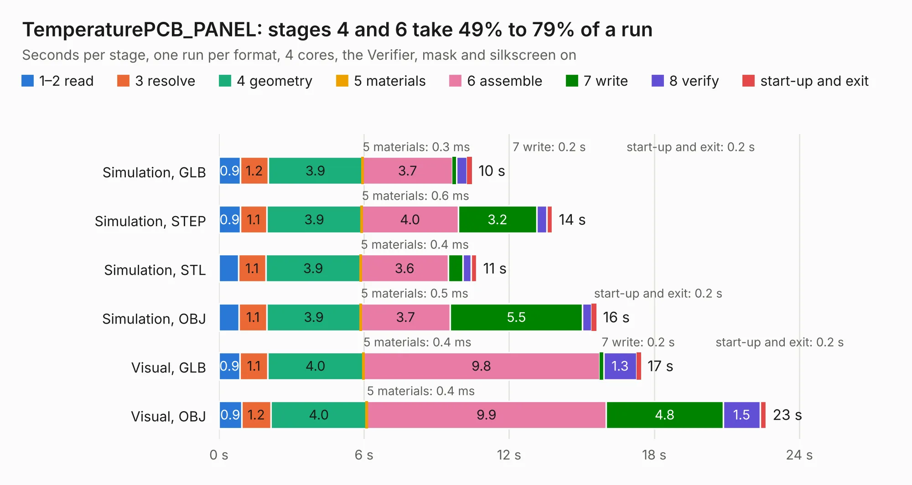

# 2674. TemperaturePCB_PANEL

Board 2,674 of the 3,108 of [Corpus Testing](../Corpus-Testing.md), on [Corpus Page 25](../CorpusTestingPages/Corpus-Testing-25.md#2674-temperaturepcb_panel).

| Mode and format | 1–2 read | 3 resolve | 4 geometry | 5 materials | 6 assemble | 7 write | 8 verify | start-up and exit | Total |
|---|---:|---:|---:|---:|---:|---:|---:|---:|---:|
| Simulation, GLB | 0.9 | 1.2 | 3.9 | 0.3&nbsp;ms | 3.7 | 0.2 | 0.4 | 0.2 | 10.5 |
| Simulation, STEP | 0.9 | 1.1 | 3.9 | 0.6&nbsp;ms | 4.0 | 3.2 | 0.4 | 0.2 | 13.8 |
| Simulation, STL | 0.8 | 1.1 | 3.9 | 0.4&nbsp;ms | 3.6 | 0.6 | 0.3 | 0.2 | 10.7 |
| Simulation, OBJ | 0.8 | 1.1 | 3.9 | 0.5&nbsp;ms | 3.7 | 5.5 | 0.4 | 0.2 | 15.6 |
| Visual, GLB | 0.9 | 1.1 | 4.0 | 0.4&nbsp;ms | 9.8 | 0.2 | 1.3 | 0.2 | 17.5 |
| Visual, OBJ | 0.9 | 1.2 | 4.0 | 0.4&nbsp;ms | 9.9 | 4.8 | 1.5 | 0.2 | 22.6 |

<table align="center"><tr><td valign="top">

| Board | Repo: [stuartpittaway/diybmsv4](https://github.com/stuartpittaway/diybmsv4) Board: `TemperaturePCB_PANEL.kicad_pcb` |
|---|---|
| Folder | TemperaturePCB_PANEL |
| Complexity | 174&nbsp;/&nbsp;1000 (size&nbsp;129, features&nbsp;45) |
| KESE&nbsp;features | rounded, trapezoid or chamfered pads, filled zones, TrueType text |
| Tested | 9th November 2026 |
| Copper&nbsp;layers | 2 |
| File&nbsp;format | KiCad 7 (20221018) |
| Parts,&nbsp;tracks,&nbsp;vias | 36, 84, 0 |
| Triangles,&nbsp;simulation | 1,351,064 in 36 parts |
| Note | panel |
| Verifier | PASS in all six runs |

</td><td valign="top">

<table>
<tr><th>File type</th><th>File size</th><th>Peak memory used</th></tr>
<tr><th colspan="3" align="left">Simulation</th></tr>
<tr><td>GLB</td><td align="right">47&nbsp;MB</td><td align="right">721&nbsp;MB</td></tr>
<tr><td>STEP</td><td align="right">199&nbsp;MB</td><td align="right">723&nbsp;MB</td></tr>
<tr><td>STL</td><td align="right">68&nbsp;MB</td><td align="right">714&nbsp;MB</td></tr>
<tr><td>OBJ</td><td align="right">142&nbsp;MB</td><td align="right">952&nbsp;MB</td></tr>
<tr><th colspan="3" align="left">Visual</th></tr>
<tr><td>GLB</td><td align="right">39&nbsp;MB</td><td align="right">746&nbsp;MB</td></tr>
<tr><td>OBJ</td><td align="right">117&nbsp;MB</td><td align="right">874&nbsp;MB</td></tr>
</table>

</td></tr></table>

| Previous | Next |
|:---|---:|
| [2673. TemperaturePCB](b2673b_diybmsv4_TemperaturePCB.md) | [2675. sensors](b2675b_Racer_sensors.md) |
