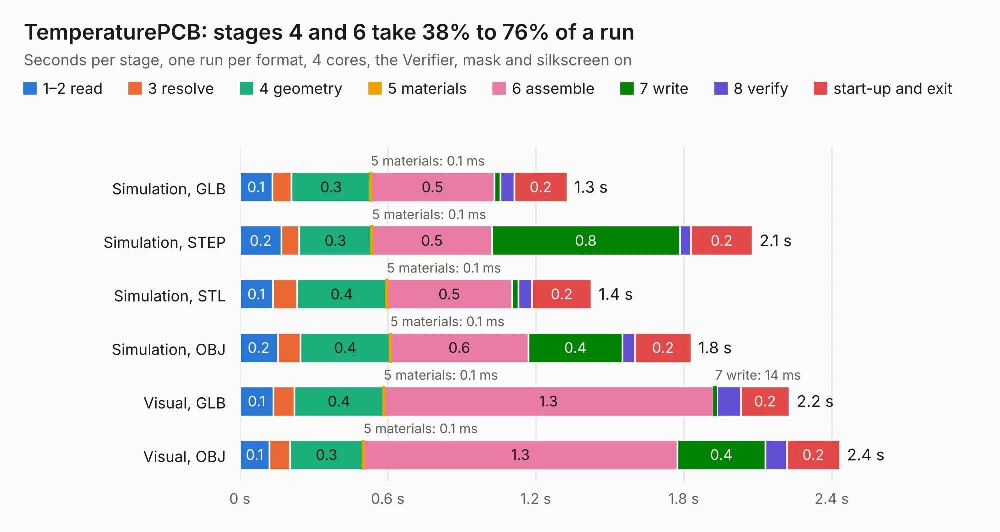

# 2674. TemperaturePCB

Board 2,674 of the 3,109 of [Corpus Testing](../Corpus-Testing.md), on [Corpus Page 25](../CorpusTestingPages/Corpus-Testing-25.md#2674-temperaturepcb).

| Mode and format | 1–2 read | 3 resolve | 4 geometry | 5 materials | 6 assemble | 7 write | 8 verify | start-up and exit | Total |
|---|---:|---:|---:|---:|---:|---:|---:|---:|---:|
| Simulation, GLB | 0.1 | 77&nbsp;ms | 0.3 | 0.1&nbsp;ms | 0.5 | 25&nbsp;ms | 56&nbsp;ms | 0.2 | 1.3 |
| Simulation, STEP | 0.2 | 70&nbsp;ms | 0.3 | 0.1&nbsp;ms | 0.5 | 0.8 | 46&nbsp;ms | 0.2 | 2.1 |
| Simulation, STL | 0.1 | 97&nbsp;ms | 0.4 | 0.1&nbsp;ms | 0.5 | 26&nbsp;ms | 56&nbsp;ms | 0.2 | 1.4 |
| Simulation, OBJ | 0.2 | 92&nbsp;ms | 0.4 | 0.1&nbsp;ms | 0.6 | 0.4 | 51&nbsp;ms | 0.2 | 1.8 |
| Visual, GLB | 0.1 | 84&nbsp;ms | 0.4 | 0.1&nbsp;ms | 1.3 | 14&nbsp;ms | 96&nbsp;ms | 0.2 | 2.2 |
| Visual, OBJ | 0.1 | 82&nbsp;ms | 0.3 | 0.1&nbsp;ms | 1.3 | 0.4 | 87&nbsp;ms | 0.2 | 2.4 |

<table align="center"><tr><td valign="top">

| Board | Repo: [stuartpittaway/diybmsv4](https://github.com/stuartpittaway/diybmsv4) Board: `TemperaturePCB.kicad_pcb` |
|---|---|
| Folder | TemperaturePCB |
| Complexity | 121&nbsp;/&nbsp;1000 (size&nbsp;66, features&nbsp;55) |
| KESE&nbsp;features | rounded, trapezoid or chamfered pads, filled zones, curved board outline, TrueType text |
| Tested | 9th November 2026 |
| Copper&nbsp;layers | 2 |
| File&nbsp;format | KiCad 7 (20221018) |
| Parts,&nbsp;tracks,&nbsp;vias | 3, 7, 0 |
| Triangles,&nbsp;simulation | 96,522 in 14 parts |
| Verifier | PASS in all six runs |

</td><td valign="top">

<table>
<tr><th>File type</th><th>File size</th><th>Peak memory used</th></tr>
<tr><th colspan="3" align="left">Simulation</th></tr>
<tr><td>GLB</td><td align="right">3.4&nbsp;MB</td><td align="right">180&nbsp;MB</td></tr>
<tr><td>STEP</td><td align="right">14&nbsp;MB</td><td align="right">187&nbsp;MB</td></tr>
<tr><td>STL</td><td align="right">4.8&nbsp;MB</td><td align="right">185&nbsp;MB</td></tr>
<tr><td>OBJ</td><td align="right">9.5&nbsp;MB</td><td align="right">190&nbsp;MB</td></tr>
<tr><th colspan="3" align="left">Visual</th></tr>
<tr><td>GLB</td><td align="right">2.8&nbsp;MB</td><td align="right">157&nbsp;MB</td></tr>
<tr><td>OBJ</td><td align="right">7.8&nbsp;MB</td><td align="right">157&nbsp;MB</td></tr>
</table>

</td></tr></table>

| Previous | Next |
|:---|---:|
| [2673. ProgrammingAdapter](b2673b_diybmsv4_ProgrammingAdapter.md) | [2675. TemperaturePCB_PANEL](b2675b_diybmsv4_TemperaturePCB-PANEL.md) |
