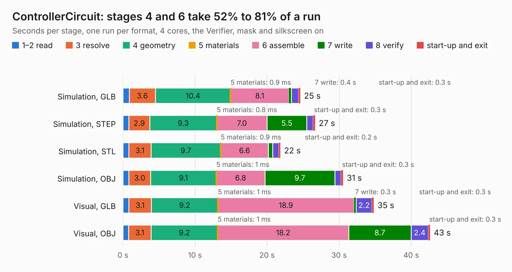

# 2675. ControllerCircuit

Board 2,675 of the 3,120 of [Corpus Testing](../Corpus-Testing.md), on [Corpus Page 25](../CorpusTestingPages/Corpus-Testing-25.md#2675-controllercircuit).

| Mode and format | 1–2 read | 3 resolve | 4 geometry | 5 materials | 6 assemble | 7 write | 8 verify | start-up and exit | Total |
|---|---:|---:|---:|---:|---:|---:|---:|---:|---:|
| Simulation, GLB | 0.9 | 3.6 | 10.4 | 0.9&nbsp;ms | 8.1 | 0.4 | 1.0 | 0.3 | 24.6 |
| Simulation, STEP | 0.8 | 2.9 | 9.3 | 0.8&nbsp;ms | 7.0 | 5.5 | 0.9 | 0.3 | 26.7 |
| Simulation, STL | 0.8 | 3.1 | 9.7 | 0.9&nbsp;ms | 6.6 | 0.6 | 0.8 | 0.2 | 21.9 |
| Simulation, OBJ | 0.8 | 3.0 | 9.1 | 1&nbsp;ms | 6.8 | 9.7 | 0.9 | 0.3 | 30.6 |
| Visual, GLB | 0.8 | 3.1 | 9.2 | 1&nbsp;ms | 18.9 | 0.3 | 2.2 | 0.3 | 34.8 |
| Visual, OBJ | 0.8 | 3.1 | 9.2 | 1&nbsp;ms | 18.2 | 8.7 | 2.4 | 0.3 | 42.6 |

<table align="center"><tr><td valign="top">

| Board | Repo: [stuartpittaway/diybmsv4](https://github.com/stuartpittaway/diybmsv4) Board: `ControllerCircuit.kicad_pcb` |
|---|---|
| Folder | ControllerCircuit |
| Complexity | 295&nbsp;/&nbsp;1000 (size&nbsp;190, features&nbsp;105) |
| KESE&nbsp;features | through vias, slotted holes, custom pads, rounded, trapezoid or chamfered pads, filled zones, copper drawings, curved board outline, TrueType text |
| Tested | 9th November 2026 |
| Copper&nbsp;layers | 2 |
| File&nbsp;format | KiCad 7 (20221018) |
| Parts,&nbsp;tracks,&nbsp;vias | 87, 925, 379 |
| Triangles,&nbsp;simulation | 2,089,958 in 115 parts |
| Verifier | PASS in all six runs |

</td><td valign="top">

<table>
<tr><th>File type</th><th>File size</th><th>Peak memory used</th></tr>
<tr><th colspan="3" align="left">Simulation</th></tr>
<tr><td>GLB</td><td align="right">73&nbsp;MB</td><td align="right">915&nbsp;MB</td></tr>
<tr><td>STEP</td><td align="right">344&nbsp;MB</td><td align="right">978&nbsp;MB</td></tr>
<tr><td>STL</td><td align="right">105&nbsp;MB</td><td align="right">903&nbsp;MB</td></tr>
<tr><td>OBJ</td><td align="right">222&nbsp;MB</td><td align="right">1.4&nbsp;GB</td></tr>
<tr><th colspan="3" align="left">Visual</th></tr>
<tr><td>GLB</td><td align="right">64&nbsp;MB</td><td align="right">1.1&nbsp;GB</td></tr>
<tr><td>OBJ</td><td align="right">197&nbsp;MB</td><td align="right">1.3&nbsp;GB</td></tr>
</table>

</td></tr></table>

| Previous | Next |
|:---|---:|
| [2674. SNSP-CPU-1CHIP](b2674b_nonSNES_SNSP-CPU-1CHIP.md) | [2676. ControllerCurrentShuntAddOn](b2676b_diybmsv4_ControllerCurrentShuntAddOn.md) |
