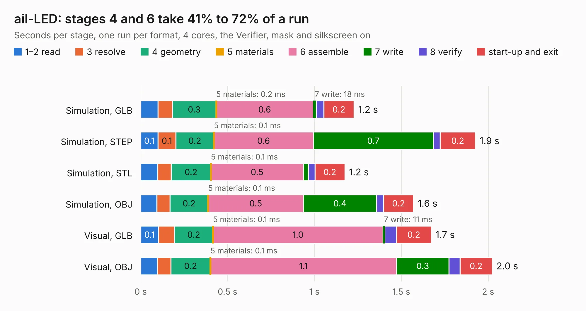

# 2675. ail-LED

Board 2,675 of the 3,105 of [Corpus Testing](../Corpus-Testing.md), on [Corpus Page 25](../CorpusTestingPages/Corpus-Testing-25.md#2675-ail-led).

| Mode and format | 1–2 read | 3 resolve | 4 geometry | 5 materials | 6 assemble | 7 write | 8 verify | start-up and exit | Total |
|---|---:|---:|---:|---:|---:|---:|---:|---:|---:|
| Simulation, GLB | 99&nbsp;ms | 83&nbsp;ms | 0.3 | 0.2&nbsp;ms | 0.6 | 18&nbsp;ms | 43&nbsp;ms | 0.2 | 1.2 |
| Simulation, STEP | 0.1 | 0.1 | 0.2 | 0.1&nbsp;ms | 0.6 | 0.7 | 38&nbsp;ms | 0.2 | 1.9 |
| Simulation, STL | 98&nbsp;ms | 78&nbsp;ms | 0.2 | 0.1&nbsp;ms | 0.5 | 29&nbsp;ms | 38&nbsp;ms | 0.2 | 1.2 |
| Simulation, OBJ | 92&nbsp;ms | 76&nbsp;ms | 0.2 | 0.1&nbsp;ms | 0.5 | 0.4 | 40&nbsp;ms | 0.2 | 1.6 |
| Visual, GLB | 0.1 | 93&nbsp;ms | 0.2 | 0.1&nbsp;ms | 1.0 | 11&nbsp;ms | 66&nbsp;ms | 0.2 | 1.7 |
| Visual, OBJ | 97&nbsp;ms | 77&nbsp;ms | 0.2 | 0.1&nbsp;ms | 1.1 | 0.3 | 63&nbsp;ms | 0.2 | 2.0 |

<table align="center"><tr><td valign="top">

| Board | Repo: [sufst/pcb](https://github.com/sufst/pcb) Board: `ail-LED.kicad_pcb` |
|---|---|
| Folder | ail-LED |
| Complexity | 221&nbsp;/&nbsp;1000 (size&nbsp;96, features&nbsp;125) |
| KESE&nbsp;features | through vias, custom pads, rounded, trapezoid or chamfered pads, filled zones, copper drawings, curved board outline, knockout text, stack-up, dielectric εr and tanδ |
| Tested | 9th November 2026 |
| Copper&nbsp;layers | 2 |
| File&nbsp;format | KiCad 7 (20221018) |
| Parts,&nbsp;tracks,&nbsp;vias | 18, 8, 3 |
| Triangles,&nbsp;simulation | 99,858 in 27 parts |
| Verifier | PASS in all six runs |

</td><td valign="top">

<table>
<tr><th>File type</th><th>File size</th><th>Peak memory used</th></tr>
<tr><th colspan="3" align="left">Simulation</th></tr>
<tr><td>GLB</td><td align="right">3.9&nbsp;MB</td><td align="right">180&nbsp;MB</td></tr>
<tr><td>STEP</td><td align="right">17&nbsp;MB</td><td align="right">196&nbsp;MB</td></tr>
<tr><td>STL</td><td align="right">5.0&nbsp;MB</td><td align="right">183&nbsp;MB</td></tr>
<tr><td>OBJ</td><td align="right">11&nbsp;MB</td><td align="right">185&nbsp;MB</td></tr>
<tr><th colspan="3" align="left">Visual</th></tr>
<tr><td>GLB</td><td align="right">2.4&nbsp;MB</td><td align="right">153&nbsp;MB</td></tr>
<tr><td>OBJ</td><td align="right">6.7&nbsp;MB</td><td align="right">157&nbsp;MB</td></tr>
</table>

</td></tr></table>

| Previous | Next |
|:---|---:|
| [2674. controller](b2674b_Racer_controller.md) | [2676. ail-LED_handsolder](b2676b_pcb_ail-LED-handsolder.md) |
