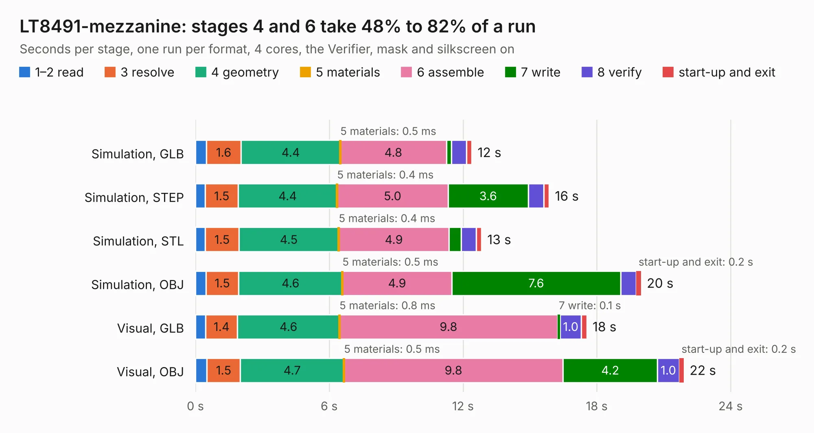

# 2675 LT8491-mezzanine

Board 2,675 of the 3,138 of [Corpus Testing](../Corpus-Testing.md), on [Corpus Page 25](../CorpusTestingPages/Corpus-Testing-25.md#2675-lt8491-mezzanine).

| Mode and format | 1–2 read | 3 resolve | 4 geometry | 5 materials | 6 assemble | 7 write | 8 verify | start-up and exit | Total |
|---|---:|---:|---:|---:|---:|---:|---:|---:|---:|
| Simulation, GLB | 0.5 | 1.6 | 4.4 | 0.5&nbsp;ms | 4.8 | 0.2 | 0.7 | 0.2 | 12.4 |
| Simulation, STEP | 0.4 | 1.5 | 4.4 | 0.4&nbsp;ms | 5.0 | 3.6 | 0.7 | 0.2 | 15.9 |
| Simulation, STL | 0.4 | 1.5 | 4.5 | 0.4&nbsp;ms | 4.9 | 0.5 | 0.7 | 0.2 | 12.8 |
| Simulation, OBJ | 0.5 | 1.5 | 4.6 | 0.5&nbsp;ms | 4.9 | 7.6 | 0.7 | 0.2 | 20.0 |
| Visual, GLB | 0.5 | 1.4 | 4.6 | 0.8&nbsp;ms | 9.8 | 0.1 | 1.0 | 0.2 | 17.5 |
| Visual, OBJ | 0.5 | 1.5 | 4.7 | 0.5&nbsp;ms | 9.8 | 4.2 | 1.0 | 0.2 | 21.9 |

<table align="center"><tr><td valign="top">

| Board | Repo: [stanford-ssi/samwise-avionics](https://github.com/stanford-ssi/samwise-avionics) Board: `LT8491-mezzanine.kicad_pcb` |
|---|---|
| Folder | LT8491-mezzanine |
| Complexity | 356&nbsp;/&nbsp;1000 (size&nbsp;211, features&nbsp;145) |
| KESE&nbsp;features | through vias, custom pads, rounded, trapezoid or chamfered pads, filled zones, copper drawings, stack-up, dielectric εr and tanδ, copper finish, mask and silkscreen colours, castellated pads |
| Tested | 9th November 2026 |
| Copper&nbsp;layers | 6 |
| File&nbsp;format | KiCad 9 (20241229) |
| Parts,&nbsp;tracks,&nbsp;vias | 122, 673, 165 |
| Triangles,&nbsp;simulation | 1,503,708 in 105 parts |
| Verifier | PASS in all six runs |

</td><td valign="top">

<table>
<tr><th>File type</th><th>File size</th><th>Peak memory used</th></tr>
<tr><th colspan="3" align="left">Simulation</th></tr>
<tr><td>GLB</td><td align="right">51&nbsp;MB</td><td align="right">525&nbsp;MB</td></tr>
<tr><td>STEP</td><td align="right">196&nbsp;MB</td><td align="right">662&nbsp;MB</td></tr>
<tr><td>STL</td><td align="right">75&nbsp;MB</td><td align="right">553&nbsp;MB</td></tr>
<tr><td>OBJ</td><td align="right">157&nbsp;MB</td><td align="right">1.0&nbsp;GB</td></tr>
<tr><th colspan="3" align="left">Visual</th></tr>
<tr><td>GLB</td><td align="right">28&nbsp;MB</td><td align="right">713&nbsp;MB</td></tr>
<tr><td>OBJ</td><td align="right">85&nbsp;MB</td><td align="right">707&nbsp;MB</td></tr>
</table>

</td></tr></table>

| Previous | Next |
|:---|---:|
| [2674 Groundstation_433_Hat](b2674b_samwise-avionics_Groundstation-433-Hat.md) | [2676 magnetometer_extern](b2676b_samwise-avionics_magnetometer-extern.md) |
