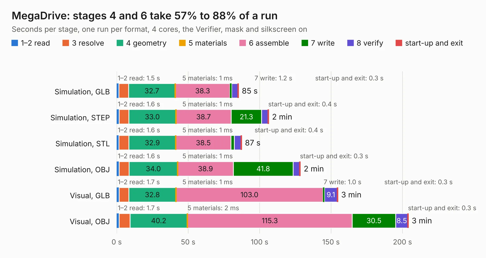

# 2676. MegaDrive

Board 2,676 of the 3,124 of [Corpus Testing](../Corpus-Testing.md), on [Corpus Page 25](../CorpusTestingPages/Corpus-Testing-25.md#2676-megadrive).

| Mode and format | 1–2 read | 3 resolve | 4 geometry | 5 materials | 6 assemble | 7 write | 8 verify | start-up and exit | Total |
|---|---:|---:|---:|---:|---:|---:|---:|---:|---:|
| Simulation, GLB | 1.5 | 6.8 | 32.7 | 1&nbsp;ms | 38.3 | 1.2 | 4.4 | 0.3 | 85.2 |
| Simulation, STEP | 1.6 | 6.8 | 33.0 | 1&nbsp;ms | 38.7 | 21.3 | 4.5 | 0.4 | 106.3 |
| Simulation, STL | 1.6 | 6.9 | 32.9 | 1&nbsp;ms | 38.5 | 2.4 | 4.7 | 0.4 | 87.3 |
| Simulation, OBJ | 1.6 | 7.0 | 34.0 | 1&nbsp;ms | 38.9 | 41.8 | 4.7 | 0.3 | 128.5 |
| Visual, GLB | 1.7 | 6.9 | 32.8 | 1&nbsp;ms | 103.0 | 1.0 | 9.1 | 0.3 | 154.7 |
| Visual, OBJ | 1.7 | 7.6 | 40.2 | 2&nbsp;ms | 115.3 | 30.5 | 8.5 | 0.3 | 204.1 |

<table align="center"><tr><td valign="top">

| Board | Repo: [stonedDiscord/MegaDrive](https://github.com/stonedDiscord/MegaDrive) Board: `MegaDrive.kicad_pcb` |
|---|---|
| Complexity | 353&nbsp;/&nbsp;1000 (size&nbsp;278, features&nbsp;75) |
| KESE&nbsp;features | through vias, slotted holes, rounded, trapezoid or chamfered pads, filled zones, copper text, curved board outline |
| Tested | 9th November 2026 |
| Copper&nbsp;layers | 2 |
| File&nbsp;format | KiCad 9 (20241229) |
| Parts,&nbsp;tracks,&nbsp;vias | 267, 9,611, 785 |
| Triangles,&nbsp;simulation | 7,235,902 in 344 parts |
| Verifier | PASS in all six runs |

</td><td valign="top">

<table>
<tr><th>File type</th><th>File size</th><th>Peak memory used</th></tr>
<tr><th colspan="3" align="left">Simulation</th></tr>
<tr><td>GLB</td><td align="right">246&nbsp;MB</td><td align="right">2.4&nbsp;GB</td></tr>
<tr><td>STEP</td><td align="right">1.2&nbsp;GB</td><td align="right">2.8&nbsp;GB</td></tr>
<tr><td>STL</td><td align="right">362&nbsp;MB</td><td align="right">2.5&nbsp;GB</td></tr>
<tr><td>OBJ</td><td align="right">771&nbsp;MB</td><td align="right">4.6&nbsp;GB</td></tr>
<tr><th colspan="3" align="left">Visual</th></tr>
<tr><td>GLB</td><td align="right">183&nbsp;MB</td><td align="right">2.9&nbsp;GB</td></tr>
<tr><td>OBJ</td><td align="right">590&nbsp;MB</td><td align="right">3.6&nbsp;GB</td></tr>
</table>

</td></tr></table>

| Previous | Next |
|:---|---:|
| [2675. ZPlus_Panel](b2675b_samwise-avionics_ZPlus-Panel.md) | [2677. SNSP-CPU-01](b2677b_nonSNES_SNSP-CPU-01.md) |
