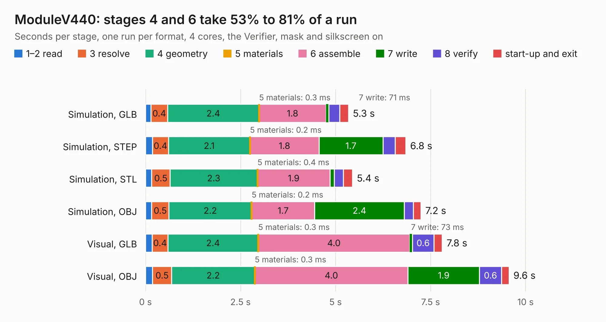

# 2677. ModuleV440

Board 2,677 of the 3,117 of [Corpus Testing](../Corpus-Testing.md), on [Corpus Page 25](../CorpusTestingPages/Corpus-Testing-25.md#2677-modulev440).

| Mode and format | 1–2 read | 3 resolve | 4 geometry | 5 materials | 6 assemble | 7 write | 8 verify | start-up and exit | Total |
|---|---:|---:|---:|---:|---:|---:|---:|---:|---:|
| Simulation, GLB | 0.1 | 0.4 | 2.4 | 0.3&nbsp;ms | 1.8 | 71&nbsp;ms | 0.3 | 0.2 | 5.3 |
| Simulation, STEP | 0.2 | 0.4 | 2.1 | 0.2&nbsp;ms | 1.8 | 1.7 | 0.3 | 0.3 | 6.8 |
| Simulation, STL | 0.2 | 0.5 | 2.3 | 0.4&nbsp;ms | 1.9 | 0.1 | 0.2 | 0.2 | 5.4 |
| Simulation, OBJ | 0.2 | 0.5 | 2.2 | 0.2&nbsp;ms | 1.7 | 2.4 | 0.2 | 0.2 | 7.2 |
| Visual, GLB | 0.2 | 0.4 | 2.4 | 0.3&nbsp;ms | 4.0 | 73&nbsp;ms | 0.6 | 0.2 | 7.8 |
| Visual, OBJ | 0.2 | 0.5 | 2.2 | 0.3&nbsp;ms | 4.0 | 1.9 | 0.6 | 0.2 | 9.6 |

<table align="center"><tr><td valign="top">

| Board | Repo: [stuartpittaway/diybmsv4](https://github.com/stuartpittaway/diybmsv4) Board: `ModuleV440.kicad_pcb` |
|---|---|
| Folder | ModuleV440 |
| Complexity | 216&nbsp;/&nbsp;1000 (size&nbsp;161, features&nbsp;55) |
| KESE&nbsp;features | through vias, rounded, trapezoid or chamfered pads, filled zones, curved board outline |
| Tested | 9th November 2026 |
| Copper&nbsp;layers | 2 |
| File&nbsp;format | KiCad 5 (20171130) |
| Parts,&nbsp;tracks,&nbsp;vias | 42, 305, 79 |
| Triangles,&nbsp;simulation | 513,534 in 40 parts |
| Verifier | PASS in all six runs |

</td><td valign="top">

<table>
<tr><th>File type</th><th>File size</th><th>Peak memory used</th></tr>
<tr><th colspan="3" align="left">Simulation</th></tr>
<tr><td>GLB</td><td align="right">18&nbsp;MB</td><td align="right">303&nbsp;MB</td></tr>
<tr><td>STEP</td><td align="right">93&nbsp;MB</td><td align="right">353&nbsp;MB</td></tr>
<tr><td>STL</td><td align="right">26&nbsp;MB</td><td align="right">295&nbsp;MB</td></tr>
<tr><td>OBJ</td><td align="right">53&nbsp;MB</td><td align="right">405&nbsp;MB</td></tr>
<tr><th colspan="3" align="left">Visual</th></tr>
<tr><td>GLB</td><td align="right">14&nbsp;MB</td><td align="right">368&nbsp;MB</td></tr>
<tr><td>OBJ</td><td align="right">43&nbsp;MB</td><td align="right">366&nbsp;MB</td></tr>
</table>

</td></tr></table>

| Previous | Next |
|:---|---:|
| [2676. ModuleV421](b2676b_diybmsv4_ModuleV421.md) | [2678. ModuleV450](b2678b_diybmsv4_ModuleV450.md) |
