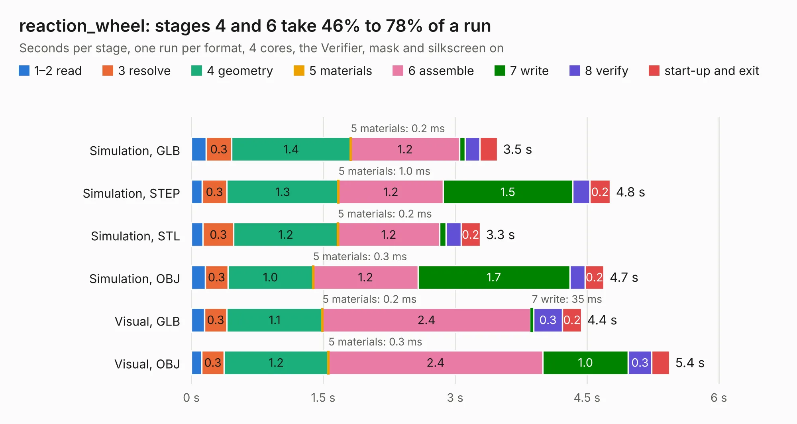

# 2678. reaction_wheel

Board 2,678 of the 3,130 of [Corpus Testing](../Corpus-Testing.md), on [Corpus Page 25](../CorpusTestingPages/Corpus-Testing-25.md#2678-reaction_wheel).

| Mode and format | 1–2 read | 3 resolve | 4 geometry | 5 materials | 6 assemble | 7 write | 8 verify | start-up and exit | Total |
|---|---:|---:|---:|---:|---:|---:|---:|---:|---:|
| Simulation, GLB | 0.2 | 0.3 | 1.4 | 0.2&nbsp;ms | 1.2 | 63&nbsp;ms | 0.2 | 0.2 | 3.5 |
| Simulation, STEP | 0.1 | 0.3 | 1.3 | 1.0&nbsp;ms | 1.2 | 1.5 | 0.2 | 0.2 | 4.8 |
| Simulation, STL | 0.1 | 0.3 | 1.2 | 0.2&nbsp;ms | 1.2 | 70&nbsp;ms | 0.2 | 0.2 | 3.3 |
| Simulation, OBJ | 0.2 | 0.3 | 1.0 | 0.3&nbsp;ms | 1.2 | 1.7 | 0.2 | 0.2 | 4.7 |
| Visual, GLB | 0.1 | 0.3 | 1.1 | 0.2&nbsp;ms | 2.4 | 35&nbsp;ms | 0.3 | 0.2 | 4.4 |
| Visual, OBJ | 0.1 | 0.3 | 1.2 | 0.3&nbsp;ms | 2.4 | 1.0 | 0.3 | 0.2 | 5.4 |

<table align="center"><tr><td valign="top">

| Board | Repo: [stanford-ssi/samwise-avionics](https://github.com/stanford-ssi/samwise-avionics) Board: `reaction_wheel.kicad_pcb` |
|---|---|
| Folder | unused_boards / reaction_wheel_board |
| Complexity | 269&nbsp;/&nbsp;1000 (size&nbsp;184, features&nbsp;85) |
| KESE&nbsp;features | through vias, rounded, trapezoid or chamfered pads, filled zones, curved board outline, stack-up, dielectric εr and tanδ |
| Tested | 9th November 2026 |
| Copper&nbsp;layers | 2 |
| File&nbsp;format | KiCad 8 (20240108) |
| Parts,&nbsp;tracks,&nbsp;vias | 26, 189, 24 |
| Triangles,&nbsp;simulation | 293,658 in 40 parts |
| Verifier | PASS in all six runs |

</td><td valign="top">

<table>
<tr><th>File type</th><th>File size</th><th>Peak memory used</th></tr>
<tr><th colspan="3" align="left">Simulation</th></tr>
<tr><td>GLB</td><td align="right">10&nbsp;MB</td><td align="right">242&nbsp;MB</td></tr>
<tr><td>STEP</td><td align="right">46&nbsp;MB</td><td align="right">269&nbsp;MB</td></tr>
<tr><td>STL</td><td align="right">15&nbsp;MB</td><td align="right">239&nbsp;MB</td></tr>
<tr><td>OBJ</td><td align="right">29&nbsp;MB</td><td align="right">256&nbsp;MB</td></tr>
<tr><th colspan="3" align="left">Visual</th></tr>
<tr><td>GLB</td><td align="right">7.4&nbsp;MB</td><td align="right">242&nbsp;MB</td></tr>
<tr><td>OBJ</td><td align="right">21&nbsp;MB</td><td align="right">247&nbsp;MB</td></tr>
</table>

</td></tr></table>

| Previous | Next |
|:---|---:|
| [2677. Pete_2400_Mini](b2677b_samwise-avionics_Pete-2400-Mini.md) | [2679. solar_charger](b2679b_samwise-avionics_solar-charger.md) |
