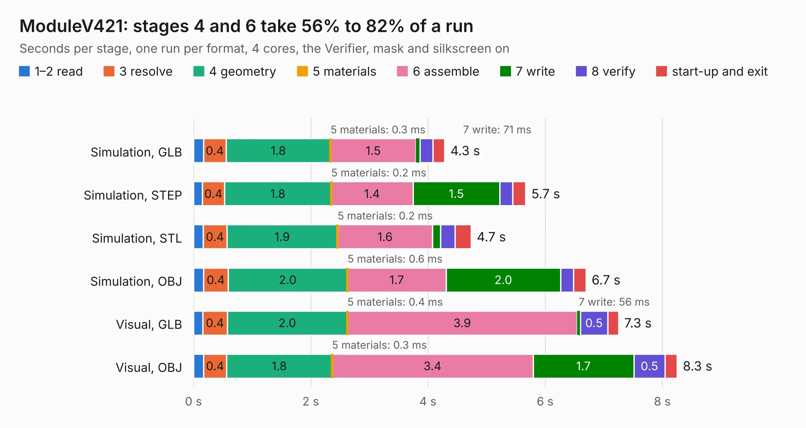

# 2679. ModuleV421

Board 2,679 of the 3,120 of [Corpus Testing](../Corpus-Testing.md), on [Corpus Page 25](../CorpusTestingPages/Corpus-Testing-25.md#2679-modulev421).

| Mode and format | 1–2 read | 3 resolve | 4 geometry | 5 materials | 6 assemble | 7 write | 8 verify | start-up and exit | Total |
|---|---:|---:|---:|---:|---:|---:|---:|---:|---:|
| Simulation, GLB | 0.2 | 0.4 | 1.8 | 0.3&nbsp;ms | 1.5 | 71&nbsp;ms | 0.2 | 0.2 | 4.3 |
| Simulation, STEP | 0.2 | 0.4 | 1.8 | 0.2&nbsp;ms | 1.4 | 1.5 | 0.2 | 0.2 | 5.7 |
| Simulation, STL | 0.2 | 0.4 | 1.9 | 0.2&nbsp;ms | 1.6 | 0.1 | 0.3 | 0.3 | 4.7 |
| Simulation, OBJ | 0.2 | 0.4 | 2.0 | 0.6&nbsp;ms | 1.7 | 2.0 | 0.2 | 0.2 | 6.7 |
| Visual, GLB | 0.2 | 0.4 | 2.0 | 0.4&nbsp;ms | 3.9 | 56&nbsp;ms | 0.5 | 0.2 | 7.3 |
| Visual, OBJ | 0.2 | 0.4 | 1.8 | 0.3&nbsp;ms | 3.4 | 1.7 | 0.5 | 0.2 | 8.3 |

<table align="center"><tr><td valign="top">

| Board | Repo: [stuartpittaway/diybmsv4](https://github.com/stuartpittaway/diybmsv4) Board: `ModuleV421.kicad_pcb` |
|---|---|
| Folder | ModuleV421 |
| Complexity | 206&nbsp;/&nbsp;1000 (size&nbsp;161, features&nbsp;45) |
| KESE&nbsp;features | through vias, filled zones, curved board outline |
| Tested | 9th November 2026 |
| Copper&nbsp;layers | 2 |
| File&nbsp;format | KiCad 5 (20171130) |
| Parts,&nbsp;tracks,&nbsp;vias | 49, 333, 55 |
| Triangles,&nbsp;simulation | 466,586 in 48 parts |
| Verifier | PASS in all six runs |

</td><td valign="top">

<table>
<tr><th>File type</th><th>File size</th><th>Peak memory used</th></tr>
<tr><th colspan="3" align="left">Simulation</th></tr>
<tr><td>GLB</td><td align="right">17&nbsp;MB</td><td align="right">304&nbsp;MB</td></tr>
<tr><td>STEP</td><td align="right">84&nbsp;MB</td><td align="right">346&nbsp;MB</td></tr>
<tr><td>STL</td><td align="right">23&nbsp;MB</td><td align="right">289&nbsp;MB</td></tr>
<tr><td>OBJ</td><td align="right">48&nbsp;MB</td><td align="right">377&nbsp;MB</td></tr>
<tr><th colspan="3" align="left">Visual</th></tr>
<tr><td>GLB</td><td align="right">14&nbsp;MB</td><td align="right">355&nbsp;MB</td></tr>
<tr><td>OBJ</td><td align="right">41&nbsp;MB</td><td align="right">356&nbsp;MB</td></tr>
</table>

</td></tr></table>

| Previous | Next |
|:---|---:|
| [2678. v4](b2678b_diybmsv4_v4.md) | [2680. ModuleV440](b2680b_diybmsv4_ModuleV440.md) |
