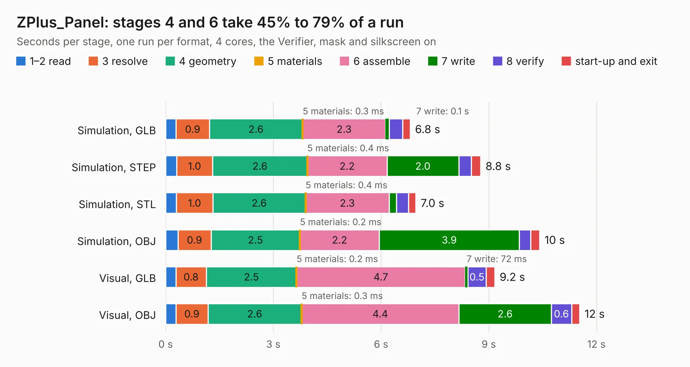

# 2680. ZPlus_Panel

Board 2,680 of the 3,130 of [Corpus Testing](../Corpus-Testing.md), on [Corpus Page 25](../CorpusTestingPages/Corpus-Testing-25.md#2680-zplus_panel).

| Mode and format | 1–2 read | 3 resolve | 4 geometry | 5 materials | 6 assemble | 7 write | 8 verify | start-up and exit | Total |
|---|---:|---:|---:|---:|---:|---:|---:|---:|---:|
| Simulation, GLB | 0.3 | 0.9 | 2.6 | 0.3&nbsp;ms | 2.3 | 0.1 | 0.4 | 0.2 | 6.8 |
| Simulation, STEP | 0.3 | 1.0 | 2.6 | 0.4&nbsp;ms | 2.2 | 2.0 | 0.3 | 0.3 | 8.8 |
| Simulation, STL | 0.3 | 1.0 | 2.6 | 0.4&nbsp;ms | 2.3 | 0.2 | 0.3 | 0.2 | 7.0 |
| Simulation, OBJ | 0.3 | 0.9 | 2.5 | 0.2&nbsp;ms | 2.2 | 3.9 | 0.3 | 0.2 | 10.4 |
| Visual, GLB | 0.3 | 0.8 | 2.5 | 0.2&nbsp;ms | 4.7 | 72&nbsp;ms | 0.5 | 0.2 | 9.2 |
| Visual, OBJ | 0.3 | 0.9 | 2.6 | 0.3&nbsp;ms | 4.4 | 2.6 | 0.6 | 0.2 | 11.5 |

<table align="center"><tr><td valign="top">

| Board | Repo: [stanford-ssi/samwise-avionics](https://github.com/stanford-ssi/samwise-avionics) Board: `ZPlus_Panel.kicad_pcb` |
|---|---|
| Folder | ZPlus_Panel |
| Complexity | 269&nbsp;/&nbsp;1000 (size&nbsp;174, features&nbsp;95) |
| KESE&nbsp;features | through vias, custom pads, rounded, trapezoid or chamfered pads, filled zones, stack-up, dielectric εr and tanδ, mask and silkscreen colours |
| Tested | 9th November 2026 |
| Copper&nbsp;layers | 4 |
| File&nbsp;format | KiCad 9 (20241229) |
| Parts,&nbsp;tracks,&nbsp;vias | 36, 157, 107 |
| Triangles,&nbsp;simulation | 680,728 in 31 parts |
| Note | panel |
| Verifier | PASS in all six runs |

</td><td valign="top">

<table>
<tr><th>File type</th><th>File size</th><th>Peak memory used</th></tr>
<tr><th colspan="3" align="left">Simulation</th></tr>
<tr><td>GLB</td><td align="right">24&nbsp;MB</td><td align="right">363&nbsp;MB</td></tr>
<tr><td>STEP</td><td align="right">84&nbsp;MB</td><td align="right">401&nbsp;MB</td></tr>
<tr><td>STL</td><td align="right">34&nbsp;MB</td><td align="right">370&nbsp;MB</td></tr>
<tr><td>OBJ</td><td align="right">71&nbsp;MB</td><td align="right">498&nbsp;MB</td></tr>
<tr><th colspan="3" align="left">Visual</th></tr>
<tr><td>GLB</td><td align="right">16&nbsp;MB</td><td align="right">393&nbsp;MB</td></tr>
<tr><td>OBJ</td><td align="right">48&nbsp;MB</td><td align="right">396&nbsp;MB</td></tr>
</table>

</td></tr></table>

| Previous | Next |
|:---|---:|
| [2679. solar_charger](b2679b_samwise-avionics_solar-charger.md) | [2681. MegaDrive](b2681b_MegaDrive_MegaDrive.md) |
