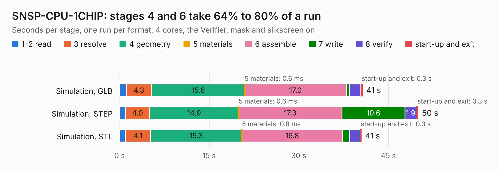

# 2682. SNSP-CPU-1CHIP

Board 2,682 of the 3,129 of [Corpus Testing](../Corpus-Testing.md), on [Corpus Page 25](../CorpusTestingPages/Corpus-Testing-25.md#2682-snsp-cpu-1chip).

| Mode and format | 1–2 read | 3 resolve | 4 geometry | 5 materials | 6 assemble | 7 write | 8 verify | start-up and exit | Total |
|---|---:|---:|---:|---:|---:|---:|---:|---:|---:|
| Simulation, GLB | 1.1 | 4.3 | 15.6 | 0.6&nbsp;ms | 17.0 | 0.5 | 1.9 | 0.3 | 40.7 |
| Simulation, STEP | 1.0 | 4.0 | 14.9 | 0.6&nbsp;ms | 17.3 | 10.6 | 1.9 | 0.3 | 50.0 |
| Simulation, STL | 1.0 | 4.1 | 15.3 | 0.8&nbsp;ms | 16.8 | 1.2 | 1.8 | 0.3 | 40.5 |
| Simulation, OBJ | 1.0 | 4.1 | 14.7 | 0.6&nbsp;ms | 16.4 | 20.8 | 2.1 | 0.3 | 59.3 |
| Visual, GLB | 1.0 | 4.1 | 15.8 | 1&nbsp;ms | 41.9 | 0.5 | 5.2 | 0.3 | 68.8 |
| Visual, OBJ | 1.2 | 4.4 | 16.3 | 1&nbsp;ms | 41.2 | 18.2 | 6.0 | 0.3 | 87.6 |

<table align="center"><tr><td valign="top">

| Board | Repo: [stonedDiscord/nonSNES](https://github.com/stonedDiscord/nonSNES) Board: `SNSP-CPU-1CHIP.kicad_pcb` |
|---|---|
| Folder | SNSP-CPU-1CHIP |
| Complexity | 408&nbsp;/&nbsp;1000 (size&nbsp;263, features&nbsp;145) |
| KESE&nbsp;features | through vias, slotted holes, custom pads, rounded, trapezoid or chamfered pads, filled zones, copper drawings, copper text, curved board outline, knockout text, stack-up, dielectric εr and tanδ |
| Tested | 9th November 2026 |
| Copper&nbsp;layers | 2 |
| File&nbsp;format | KiCad 10 (20260206) |
| Parts,&nbsp;tracks,&nbsp;vias | 178, 4,345, 686 |
| Triangles,&nbsp;simulation | 3,805,256 in 257 parts |
| Verifier | PASS in all six runs |

</td><td valign="top">

<table>
<tr><th>File type</th><th>File size</th><th>Peak memory used</th></tr>
<tr><th colspan="3" align="left">Simulation</th></tr>
<tr><td>GLB</td><td align="right">131&nbsp;MB</td><td align="right">1.4&nbsp;GB</td></tr>
<tr><td>STEP</td><td align="right">696&nbsp;MB</td><td align="right">1.6&nbsp;GB</td></tr>
<tr><td>STL</td><td align="right">190&nbsp;MB</td><td align="right">1.4&nbsp;GB</td></tr>
<tr><td>OBJ</td><td align="right">406&nbsp;MB</td><td align="right">2.5&nbsp;GB</td></tr>
<tr><th colspan="3" align="left">Visual</th></tr>
<tr><td>GLB</td><td align="right">107&nbsp;MB</td><td align="right">2.0&nbsp;GB</td></tr>
<tr><td>OBJ</td><td align="right">341&nbsp;MB</td><td align="right">2.3&nbsp;GB</td></tr>
</table>

</td></tr></table>

| Previous | Next |
|:---|---:|
| [2681. SNSP-CPU-01](b2681b_nonSNES_SNSP-CPU-01.md) | [2683. ControllerCircuit](b2683b_diybmsv4_ControllerCircuit.md) |
