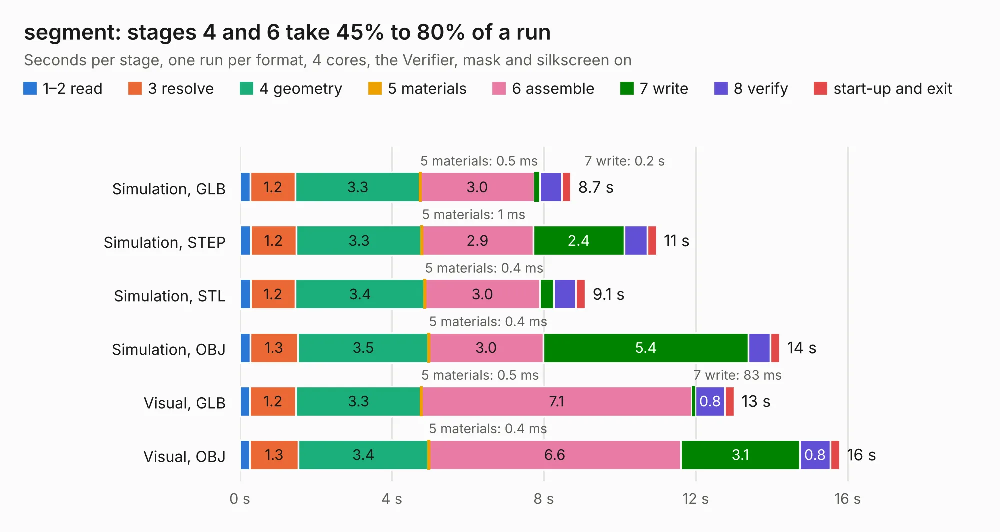

# 2682. segment

Board 2,682 of the 3,107 of [Corpus Testing](../Corpus-Testing.md), on [Corpus Page 25](../CorpusTestingPages/Corpus-Testing-25.md#2682-segment).

| Mode and format | 1–2 read | 3 resolve | 4 geometry | 5 materials | 6 assemble | 7 write | 8 verify | start-up and exit | Total |
|---|---:|---:|---:|---:|---:|---:|---:|---:|---:|
| Simulation, GLB | 0.3 | 1.2 | 3.3 | 0.5&nbsp;ms | 3.0 | 0.2 | 0.6 | 0.2 | 8.7 |
| Simulation, STEP | 0.3 | 1.2 | 3.3 | 1&nbsp;ms | 2.9 | 2.4 | 0.6 | 0.3 | 11.0 |
| Simulation, STL | 0.3 | 1.2 | 3.4 | 0.4&nbsp;ms | 3.0 | 0.4 | 0.6 | 0.2 | 9.1 |
| Simulation, OBJ | 0.3 | 1.3 | 3.5 | 0.4&nbsp;ms | 3.0 | 5.4 | 0.6 | 0.2 | 14.2 |
| Visual, GLB | 0.3 | 1.2 | 3.3 | 0.5&nbsp;ms | 7.1 | 83&nbsp;ms | 0.8 | 0.2 | 13.0 |
| Visual, OBJ | 0.3 | 1.3 | 3.4 | 0.4&nbsp;ms | 6.6 | 3.1 | 0.8 | 0.2 | 15.8 |

<table align="center"><tr><td valign="top">

| Board | Repo: [sufst/pcb](https://github.com/sufst/pcb) Board: `segment.kicad_pcb` |
|---|---|
| Folder | archive / segment |
| Complexity | 242&nbsp;/&nbsp;1000 (size&nbsp;157, features&nbsp;85) |
| KESE&nbsp;features | rounded, trapezoid or chamfered pads, filled zones, curved board outline, knockout text, stack-up, dielectric εr and tanδ |
| Tested | 9th November 2026 |
| Copper&nbsp;layers | 4 |
| File&nbsp;format | KiCad 7 (20221018) |
| Parts,&nbsp;tracks,&nbsp;vias | 19, 261, 0 |
| Triangles,&nbsp;simulation | 940,566 in 66 parts |
| Verifier | PASS in all six runs |

</td><td valign="top">

<table>
<tr><th>File type</th><th>File size</th><th>Peak memory used</th></tr>
<tr><th colspan="3" align="left">Simulation</th></tr>
<tr><td>GLB</td><td align="right">32&nbsp;MB</td><td align="right">402&nbsp;MB</td></tr>
<tr><td>STEP</td><td align="right">120&nbsp;MB</td><td align="right">447&nbsp;MB</td></tr>
<tr><td>STL</td><td align="right">47&nbsp;MB</td><td align="right">410&nbsp;MB</td></tr>
<tr><td>OBJ</td><td align="right">95&nbsp;MB</td><td align="right">649&nbsp;MB</td></tr>
<tr><th colspan="3" align="left">Visual</th></tr>
<tr><td>GLB</td><td align="right">18&nbsp;MB</td><td align="right">506&nbsp;MB</td></tr>
<tr><td>OBJ</td><td align="right">54&nbsp;MB</td><td align="right">478&nbsp;MB</td></tr>
</table>

</td></tr></table>

| Previous | Next |
|:---|---:|
| [2681. latching](b2681b_pcb_latching.md) | [2683. sensor-board](b2683b_pcb_sensor-board.md) |
