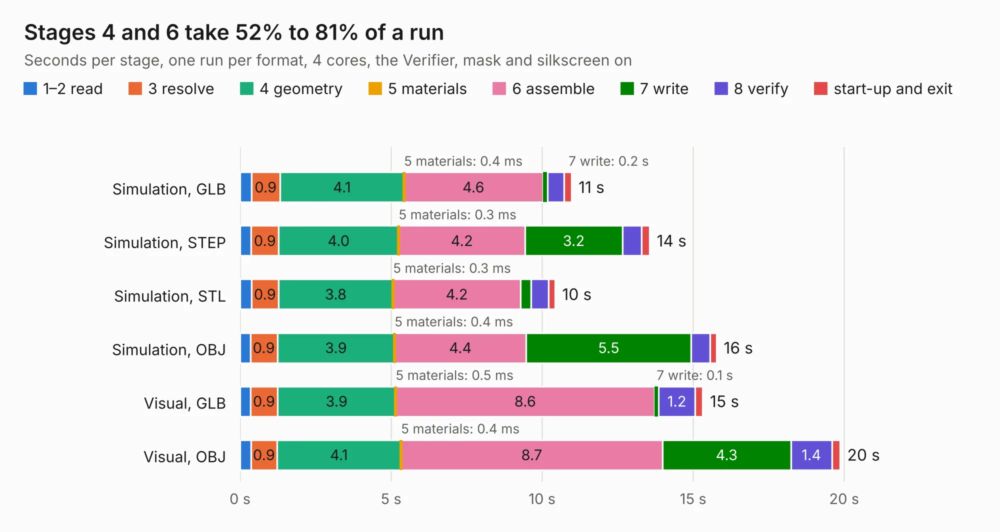

# 2683. Module_16S_PassiveBalanceAddOn

Board 2,683 of the 3,120 of [Corpus Testing](../Corpus-Testing.md), on [Corpus Page 25](../CorpusTestingPages/Corpus-Testing-25.md#2683-module_16s_passivebalanceaddon).

| Mode and format | 1–2 read | 3 resolve | 4 geometry | 5 materials | 6 assemble | 7 write | 8 verify | start-up and exit | Total |
|---|---:|---:|---:|---:|---:|---:|---:|---:|---:|
| Simulation, GLB | 0.4 | 0.9 | 4.1 | 0.4&nbsp;ms | 4.6 | 0.2 | 0.6 | 0.2 | 11.0 |
| Simulation, STEP | 0.4 | 0.9 | 4.0 | 0.3&nbsp;ms | 4.2 | 3.2 | 0.6 | 0.3 | 13.6 |
| Simulation, STL | 0.4 | 0.9 | 3.8 | 0.3&nbsp;ms | 4.2 | 0.4 | 0.6 | 0.2 | 10.4 |
| Simulation, OBJ | 0.3 | 0.9 | 3.9 | 0.4&nbsp;ms | 4.4 | 5.5 | 0.6 | 0.2 | 15.8 |
| Visual, GLB | 0.3 | 0.9 | 3.9 | 0.5&nbsp;ms | 8.6 | 0.1 | 1.2 | 0.3 | 15.3 |
| Visual, OBJ | 0.4 | 0.9 | 4.1 | 0.4&nbsp;ms | 8.7 | 4.3 | 1.4 | 0.3 | 19.9 |

<table align="center"><tr><td valign="top">

| Board | Repo: [stuartpittaway/diybmsv4](https://github.com/stuartpittaway/diybmsv4) Board: `Module_16S_PassiveBalanceAddOn.kicad_pcb` |
|---|---|
| Folder | ModuleV490-PassiveBal |
| Complexity | 281&nbsp;/&nbsp;1000 (size&nbsp;181, features&nbsp;100) |
| KESE&nbsp;features | through vias, rounded, trapezoid or chamfered pads, filled zones, curved board outline, TrueType text, stack-up, dielectric εr and tanδ |
| Tested | 9th November 2026 |
| Copper&nbsp;layers | 2 |
| File&nbsp;format | KiCad 7 (20221018) |
| Parts,&nbsp;tracks,&nbsp;vias | 86, 623, 173 |
| Triangles,&nbsp;simulation | 984,182 in 102 parts |
| Verifier | PASS in all six runs |

</td><td valign="top">

<table>
<tr><th>File type</th><th>File size</th><th>Peak memory used</th></tr>
<tr><th colspan="3" align="left">Simulation</th></tr>
<tr><td>GLB</td><td align="right">34&nbsp;MB</td><td align="right">452&nbsp;MB</td></tr>
<tr><td>STEP</td><td align="right">167&nbsp;MB</td><td align="right">580&nbsp;MB</td></tr>
<tr><td>STL</td><td align="right">49&nbsp;MB</td><td align="right">453&nbsp;MB</td></tr>
<tr><td>OBJ</td><td align="right">100&nbsp;MB</td><td align="right">725&nbsp;MB</td></tr>
<tr><th colspan="3" align="left">Visual</th></tr>
<tr><td>GLB</td><td align="right">28&nbsp;MB</td><td align="right">659&nbsp;MB</td></tr>
<tr><td>OBJ</td><td align="right">84&nbsp;MB</td><td align="right">701&nbsp;MB</td></tr>
</table>

</td></tr></table>

| Previous | Next |
|:---|---:|
| [2682. Module_16S](b2682b_diybmsv4_Module-16S.md) | [2684. ProgrammingAdapter](b2684b_diybmsv4_ProgrammingAdapter.md) |
