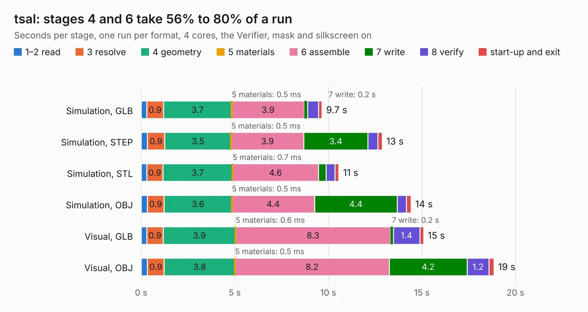

# 2683. tsal

Board 2,683 of the 3,103 of [Corpus Testing](../Corpus-Testing.md), on [Corpus Page 25](../CorpusTestingPages/Corpus-Testing-25.md#2683-tsal).

| Mode and format | 1–2 read | 3 resolve | 4 geometry | 5 materials | 6 assemble | 7 write | 8 verify | start-up and exit | Total |
|---|---:|---:|---:|---:|---:|---:|---:|---:|---:|
| Simulation, GLB | 0.3 | 0.9 | 3.7 | 0.5&nbsp;ms | 3.9 | 0.2 | 0.6 | 0.2 | 9.7 |
| Simulation, STEP | 0.3 | 0.9 | 3.5 | 0.5&nbsp;ms | 3.9 | 3.4 | 0.5 | 0.2 | 12.9 |
| Simulation, STL | 0.3 | 0.9 | 3.7 | 0.7&nbsp;ms | 4.6 | 0.4 | 0.5 | 0.2 | 10.6 |
| Simulation, OBJ | 0.3 | 0.9 | 3.6 | 0.5&nbsp;ms | 4.4 | 4.4 | 0.5 | 0.2 | 14.4 |
| Visual, GLB | 0.3 | 0.9 | 3.9 | 0.6&nbsp;ms | 8.3 | 0.2 | 1.4 | 0.2 | 15.1 |
| Visual, OBJ | 0.3 | 0.9 | 3.8 | 0.5&nbsp;ms | 8.2 | 4.2 | 1.2 | 0.3 | 18.9 |

<table align="center"><tr><td valign="top">

| Board | Repo: [sufst/pcb](https://github.com/sufst/pcb) Board: `tsal.kicad_pcb` |
|---|---|
| Folder | archive / tsal |
| Complexity | 281&nbsp;/&nbsp;1000 (size&nbsp;181, features&nbsp;100) |
| KESE&nbsp;features | through vias, rounded, trapezoid or chamfered pads, filled zones, curved board outline, knockout text, stack-up, dielectric εr and tanδ |
| Tested | 9th November 2026 |
| Copper&nbsp;layers | 2 |
| File&nbsp;format | KiCad 8 (20240108) |
| Parts,&nbsp;tracks,&nbsp;vias | 93, 603, 181 |
| Triangles,&nbsp;simulation | 1,101,330 in 93 parts |
| Verifier | PASS in all six runs |

</td><td valign="top">

<table>
<tr><th>File type</th><th>File size</th><th>Peak memory used</th></tr>
<tr><th colspan="3" align="left">Simulation</th></tr>
<tr><td>GLB</td><td align="right">38&nbsp;MB</td><td align="right">522&nbsp;MB</td></tr>
<tr><td>STEP</td><td align="right">182&nbsp;MB</td><td align="right">632&nbsp;MB</td></tr>
<tr><td>STL</td><td align="right">55&nbsp;MB</td><td align="right">529&nbsp;MB</td></tr>
<tr><td>OBJ</td><td align="right">111&nbsp;MB</td><td align="right">753&nbsp;MB</td></tr>
<tr><th colspan="3" align="left">Visual</th></tr>
<tr><td>GLB</td><td align="right">32&nbsp;MB</td><td align="right">618&nbsp;MB</td></tr>
<tr><td>OBJ</td><td align="right">97&nbsp;MB</td><td align="right">707&nbsp;MB</td></tr>
</table>

</td></tr></table>

| Previous | Next |
|:---|---:|
| [2682. test-rig](b2682b_pcb_test-rig.md) | [2684. batak](b2684b_pcb_batak.md) |
